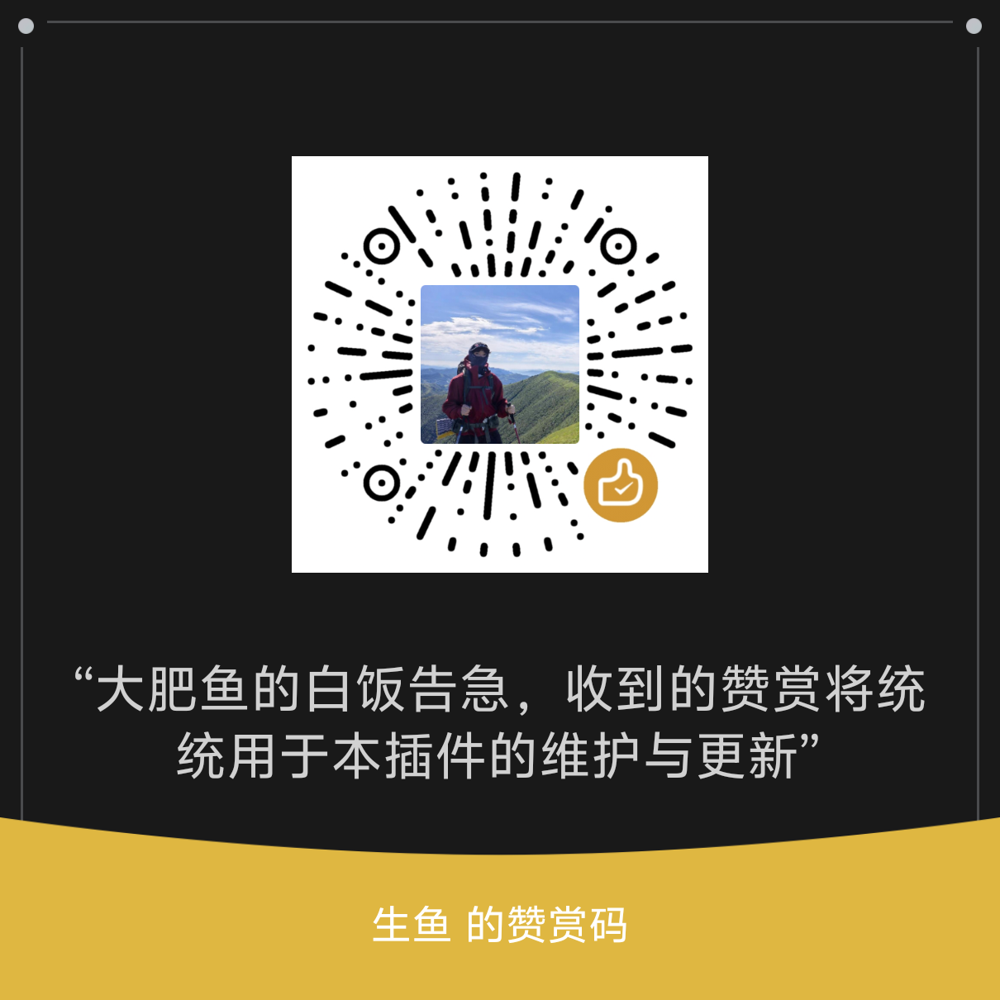
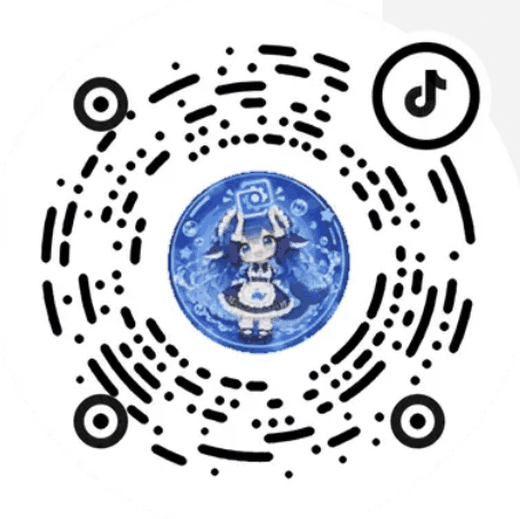

<div align="center">

<p>
  <a href="README.md"><picture><source media="(prefers-color-scheme: dark)" srcset="assets/readme/key-lang-zh-dark.png"></picture></a>
  <a href="README.en.md"><picture><source media="(prefers-color-scheme: dark)" srcset="assets/readme/key-lang-en-dark.png"></picture></a>
  <a href="README.beginner.md"><picture><source media="(prefers-color-scheme: dark)" srcset="assets/readme/key-lang-start-dark.png"></picture></a>
</p>

<h1>
  <picture>
    <source media="(prefers-color-scheme: dark)" srcset="assets/readme/hero-dark.png">
    
  </picture>
</h1>

<p>
  <a href="package.json"><picture><source media="(prefers-color-scheme: dark)" srcset="assets/readme/stat-version-dark.png"></picture></a>
  <a href="#支持哪些壁纸类型"><picture><source media="(prefers-color-scheme: dark)" srcset="assets/readme/stat-formats-dark.png"></picture></a>
  <a href="#吉祥物与扩展"><picture><source media="(prefers-color-scheme: dark)" srcset="assets/readme/stat-mascots-dark.png"></picture></a>
  <a href="cordis.patch.yml"><picture><source media="(prefers-color-scheme: dark)" srcset="assets/readme/stat-modules-dark.png"></picture></a>
</p>

 [](LICENSE) [](https://www.npmjs.com/package/dsh-plugin-wallpaper-engine) [](https://github.com/elysia395/dsh-wallpaper-engine/stargazers) [](https://github.com/elysia395/dsh-wallpaper-engine/forks) [](https://github.com/elysia395/dsh-wallpaper-engine/graphs/contributors) [](https://github.com/elysia395/dsh-wallpaper-engine/releases) [](https://www.npmjs.com/package/dsh-plugin-wallpaper-engine) [](https://github.com/Fish-under-sea/dsh-wallpaper-engine) [](https://github.com/PC2005-cloud/dsh-pet/issues/122)

<p>
  <a href="https://trendshift.io/repositories/170341" target="_blank"></a>
  <a href="https://trendshift.io/repositories/170341" target="_blank"></a>
</p>

<p>
  <a href="#快速开始"><picture><source media="(prefers-color-scheme: dark)" srcset="assets/readme/key-get-dark.png"></picture></a>
  <a href="README.beginner.md"><picture><source media="(prefers-color-scheme: dark)" srcset="assets/readme/key-setup-dark.png"></picture></a>
  <a href="docs/README.md"><picture><source media="(prefers-color-scheme: dark)" srcset="assets/readme/key-docs-dark.png"></picture></a>
  <a href="https://github.com/elysia395/dsh-wallpaper-engine/releases"><picture><source media="(prefers-color-scheme: dark)" srcset="assets/readme/key-release-dark.png"></picture></a>
</p>

</div>

<h2 id="简介"><picture><source media="(prefers-color-scheme: dark)" srcset="assets/readme/section-intro-dark.png"></picture></h2>

把本机 **Wallpaper Engine** 的场景、网页与视频壁纸带到 DSH 对话界面，再配上液态玻璃、字体、吉祥物与可分享的外观预设。插件不向 agent 注册工具或注入提示文本，**不增加模型 token 开销**。

> [!NOTE]
> 本页描述 [elysia395/ Fish-under-sea 当前维护源码](https://github.com/Fish-under-sea/dsh-wallpaper-engine)。正式项目由 [elysia395/dsh-wallpaper-engine](https://github.com/elysia395/dsh-wallpaper-engine) 维护；上方 Stars、Forks、贡献者、Release、npm 版本与下载量，以及下方 Star History，均来自正式主仓或同名 npm 包，不是本分支的统计。动态徽章有缓存，不代表本分支改动已经发布。

### 当前源码与正式发行的区别

| 项目 | 当前说明 |
|---|---|
| 源码入口 | [Fish-under-sea 维护仓库](https://github.com/Fish-under-sea/dsh-wallpaper-engine)，灰测请下载这里的完整源码 |
| 正式版本与贡献记录 | 以 [正式主仓 Release](https://github.com/elysia395/dsh-wallpaper-engine/releases)、[Contributors](https://github.com/elysia395/dsh-wallpaper-engine/graphs/contributors) 和 npm 页面为准；相同源码版本号不表示代码完全相同 |
| 部署闭包 | 主包加七个子包，共八包；完整源码安装器登记依赖，更新后不会因临时链接被包管理器清除而丢失子包 |
| 官方 pet 联动 | 通过 dsh-pet 公开接口接入，不再捆绑 pet、Electron 或第三方文件补丁；官方 pet 自行安装 |
| 外观预设与深浅 | 「作者自用」预设携带深色偏好，套用即把界面一并切到深色；全新安装默认套用它。发布版仍是「一次性二选一」弹窗询问，且套用预设不改深浅 |
| 体积变化 | 本次本地发布集压缩体积实测约 84.88 MiB → 25.12 MiB，减少约 70.4%；不含另装的官方 pet，不是内存或 Git 仓库体积 |
| 验收边界 | 已验证隔离部署、协议、排播与自有气泡 / 面板，预设与深浅联动已在本机真机实测；官方完整宠物及桌面端四套演出的真机视觉验收仍需补齐 |

源码包、正式发行和旧演示图应分别看待。不要用 npm 线上版本号或主仓热度推断本分支已经发布、已合并或完成所有平台验收。

<h2 id="目录"><picture><source media="(prefers-color-scheme: dark)" srcset="assets/readme/section-index-dark.png"></picture></h2>

<table>
  <tr>
    <td width="36%" valign="middle">
      <ul>
        <li><a href="#能做什么">能做什么</a> · <a href="#支持哪些壁纸类型">支持哪些壁纸类型</a> · <a href="#安装">安装</a> · <a href="#使用">使用</a></li>
        <li><a href="#可选桌宠联动">可选桌宠联动</a> · <a href="#配置与数据">配置与数据</a> · <a href="#兼容与限制">兼容与限制</a> · <a href="#开发与贡献">开发与贡献</a></li>
        <li><a href="#联系方式">联系方式</a> · <a href="#致谢">致谢</a> · <a href="#支持与赞赏">支持与赞赏</a> · <a href="#star-history">Star History</a></li>
      </ul>
    </td>
    <td width="28%" align="center" valign="middle">
      <a href="assets/readme/mascot-eating-rice-1280x1784.jpg">
        
      </a>
    </td>
    <td width="36%" align="center" valign="middle">
      <a href="assets/about/sponsor-fish.png">
        
      </a>
      <br><strong>生鱼的赞赏码</strong>
      <br><sub>“大肥鱼的白饭告急，收到的赞赏将统统用于本插件的维护与更新”</sub>
      <br><sub>自愿赞赏 · 不影响安装与使用</sub>
    </td>
  </tr>
</table>

<h2 id="界面预览"><picture><source media="(prefers-color-scheme: dark)" srcset="assets/readme/section-preview-dark.png"></picture></h2>


<p align="center"><sub>真实界面演示；历史素材与当前安装版本可能略有不同。</sub></p>

<h2 id="快速开始"><picture><source media="(prefers-color-scheme: dark)" srcset="assets/readme/section-start-dark.png"></picture></h2>

先下载本仓 ZIP 并解压，进入插件目录，完全退出目标 DSH 应用，然后执行：

```sh
node scripts/install-source.mjs --profile desktop --dsh-home "<目标 DSH 数据目录>" --app-closed
```

网页宿主将 `desktop` 改为 `web`。完成后重启对应宿主，打开 **设置 → Wallpaper Engine → 壁纸库**。目标目录和 CLI 说明见 [安装](#安装)。

**前置条件**：DSH 0.2 内核（包括 `0.2.0-rc.1/rc.2`）、Node.js `>=22.12.0` 和 pnpm。**自 `1.4.0` 起八包已发布到 npm**，可直接按包名安装（见 [npm 通道](#npm-通道仅适用于整套包已发布的版本)）；`dsh-better-sidebar` 是可选配套插件，不是必装依赖。

没用过命令行？从 [新手指南](README.beginner.md) 开始。

<h2 id="能做什么"><picture><source media="(prefers-color-scheme: dark)" srcset="assets/readme/section-features-dark.png"></picture></h2>

| 方向 | 能力 |
|---|---|
| 实时壁纸 | 内置 **WebWallGL** 渲染 Scene / Web 壁纸，支持粒子、puppet 骨骼、SceneScript、鼠标交互与音频反应；视频直接播放 |
| 液态玻璃 | 设置窗口、对话区与侧边栏玻璃效果，支持配色、透明度、雾化、边框与独立侧栏参数 |
| 外观预设 | 整套配置快照，字体、吉祥物与头像资产可按需携带；「作者自用」还携带深色偏好，套用即同步切换界面深浅；支持 JSON 导出、导入与分享 |
| 字体与配色 | 按颜色角色、排版角色和组件细调字体；支持系统字体、终端字体、字体集与独立光标颜色 |
| 吉祥物 | **10 只内置立绘 + 自定义导入**，通过 3D 圆环选择；拉绳展开壁纸仓库抽屉 |
| 壁纸库 | 内容分级与类型筛选、批量隐藏与恢复、自定义图片 / 视频上传、WE 项目目录收录、自动轮播 |
| 播放与降载 | 帧率上限、转码缓存、倍速、水平翻转、切换过场、遮挡暂停与可迁移的缓存目录 |
| 音乐联动 | 系统输出回环频谱、Now Playing 歌曲信息与封面；在线歌词按需启用 |
| 扩展效果 | 可选的会话头像、点击 / 拖尾特效、壁纸与界面视差；不需要的效果可关闭 |
| 官方 pet 联动 | 对接独立安装的 dsh-pet，支持侧栏后拉、抓绳、踢腿弹飞和哈气；按 petId 选目标，桥接自行绘制气泡 |
| 宿主适配 | Windows / macOS / Linux 使用同一套源码与发布集；界面跟随 DSH 的语言设置 |

场景渲染失败时会逐级降级，首帧准备期间使用可用的预览图。不同壁纸使用的资源与脚本不同，**不能保证每张工坊壁纸都与 Wallpaper Engine 本体完全一致**。渲染与降级规则见 [工作原理](https://github.com/Fish-under-sea/dsh-wallpaper-engine/blob/official-pet-bridge-20261020/docs/HOW-IT-WORKS.md)。

<h2 id="支持哪些壁纸类型"><picture><source media="(prefers-color-scheme: dark)" srcset="assets/readme/section-formats-dark.png"></picture></h2>

| 类型 | 在 DSH 中的路径 | 支持情况 |
|---|---|---|
| **Scene（场景）** | 内置 WebWallGL 实时 WebGL 渲染；失败按降级链回退 | 支持，不需要 WE 在后台运行 |
| **Web（网页）** | 网页挂载、WE API 注入与沙箱隔离 | 支持；效果取决于网页及浏览器能力 |
| **Video（视频）** | 浏览器播放，配合转码、帧率上限与暂停控制 | 支持 |
| **Application（应用）** | 需要启动第三方可执行程序 | **不支持**，不进入壁纸库与轮播候选 |
| **自定义图片 / 视频** | 上传本地 JPG / PNG / MP4 | 支持，文件保存在本机 |

<h2 id="安装"><picture><source media="(prefers-color-scheme: dark)" srcset="assets/readme/section-install-dark.png"></picture></h2>

### 源码用户：从仓库安装或更新

`1.4.0` 已发布到 npm（推荐直接用下面的 [npm 通道](#npm-通道仅适用于整套包已发布的版本)）。想拿**本分支最新、尚未发版的改动**，才需要走源码部署 —— 那条路只能从 GitHub 取源码。

要求 **Node.js >=22.12.0、DSH 0.2 内核（包含 0.2.0-rc.1/rc.2）**，并已安装可用的 DSH CLI 和 pnpm。桌面应用外部版本号不等于内核版本。下载 [本轮评审分支 `official-pet-bridge-20261020`](https://github.com/Fish-under-sea/dsh-wallpaper-engine/tree/official-pet-bridge-20261020) 的完整 ZIP，或克隆该分支，不要用 Fork 默认分支代替；进入包含 `package.json` 的目录。先完全退出目标 DSH 应用，然后执行：

```sh
node scripts/install-source.mjs --profile desktop --dsh-home "<目标 DSH 数据目录>" --app-closed
```

网页宿主把 `desktop` 改为 `web`。数据目录应从目标宿主环境确认，不要假定始终是 `~/.dsh`。先加 `--dry-run` 可核对目标和八条链接。**桌面 profile 必须使用桌面宿主安装的 carrier CLI**；独立 npm 安装的 `dsh` 不允许管理 `desktop`，不能把它当成桌面 CLI。网页版若 `dsh` 不在 PATH，可使用 `--dsh-cli "<DSH CLI 的 lib/bin.js 路径>"`。

脚本会安装仓库依赖、构建所有客户端，并通过 DSH 将**主包和 7 个子包**登记成目标 profile 的持久 `link:` 依赖。只保留主包的 bundle 选择，防止子包自带 patch 重复插入同一组行；现有行级开关和其他 bundle 选择不变。之后重启目标宿主。

更新时先退出宿主，再更新整个源码目录并重跑同一命令。安装完成后不要删除或移动源码目录。不要只安装主包，不要用裸 `github:` 直装，也不要只运行临时子包链接工具。

### npm 通道（`1.4.0` 起可用）

正式发布者必须先运行 `npm run pack:release`，生成含构建产物的八个 tarball，并按生成清单先发布子包、最后发布主包。主包发布清单以七个子包的**真实精确版本**声明运行依赖，不包含 pet 或 Electron。单独在源码根目录执行 `npm pack` 得到的开发形态主包不能代表完整发布集。

子包没发全时，主包在用户机器上会以 `ERR_PNPM_FETCH_404` 失败并回滚——"只拿到母包"就是这个形态。发布顺序、GitHub Release 的八件套资产、发布后自证与回滚办法见 **[`docs/RELEASING.md`](docs/RELEASING.md)**；离线安装发布集用 `npm run install:release -- --set <目录> --profile <name> --dsh-home <目录> --app-closed`。

**自 `1.4.0` 起**，直接执行（一条命令即装齐八个包，主包会把七个子包按精确版本解析下来）：

```sh
dsh plugin --profile web add dsh-plugin-wallpaper-engine
```

桌面宿主将 `web` 改为 `desktop`，安装前完全退出，完成后重启。不要单独启用子包 bundle；整组行由主包 patch 管理。源码部署和发布说明见 [贡献指南](CONTRIBUTING.md)。

### 插件行与启停

插件管理器中的主包、关于、吉祥物与头像、媒体联动、桌宠联动、特效、视差和字体分别由对应行管理。**行级开关需要重新加载或重启对应宿主，不是即时切换**。

- 关于、吉祥物与头像行停用后，相应宿主能力及浏览器区块一起退出；不会隐藏无关的整个设置页签。
- 特效、视差和字体由各自子包提供；桌宠联动可独立停用，不影响壁纸主体。
- 媒体联动行是例外：停用会撤下媒体路由，当前没有与其他组件完全相同的界面整块隐藏语义。
- 主包关闭后不再提供整套壁纸界面。各行以插件管理器和 [行清单](cordis.patch.yml) 为准。

### macOS / Linux

三平台使用同一个包。系统媒体链路分别使用 Windows 的 GSMTC、macOS 的 MediaRemote、Linux 的 MPRIS。

macOS 没有 Wallpaper Engine 官方客户端。可以上传图片 / 视频，或把「自定义壁纸 → 存储位置」指向包含 WE 项目的目录。含 `project.json` 与场景包、网页入口或视频的项目会按对应类型收录；这些项目目录只读，不参与上传文件的删除操作。

### 安装失败

`ERR_PNPM_UNEXPECTED_VIRTUAL_STORE` 等安装错误的处理见 [故障排查](https://github.com/Fish-under-sea/dsh-wallpaper-engine/blob/official-pet-bridge-20261020/docs/TROUBLESHOOTING.md)。

<h2 id="使用"><picture><source media="(prefers-color-scheme: dark)" srcset="assets/readme/section-usage-dark.png"></picture></h2>

1. 打开 **设置 → Wallpaper Engine**，或向下拉聊天顶部的吉祥物拉绳，展开「壁纸仓库」抽屉。
2. 在「壁纸库」中点 **选择壁纸**，进入页内库视图。它不是额外的模态弹窗。
3. 通过缩略图选择壁纸，按需调整播放与外观。修改即时生效并保存到宿主端。
4. 暂停 / 播放控制视频；清除当前壁纸不会删除原文件。


### 六个设置页签

| 页签 | 主要内容 |
|---|---|
| **壁纸库** | 壁纸选择、筛选、自定义上传与轮播列表 |
| **外观** | 主题预设、配色、玻璃、侧边栏圆角、全局 UI 配色与字体 |
| **播放** | 画面滤镜、取景、倍速、过场、音频与媒体联动 |
| **系统** | 吉祥物、宿主适配、遮挡暂停、缓存与高级选项 |
| **扩展** | 会话头像、点击与拖尾、3D 视差等可选效果 |
| **关于** | 项目入口、Star 数、交流群与贡献者信息 |

### 壁纸库与自动轮播

- **筛选**：按内容分级与类型过滤；筛选同时作用于库视图与轮播候选。
- **隐藏 / 恢复**：只改变列表，不删除源文件。支持批量隐藏与恢复；隐藏当前壁纸不会中断播放。
- **自动轮播**：创建列表，选择壁纸并设置间隔与顺序 / 随机播放。至少需要两张可播放壁纸。
- **准备后切换**：下一张准备完成后再交接；失败候选自动跳过。可选择硬切、淡化、推移等过场，系统「减少动态效果」开启时使用硬切。
- **壁纸属性**：Scene / Web 壁纸可显示作者定义的颜色、开关、滑块等属性，按壁纸保存，并可恢复默认。


> 演示素材保留历史界面；当前交互以安装版本为准，壁纸选择在页内库视图完成。

### 液态玻璃、字体与预设

- 本分支采用统一表面所有权：已知设置 / 侧栏安全接管，未知插件背景保留原生。高级设置可分别将左栏、右栏、设置窗、内容、声明式面与额外选择器切为 `auto` / `native`；这是逐面回退，不是全局四态总开关。
- **额外补雾化的选择器**：逗号或换行分隔，最多 8 条、每条最多 120 字；超长或超量项整条丢弃。只有目标已有安全定位与层叠上下文、装饰伪元素空闲时才补玻璃，否则保留原生，不强制清空未知背景。留空关闭此通道。
- 兼容适配不会通过抬高其他插件的 `z-index` 抢层；外部可见模态打开时，本插件拉绳、公告和引导让路。实现边界与显式接入方式见 [共存文档](docs/COEXISTENCE.md)。专项门禁、独立验证与独立审查已闭环；这仍不代表所有第三方插件已认证，共存以显式接入与逐面回退为准。
- 设置页与侧栏均可调整外观，各节支持折叠；侧栏的圆角、全局 UI 配色与全局字体默认收起。
- **主题随壁纸默认关闭**。开启后才按作者配色与画面取色切换深浅主题；本张壁纸下手动改过主题后，自动切换会让位。
- 字体支持按角色 / 组件细调、系统字体枚举与字体集管理。终端里的 Nerd Font 图标需要对应字体。
- 「主题预设」保存的是整套配置，不只是玻璃参数。导入只加入列表，不立即应用；分享时可选择携带字体、吉祥物和头像。
- **预设可以携带深浅偏好**：「作者自用」声明深色，套用它会把界面一并切到深色（与「主题随壁纸」是两条独立通道）。全新安装默认套用「作者自用」+ 深色，不再弹窗询问；已有存档的用户一概不受影响。
- **套用预设前注意覆盖范围**：预设可能更换或清除自定义资产。保存、导出与套用前，阅读对应确认提示。

默认值、枚举与取值范围以 [设置 schema](https://github.com/Fish-under-sea/dsh-wallpaper-engine/blob/official-pet-bridge-20261020/lib/settings-schema.js) 和当前控件为准，避免在文档中维护一套容易过时的数值。

### 吉祥物与扩展

3D 转盘提供 **Deepseek_Pro、菲比啾比** 与 **Claude、DeepSeek、Gemini、GPT、GLM、Grok、Kimi、Qwen**，默认形态是 **DeepSeek**。支持拖动、方向键与圆点导航，也可导入自己的立绘；自定义生效后仍可选择内置项，但切回前会要求确认清除自定义立绘。

「小女仆」不在内置转盘中，由「作者自用」预设携带。会话头像、点击 / 拖尾与 3D 视差在「扩展」中按需启用。

**新吉祥物致谢**：感谢 B 站 UP 主 [ZipZipPipe](https://space.bilibili.com/4168597) 创作的 AI 娘二创形象，为本项目的新吉祥物提供形象基础。AI 娘是二创角色，不代表对应模型厂商的官方形象或背书；角色与素材权利仍归各自权利人。详见 [致谢](#致谢) 与 [素材来源](assets/readme/SOURCES.md)。

### 播放、省电与音乐联动

- 画面可调模糊、亮度、对比度、饱和度、透明度、暗化与取景。视频支持倍速与翻转。
- 帧率上限由 ffmpeg 转码生成缓存：先播放原片，完成后切换；优先使用可用的硬件编码器，失败回退原片或软件编码。
- 遮挡暂停覆盖视频解码和场景实时渲染；窗口失焦暂停只在原生浏览器适配目标下提供，纯网页 iframe 不受同样的暂停控制。
- 系统音频反应采集的是**输出回环，不是麦克风**。媒体中间件按需下载并校验，不可用时回退内置实现。
- Now Playing 提供歌名、歌手、专辑、封面与播放进度；支持这些 WE API 的壁纸可显示它们。
- **在线歌词默认关闭**。开启后，本地歌词不可用时才向 [LRCLIB](https://lrclib.net) 查询，请求会发送歌名、歌手和专辑。

<h2 id="可选桌宠联动"><picture><source media="(prefers-color-scheme: dark)" srcset="assets/readme/section-pet-dark.png"></picture></h2>

本源码分支已接入 [dsh-pet](https://github.com/PC2005-cloud/dsh-pet) 的公开控制接口，实现 Wallpaper 与官方 pet 的可选联动：侧栏后拉、跳抓吉祥物、踢侧栏后原生弹飞、哈气开栏。感谢官方作者 [PC2005-cloud](https://github.com/PC2005-cloud) 对 [跨插件控制接口讨论 #122](https://github.com/PC2005-cloud/dsh-pet/issues/122) 的支持与边界说明。这是公开 API 对接，不是把官方 pet 重新打包，也不表示上游已经联合发布该版本。运行时、调参面板、九段联动动画和五张气泡配图集中在 [pet-link 子包](packages/pet-link/README.md)。

**不再内置 pet，不自动安装官方 pet，也不修改其文件、配置或动画池。** 请自行安装提供同页 `petApi7340.pose/progress` 和 HTTP 动作、位置、抛掷、占用接口的官方版本；仅凭 `0.3.7` 版本号不能判定接口齐全。未安装、目标隐藏或接口不可用时，只停用联动，壁纸和吉祥物的原生侧栏操作继续可用。

| 你需要知道 | 当前行为 |
|---|---|
| 目标选择 | `Ctrl+Shift+D` 打开调参面板，按真实 petId 选择网页显示的宠物；目标缺失不偷偷切换其他宠物 |
| 同时显示 | 同一 pet 在其他网页或桌面上的动作按官方共享状态同步，不承诺实例隔离 |
| 气泡 | 桥接在发起网页自绘，可在动作释放后继续显示；不占用或清除官方气泡，也不向桌面透明窗注入气泡 |
| 参数与试跑 | 四条逻辑的参数、重置、停止和 JSON 导出；参数是当前页运行时覆盖，刷新前请导出 |
| 运动边界 | 只用官方 `position/throw`，不改宠物 DOM、不逐帧发送 HTTP；缓冲时位置与视频不保证逐帧同步 |
| 验证范围 | 协议、隔离 HTTP 和四条排播回归不能代替真实官方宠物的完整视觉验收 |

旧内置 pet 与外部文件补丁入口已删除。已有安装的旧依赖、旧 bundle 选择和数据不会被自动删除；升级前先停用旧内置行，再按部署说明更新。不要同时启用旧内置 pet 与官方 pet 来驱动同一目标。

<h2 id="配置与数据"><picture><source media="(prefers-color-scheme: dark)" srcset="assets/readme/section-config-dark.png"></picture></h2>

壁纸与外观等常规设置保存在宿主端 `~/.dsh-wallpaper-engine/config.json`，不依赖浏览器端口。重启、换端口或清浏览器数据不影响这份配置；旧 localStorage 配置可自动迁移。官方 pet 目标选择与调参另有生命周期，运行时参数需导出 JSON 留存，并非全部写入这份配置。

| 数据 | 默认位置 | 调整入口 |
|---|---|---|
| 设置与插件数据 | `~/.dsh-wallpaper-engine/` | 环境变量 `DSH_WE_DATA_DIR` |
| 可再生成缓存 | `~/.dsh-wallpaper-engine/cache/` | 系统 → 高级 → 缓存位置；或 `DSH_WE_CACHE_DIR` |
| 上传的壁纸 | `~/.dsh-wallpaper-engine/uploads/` | 壁纸库 → 自定义壁纸 → 存储位置；或 `DSH_WE_UPLOAD_DIR` |
| 按需下载的运行时 | 数据目录下的 `bin/` 等子目录 | 由插件管理 |

修改缓存 / 上传位置时会迁移对应的插件文件，不移动目标目录中不认识的文件。环境变量优先于面板中的路径设置。

常用环境变量：

| 变量 | 用途 |
|---|---|
| `DSH_WE_DATA_DIR` | 覆盖整个数据目录 |
| `DSH_WE_CACHE_DIR` / `DSH_WE_UPLOAD_DIR` | 覆盖缓存 / 上传目录 |
| `DSH_WE_STEAM_ROOT` | 指定 Steam 根目录，支持多个候选 |
| `DSH_WE_ASSETS_DIR` | 覆盖 WE 官方资源路径 |
| `DSH_WE_FFMPEG` / `DSH_WE_FFMPEG_URL` | 指定 ffmpeg 文件 / 下载源 |
| `DSH_WE_TRANSCODE_TIMEOUT_MS` | 单次转码的超时预算 |
| `DSH_WE_MEDIA_BRIDGE` / `DSH_WE_MEDIA_BRIDGE_URL` | 指定媒体中间件文件 / 下载源 |
| `DSH_WE_MEDIA_BRIDGE_TAG` / `DSH_WE_MEDIA_BRIDGE_SHA256` | 指定中间件版本与校验值；自定义版本必须给出 SHA-256 |
| `DSH_WE_MEDIA_LEGACY` | `=1`，强制使用内置媒体实现 |
| `DSH_WE_MEDIA_NO_AUDIO` | `=1`，只读取媒体信息，不采集系统音频 |
| `DSH_WE_MEDIA_PROVIDER` | `=mock`，使用模拟播放器联调 |
| `DSH_WE_MEDIA_IDLE_MS` / `DSH_WE_MEDIA_DEBUG` | 中间件空闲回收时间 / 调试日志 |

插件不向模型注册工具，不上传你的壁纸；但下载运行时、查询仓库 Stars 和主动开启在线歌词会访问外部服务。它不是「完全离线」插件。

<h2 id="兼容与限制"><picture><source media="(prefers-color-scheme: dark)" srcset="assets/readme/section-compat-dark.png"></picture></h2>

- **三平台可安装不等于 WE 官方三平台可用**。没有 WE 客户端的平台通过项目目录或自定义上传使用壁纸。
- 场景渲染依赖浏览器的 WebGL 能力和显卡驱动。失败会降级，复杂工坊项目可能存在兼容差异。
- Application 壁纸不支持，插件不会为此启动第三方程序。
- ffmpeg 不可获取时，转码 / 帧率上限不可用，但视频仍可按原片播放。
- 桌面壳最小化 / 还原仍可能出现短暂白帧；窗口底板属于宿主能力，插件不能完全消除。
- `dsh-better-sidebar` 可选；插件为它的侧栏提供独立玻璃参数与字体适配。不支持 `backdrop-filter` 的浏览器回退实色。
- 与其他皮肤同时启用时，查看 [共存说明](https://github.com/Fish-under-sea/dsh-wallpaper-engine/blob/official-pet-bridge-20261020/docs/COEXISTENCE.md)，避免让多个插件同时接管同一表面。
- 官方 pet 的同一目标在多端同步动作；自绘联动气泡只属于发起网页，原生位移不承诺与视频缓冲逐帧同步。
- 预设携带的深浅偏好只随预设正文走：**导出 / 导入的往返不含该段**，分享出去的预设不会改对方的深浅主题。


<h2 id="开发与贡献"><picture><source media="(prefers-color-scheme: dark)" srcset="assets/readme/section-develop-dark.png"></picture></h2>

欢迎提交 Bug 复现、平台兼容反馈、文档修正和功能 PR。反馈时请附宿主 / 插件版本、操作系统、壁纸类型、复现步骤与相关日志；不要附带 API Key 等凭据。

本地安装、构建、验证与客户端产物规则见 [贡献指南](https://github.com/Fish-under-sea/dsh-wallpaper-engine/blob/official-pet-bridge-20261020/CONTRIBUTING.md)。宿主端改动需要重启 DSH；客户端产物由构建脚本生成，不要手工编辑生成文件。

- [更新记录](https://github.com/Fish-under-sea/dsh-wallpaper-engine/blob/official-pet-bridge-20261020/docs/CHANGELOG.md)
- [升级指南](https://github.com/Fish-under-sea/dsh-wallpaper-engine/blob/official-pet-bridge-20261020/docs/UPGRADING.md)
- [工作原理](https://github.com/Fish-under-sea/dsh-wallpaper-engine/blob/official-pet-bridge-20261020/docs/HOW-IT-WORKS.md)
- [故障排查](https://github.com/Fish-under-sea/dsh-wallpaper-engine/blob/official-pet-bridge-20261020/docs/TROUBLESHOOTING.md)

> npm 包不包含 `docs/`。上面的技术资料使用源码仓库地址、演示图使用 Release 资产地址（`media-v1`），避免在 npm 页面中出现无效的相对路径。

<h2 id="联系方式"><picture><source media="(prefers-color-scheme: dark)" srcset="assets/readme/section-community-dark.png"></picture></h2>

本分支安装与联动回归优先提交到 [维护仓库 Issues](https://github.com/Fish-under-sea/dsh-wallpaper-engine/issues)；正式版本的共性问题提交到 [正式主仓 Issues](https://github.com/elysia395/dsh-wallpaper-engine/issues)，方便追踪与复现。交流也可以加入以下群组；插件「关于」页使用同一份二维码。

<p align="center">
  <a href="lib/about/qq-group.png"></a>
  &nbsp;
  <a href="lib/about/douyin-group.png"></a>
</p>

| 交流入口 | 群组 |
|---|---|
| QQ 群 | **DSHWE \| LLM 讨论群** |
| 抖音群 | **dshwe 交流 2 群**，群号 `917001335502` |

<h2 id="致谢"><picture><source media="(prefers-color-scheme: dark)" srcset="assets/readme/section-credits-dark.png"></picture></h2>

感谢所有提交代码、维护文档、反馈问题和帮助验证的朋友。以下按贡献方向整理，不按提交数量排名；历史方案的贡献同样保留。

### 项目维护与核心建设

| 贡献者 | 贡献 |
|---|---|
| [elysia395](https://github.com/elysia395) | 项目发起与维护、版本发布、预设策展、公告与社区维护 |
| [Fish-under-sea](https://github.com/Fish-under-sea) | 当前灰测分支维护与集成；整套预设及资产导入 / 导出、吉祥物 3D 转盘与分节布局；源码部署和发布闭包修复、官方 dsh-pet 桥接、自绘气泡、联动排播与调参，移除内置 pet 并补齐回归和文档（[#173](https://github.com/elysia395/dsh-wallpaper-engine/pull/173)、[#180](https://github.com/elysia395/dsh-wallpaper-engine/pull/180)、[集成 PR #251](https://github.com/elysia395/dsh-wallpaper-engine/pull/251)；部分最新源码尚未提交或发布） |
| [YV3507](https://github.com/YV3507) | 早期场景渲染与静态帧修复、液态玻璃令牌、实时帧链路、架构重构、文档与回归守卫；整合社区 PR（含 [#181](https://github.com/elysia395/dsh-wallpaper-engine/pull/181)） |
| [oneincase](https://github.com/oneincase) | [WebWallGL](https://github.com/oneincase/webwallgl) 与 [media-bridge](https://github.com/oneincase/media-bridge) 作者；实时渲染、三平台媒体链路、壁纸属性及合成 / 性能修复（[#103](https://github.com/elysia395/dsh-wallpaper-engine/pull/103)、[#104](https://github.com/elysia395/dsh-wallpaper-engine/pull/104)、[#165](https://github.com/elysia395/dsh-wallpaper-engine/pull/165)） |
| [yuxilao](https://github.com/yuxilao) | Linux scene-gl 实时渲染探索、性能优化、轮换交接、GPU 帧回填与官方资源路径（[#65](https://github.com/elysia395/dsh-wallpaper-engine/pull/65)、[#108](https://github.com/elysia395/dsh-wallpaper-engine/pull/108)） |
| [Jerry / ruijiaang-lab](https://github.com/ruijiaang-lab) | 早期 macOS / WaifuX 支持、工坊目录扫描、缩略图兜底、上游移植与贡献路径文档（[#44](https://github.com/elysia395/dsh-wallpaper-engine/pull/44)、[#45](https://github.com/elysia395/dsh-wallpaper-engine/pull/45)、[#52](https://github.com/elysia395/dsh-wallpaper-engine/pull/52)、[#54](https://github.com/elysia395/dsh-wallpaper-engine/pull/54)） |

### 社区功能与修复

| 贡献者 | 贡献 |
|---|---|
| [WTStarMark](https://github.com/WTStarMark) | 侧边栏圆角与独立角控制；大型壁纸库 JSON 应答的协商式 gzip（[#177](https://github.com/elysia395/dsh-wallpaper-engine/pull/177)、[#183](https://github.com/elysia395/dsh-wallpaper-engine/pull/183)） |
| [levodoubt](https://github.com/levodoubt) | 扩展模块基础、点击与拖尾、3D 视差，以及逐区域界面跟随（[#135](https://github.com/elysia395/dsh-wallpaper-engine/pull/135)、[#144](https://github.com/elysia395/dsh-wallpaper-engine/pull/144)） |
| [Willhamster](https://github.com/Willhamster) | 标题栏液态玻璃与相关回归验证（[#145](https://github.com/elysia395/dsh-wallpaper-engine/pull/145)） |
| [383891598](https://github.com/383891598) | 扩展思考区玻璃效果、Windows 窗口控制区黑底修复（[#134](https://github.com/elysia395/dsh-wallpaper-engine/pull/134)） |
| [SiriLee](https://github.com/SiriLee) | 亮度 / 对比度 / 饱和度调节、吉祥物拉绳开关、WSL 下 Steam 根目录探测 |
| [libiwolve](https://github.com/libiwolve) | 内容分级与壁纸类型过滤 |
| [0-007pro](https://github.com/0-007pro) | 基于播放列表的自动轮播 |
| [jujubaoj646-star](https://github.com/jujubaoj646-star) | 字体与气泡样式自定义面板 |
| [xiahou001](https://github.com/xiahou001) | 壁纸音轨音量控制 |
| [wilianyichen](https://github.com/wilianyichen) | MP4 按需缩略图、自上传壁纸内容分级 |
| [hecoococ](https://github.com/hecoococ) | 侧栏玻璃与活动壁纸解耦 |
| [ShamSky88](https://github.com/ShamSky88) | 输入框玻璃模糊与固定定位修复 |
| [Rekk0](https://github.com/Rekk0) | 玻璃透明度令牌化、通过注册表定位 Steam |
| [Y1X1n](https://github.com/Y1X1n) | 新手使用指南 |
| [wwexplorer](https://github.com/wwexplorer) | 壁纸水平 / 垂直 / 缩放取景与直接数值输入 |

完整、持续更新的代码贡献记录见 [GitHub Contributors](https://github.com/elysia395/dsh-wallpaper-engine/graphs/contributors) 与 [已合并 PR](https://github.com/elysia395/dsh-wallpaper-engine/pulls?q=is%3Apr+is%3Amerged)。以上是贡献方向摘要，不是完整名单或提交数排名；也感谢 [jassdingk](https://github.com/jassdingk)、[w-sli](https://github.com/w-sli) 及所有通过 Issues、交流群和真机验证帮助项目的朋友。

### 跨项目联动与形象创作

- **[PC2005-cloud / dsh-pet](https://github.com/PC2005-cloud/dsh-pet)**：感谢官方桌宠项目提供控制接口、同页位置与播放进度服务，并参与 [联动接口讨论 #122](https://github.com/PC2005-cloud/dsh-pet/issues/122)。本插件通过公开接口完成联动，不分发或修改官方 pet 运行时。
- **B 站 UP 主 [ZipZipPipe](https://space.bilibili.com/4168597)**：感谢其制作的 **AI 娘二创形象**，为我们的新吉祥物提供形象基础。此处署名是创作致谢，不把角色认定为模型厂商官方形象，也不把素材自动改授为 MIT。
- **素材与原始角色作者**：感谢项目图标、菲比啾比、联动配图、字体及相关二创链条的创作者。代码许可与角色 / 图像许可分别适用；再分发或商用需核对对应素材授权，不能仅依据本仓代码许可证。

本项目基于 [MIT License](https://github.com/elysia395/dsh-wallpaper-engine/blob/main/LICENSE) 开源。感谢 [DeepSeek Harness](https://github.com/deepseek-ai/DeepSeek-Harness) 提供插件宿主，以及 WebWallGL、media-bridge 等上游项目提供基础能力。Wallpaper Engine 与工坊壁纸的版权归各自权利人，本插件不是 Wallpaper Engine 官方产品。

README 首屏与分节横条的复古窗口视觉复刻自 [MaiBot](https://github.com/Mai-with-u/MaiBot)，项目图标与菲比使用本仓原始素材，像素字体采用 Jersey 20。详细来源与授权见 [素材说明](assets/readme/SOURCES.md)；未沿用对方的人物、统计数据或排名。

<h2 id="支持与赞赏"><picture><source media="(prefers-color-scheme: dark)" srcset="assets/readme/section-support-dark.png"></picture></h2>

项目保持开源，赞赏完全自愿，**不影响安装、使用或问题反馈**。给仓库点 Star、提交可复现的 Issue、补充文档与参与测试，同样是在支持项目。

**生鱼的赞赏码**：赞赏用于本插件的维护与更新。以下是生鱼个人的赞赏入口，不代表全部贡献者的收款账户。

> “大肥鱼的白饭告急，收到的赞赏将统统用于本插件的维护与更新”

赞赏码展示在 [目录](#目录) 右侧，点击图片可查看原图。感谢每一份支持。

<h2 id="star-history"><picture><source media="(prefers-color-scheme: dark)" srcset="assets/readme/section-stars-dark.png"></picture></h2>

<a href="https://star-history.com/#elysia395/dsh-wallpaper-engine&Date">
  <picture>
    <source media="(prefers-color-scheme: dark)" srcset="https://api.star-history.com/svg?repos=elysia395/dsh-wallpaper-engine&amp;type=Date&amp;theme=dark">
    
  </picture>
</a>

<p align="center"><a href="#">回到顶部</a> · <a href="https://github.com/Fish-under-sea/dsh-wallpaper-engine">当前维护仓库</a> · <a href="https://github.com/elysia395/dsh-wallpaper-engine">正式主仓</a></p>
