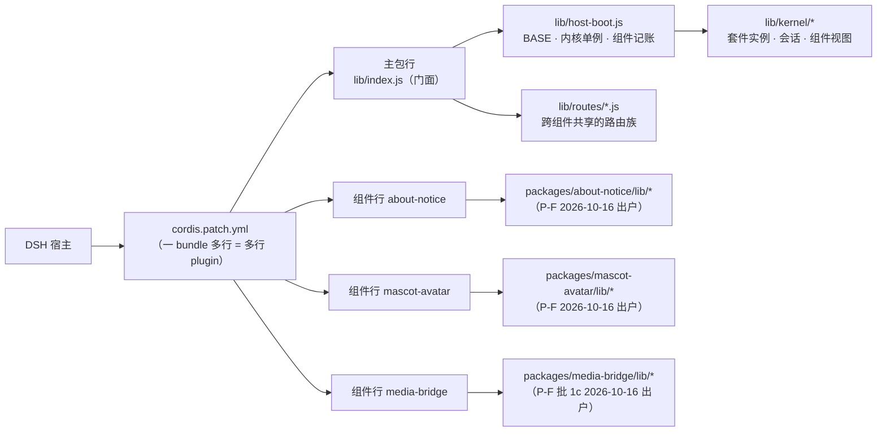

# 宿主半边架构：主包 + 组件行 + 内核化（门面重写记录）

> **本文回答一件事**：本分支的宿主半边**现在长什么样**、门面（`lib/index.js`）里原先那些实现
> **搬去了哪**、与上游（`origin/main`）的**单包单行**形态差在哪、以及**怎么把上游的改动迁到这条形态上**。
>
> 它**不重复**机制与不变量 —— 那些住在各自实现文件的头注释里（本仓纪律：能写在代码旁的规则不单写文档，
> 见 [`README.md`](./README.md) §写作纪律 3）。决策与代价住
> [`adr/0013-bundle-multi-component-rows.md`](./adr/0013-bundle-multi-component-rows.md)（组件行；
> 原编号 0012，已让位重编为 0013，见 §7）与
> [`adr/0003`](./adr/0003-build-time-module-inlining.md)（浏览器半边的构建期内联，未被本分支推翻）。
>
> **不写会漂的数值**：行数 / 条数 / 键数一律给**复算命令**，不抄进本文（[`adr/0006`](./adr/0006-comment-discipline-as-written-convention.md) D2）。

## 1. 上游形态：一份 patch 行，门面即宿主

`origin/main` 的宿主半边是**单包单行**：

- `cordis.patch.yml` 只插一行（`wallpaper-engine`，`name` = 裸包名）；
- `lib/index.js` 是"门面即宿主"：定位 WE 安装 / 枚举壁纸 / 服务 JSON 清单与字节 / 注册全部路由族，
  都在同一个文件里。上游门面头注释自己列的就是这份职责清单（三件事 + 路由表指向 `docs/ROUTE-INDEX.md`）；
- 复杂度实测记在 [`adr/0013`](./adr/0013-bundle-multi-component-rows.md) 的 Context：门面里混着大量
  **与装配无关**的实现（Steam / WE 发现、媒体、上传、转码……），而 `lib/routes/*.js` **每个文件的入边
  恰好是 1**（只有门面 import 它）⇒ 路由族事实上已经在"插件"的形状上。

体量不抄数字，现算：

```sh
git show origin/main:lib/index.js | wc -l    # 上游
wc -l lib/index.js                           # 本分支
node test/verify-component-face.mjs          # 内核对外面（稳定面 / 内部面）的分级与键数由它现报
```

## 2. 本分支的三段：主包 / 组件行 / 内核化



（**P-F 组件行统一进行中**：`about-notice` 与 `mascot-avatar` 已出户到 `packages/<组件>/`（真名行 + 独立清单），
`media-bridge` 已于 P-F 批 1c（2026-10-16）出户；随后 `visibility.js` 移到 `lib/component-visibility.js` ⇒ **`lib/components/` 目录已删除**。计划与须知见 [`wip/BUNDLE-SPLIT.md`](./wip/BUNDLE-SPLIT.md) §15。）

| 段 | 住在哪 | 是什么 | 契约 / 判据 |
|---|---|---|---|
| **门面** | `lib/index.js` | 薄适配层：`apply()` 建会话段、按族注册、按 disposer 回卷；组件分发点 `applyComponent()` | 只做注册与协议聚合（`verify-module-layout`）；注入键集双向对账（`verify-inject-contracts`） |
| **引导叶子** | `lib/host-boot.js` | `BASE` / `PLUGIN_NAME` / `repoSlugFromPkg()` / `hostKernel` 单例 / `runComponent()` / `handOffTeardown()` / `componentProbe()` | 它不 import 门面，也不 import 组件 ⇒ 拆掉「门面 ⇄ 组件入口」的 import 环；`verify-bundle-rows` ⑥ 双向判 |
| **宿主内核** | `lib/kernel/*` | `host-kernel.js`（模块加载期建一次的套件实例）、`host-session.js`（一次 apply 的会话段：版本戳 / 日志提示 / token 表 / faststart / 启动清扫 / 字节出站 / 媒体源 / 清单 ＋ teardown）、`component-session.js`（组件的迷你会话 + `componentViewFrom()` 视图）、`config.js`、`data-dir.js` | 对外面分两级（稳定面 / 内部面），键数与分级由 `verify-component-face` 现算；「内核绝不 import 门面」 |
| **跨组件路由族** | `lib/routes/*.js` | 主包自己的路由，一文件一族 | 族的 `DEPS` 声明 ↔ 调用点实参双向对账；`verify-route-families` 盯触发线 |
| **组件行** | `packages/<组件>/lib/`（2026-10-16 三格全部出户；旧落点 `lib/components/<组件>/` 已不存在）（`packages/about-notice/`、`packages/mascot-avatar/`、`packages/media-bridge/`，2026-10-16 全部出户） | 一行一个目录：入口 `index.js` + 它自己的路由族实现 + 清单（`package.json`）+ `icon.png` + `locale/*.json` | 行的存在性/形态由 `verify-bundle-rows` ⑥（入口 ⇄ 清单出口三连 ⇄ `files` 四类文件、装载等价、跨行无重复）与 `verify-route-ownership` 钉 |
| **共享内核** | `lib/settings-schema.js` | 唯一被构建期内联进浏览器的 `lib/**` 文件 | 白名单 = `test/verify-module-layout.mjs` 的 `SHARED_KERNEL_WHITELIST`（再加一个必须改清单） |

**行的开关语义 = A 语义**：宿主行级。停用某个组件行 ⇒ 该组件的宿主路由**整族不注册**；
浏览器半边仍随整包加载，可见面由宿主行状态派生、双向对账（[`HOW-IT-WORKS.md`](./HOW-IT-WORKS.md)
与 `lib/component-visibility.js`）。**当前**组件行三格已按 `adr/0013` D6/D8 的「多包」终态出户到
`packages/<组件>/`（开发期 `file:` 链接解析，发布形态未落地），但**不**做每组件一格客户端开关
（[`adr/0013`](./adr/0013-bundle-multi-component-rows.md) D17 的非目标）；⚠️ **目标形态已于 2026-10-14 改为
「多包」**（该 ADR 的 D6/D8 就地改写，实施计划见 [`wip/BUNDLE-SPLIT.md`](./wip/BUNDLE-SPLIT.md)）——
本条描述的是**本分支的现状**，不是终态。

## 3. 门面现在只剩什么

四点，逐条都可在文件里核：**注册与编排** · **一次 apply 的共享可变状态与访问器**（住 `host-session.js`，
跨模块只以访问器出去）· **只 import 不复制的基座**（`lib/host-boot.js` / `lib/kernel/data-dir.js`）·
**组件分发与账本**（`componentImpls()` / `applyComponent()` → `runComponent()`）。
展开与"为什么仍不能拆干净"见 [`CODE-STRUCTURE.md`](./CODE-STRUCTURE.md) §2.3。

## 4. 能力搬去哪（搬家账）

上游的路径 → 本分支的真源。这张表是**给迁移用的**，逐行都由 `git diff --name-status origin/main -- lib`
可复现（`R` = 重命名+纯搬移，`A` = 本分支新增的落点）。左列一律写成 **git 对象引用**
`origin/main:<path>`（用 `git show origin/main:<path>` 取内容）—— 它们是**过去的位置**，
在本分支的工作树上不存在，不要照它们建文件：

| 上游（`origin/main`） | 本分支真源 | 形态 |
|---|---|---|
| `origin/main:lib/routes/now-playing.js` | `packages/media-bridge/lib/routes/now-playing.js`（原 `lib/components/media-bridge/now-playing.js`，P-F 批 1c 2026-10-16 出户） | 已出户的组件行（媒体桥） |
| `origin/main:lib/media/index.js`（后端门面 `/media-status` 族） | `packages/media-bridge/lib/backend.js` | 已出户的组件行 |
| `origin/main:lib/media/legacy.js` | `packages/media-bridge/lib/legacy.js` | 已出户的组件行（内置回落实现） |
| `origin/main:lib/media/supervisor.js` | `packages/media-bridge/lib/supervisor.js` | 已出户的组件行（子进程守护） |
| `origin/main:lib/media/provision.js` | `packages/media-bridge/lib/provision.js` | 已出户的组件行（产物解析 / 下载） |
| `origin/main:lib/routes/about-qr.js` · `origin/main:lib/routes/github-stars.js` | `packages/about-notice/lib/routes/*.js`（原 `lib/components/about-notice/*.js`，P-F 2026-10-16 出户） | 已出户的组件行（关于页两条腿） |
| `origin/main:lib/routes/avatar.js` · `origin/main:lib/routes/mascot.js` | `packages/mascot-avatar/lib/routes/*.js`（原 `lib/components/mascot-avatar/*.js`，P-F 2026-10-16 出户） | 已出户的组件行（头像 + 立绘） |
| `origin/main:lib/scene-probe.js` | `lib/media/scene-probe.js` | 内核媒体（`lib/media/` 只剩内核媒体文件） |
| `origin/main:lib/media-probe.js` | `lib/media/mp4-probe.js` | 内核媒体 |
| `origin/main:lib/transcode.js` · `origin/main:lib/video-preview.js` | `lib/media/transcode.js` · `lib/media/video-preview.js` | 内核媒体 |
| 门面内的帧缓存 / 各类媒体目录段 | `lib/media/frame-store.js` · `lib/media/media-dirs.js` | 内核媒体 |
| 门面内的扫描链 / Steam 发现段 | `lib/steam-discovery.js`（安装/库发现）+ `lib/wallpaper-scan.js`（目录树→条目） | 叶子套件（取上游两族拆分，各有独立守卫；P0 的合并版 `lib/we-discovery.js` 已删） |
| 门面内的 `config.json` 读写段 | `lib/kernel/config.js` | 内核（上游同名副本已删；判据已重指真源） |
| 门面内的启动清扫段 | `lib/startup-sweep.js` + 各套件的 sweep/prune | 叶子 + 内核媒体（上游同名副本 `lib/cache-prune.js` 已删：清扫本体住 `lib/media/transcode.js` / `lib/media/video-preview.js` 的返回面） |
| 门面内的上传目录状态段 | `lib/upload-dir.js`（+ `lib/upload-store.js` 的枚举/元数据） | 叶子 |
| 门面内的 `normalizeUserDir` / `moveFileP` | `lib/fs-paths.js` | 叶子（避免"内核 → 门面"环） |
| 门面内的 `BASE` / `PLUGIN_NAME` / `repoSlugFromPkg` | `lib/host-boot.js` | 引导叶子 |
| 门面内的诊断追踪段 | `lib/diag-trace.js`（+ `lib/routes/diag.js`） | 叶子 + 路由族 |
| 门面内的 http 生命周期段 | `lib/http-lifecycle.js` | 叶子 |
| 门面内的随包资源段 | `lib/we-assets.js` | 叶子 |
| 门面内的 shim/seed 注入段 | `lib/shim-seed.js` | 叶子 |
| 门面内的缓存根迁移段 | `lib/cache-dir.js` + `lib/routes/cache-dir.js` | 叶子 + 路由族 |
| 门面内的 `/inventory` 注册段 | `lib/routes/inventory.js` | 路由族（本分支新增的落点） |


**搬迁的纪律**（[`adr/0013`](./adr/0013-bundle-multi-component-rows.md) D7 与 `CODE-STRUCTURE` §4.2）：
先**纯搬移**（零行为变化）再改语义；`npm run verify:all` 兜底；一次性脚本用完即删。

## 5. 与上游单包形态的差异（逐维）

| 维度 | 上游：单包单行 | 本分支：主包 + 组件行 + 内核化 |
|---|---|---|
| `cordis.patch.yml` | 1 行（裸包名） | 多行：全部用**真包名**（`dsh-plugin-wallpaper-engine` + 各子包真名 `dsh-plugin-wallpaper-engine-<pkg>`）；`<裸包名>/<子路径>` 形态已于 2026-10-16（P-F 三格出户）退役；行可单独 disable |
| 关掉一行会怎样 | 关掉整包 | 只丢该组件的宿主路由族 + 它的浏览器可见面；其余行的路由不动 |
| 门面体量 | 门面即宿主 | 门面 = 装配 + 协议聚合（现算见 §1） |
| 依赖注入 | 门面内自由引用 | 每个路由族带**显式 `DEPS` 声明**，与调用点实参**双向对账**（`verify-inject-contracts`） |
| 组件能拿到什么 | —（没有这层） | 内核的**组件视图**（`componentViewFrom()`，缺键即抛；`verify-component-face` 对账） |
| 内核对外面 | 无此概念 | 稳定面 / 内部面两级：内部面本文件外不得直接解构，跨族复用要先升稳定面 + 补契约 |
| 浏览器可见面 | 整包一套 | 宿主侧单一真源 `lib/component-visibility.js`；经 `/inventory` 的 `components` 字段下发（`verify-component-visibility`） |
| 释放纪律 | 一次加载一次卸载 | 内核单例 + **引用计数租约**（`acquireKernelLease` / `releaseKernelLease`）：多行共享内核，最后一个卸载者才 dispose；组件行**有意不 acquire**（没有可释放的共享资源） |

> **不属于差异的一件事**：WebWallGL 已在上游完成 **npm 化**（`origin/main` 的 `lib/webwallgl/` 同样
> 只有本仓适配页；上游同步工具与 `lib/webwallgl/` 下的 `.upstream.json` 由 `d561f5f` 删除，
> 想取它们最后的样子用 `git show 'd561f5f^:lib/webwallgl/.upstream.json'`）——
> 它**不是**本分支的改动，但凡是按旧 vendored 形态写的文档 / 注释都是**死路径**，要一并修
> （两处都**已修**：`docs/wip/LINUX-OCCLUSION.md` 与 `lib/we-assets.js` 的 `WEBWALLGL_DIR` 注释）。

## 6. 迁移路径：把上游的改动搬到这条形态上

1. **先分类，再动手**。这段改动属于哪一类？
   发现 / 传输 / 设置 / 字节出站 → **主包叶子**（`lib/*.js`、`lib/media/*.js`，由内核装配）；
   系统媒体桥 / 关于页 / 头像立绘 → **组件行**（`packages/<组件>/lib/`）；
   两侧共用的规则 → `lib/settings-schema.js`（改它必须重新 `npm run build`）。
2. **路由族归属判据（三问，任一为"是"就进组件行）**：它的浏览器可见面是否**随行开关启停**？
   它是否自成一条与主包零交叉的边（自带子进程 / 自带磁盘载体）？它的实现是否只被这一族消费？
3. **纯搬移**：只改声明住哪，不改做什么；搬完 `npm run verify:all`（含真跑构建逐字节比对）。
4. **补三个键集对账**：族的 `DEPS` ↔ 族自身消费面 ↔ 调用点实参。
   漏一个键的形态是"不抛错、不判红，只是闸门不再工作"（真机踩过三次，`GPU_FRAME_AREA_TOL` / `WEBWALLGL_PKG_DIR`）。
   判据：`node test/verify-inject-contracts.mjs`。
5. **补行级登记**：根 `cordis.patch.yml` 加一行（`name` 用组件的**真包名**）；**新建 `packages/<pkg>/`**，
   登记写在该组件包**自己的 `package.json`** 里——`exports` 三连（`./lib/index.js` 入口 / `./package.json`
   清单 / `./locale/*.json` locale）+ `files` 覆盖本包四类文件（入口 / 清单 / 图标 `icon.png` / locale）。
   判据：`node test/verify-bundle-rows.mjs`、`node test/verify-route-ownership.mjs`、`test/verify-package-files.mjs` P1（三份守卫的「归属清单」按上句的落点解析）。
6. **生成物与产物**：动了路由 ⇒ `node test/tools/host-route-index.mjs --write`（`docs/ROUTE-INDEX.md`
   是生成物，别手改）；动了守卫⇒模块映射 ⇒ `node test/tools/guard-targets.mjs --write`；
   动了共享内核 / 浏览器半边 ⇒ `npm run build`（`lib/client.js` 是产物，不入库）。
7. **上游已删的东西不要搬回来**：vendored WebWallGL 那一套（由 `d561f5f` 删除；最后的样子在
   `git show 'd561f5f^:test/tools/sync-webwallgl.mjs'` / `'d561f5f^:lib/webwallgl/.upstream.json'`），
   以及更早退役、只在 `CHANGELOG` 与 git 历史里还有记载的那几条线。搬任何东西之前，
   先确认它在 import 图上活着（§7 第一条）。

## 7. 已知缺口（诚实清单，不是待办台账）

本仓没有活账本（`docs/README.md` §其它），所以这几条**只写"怎么复算"**：

- **上游同名副本「未接线」这一类：已关闭**（收口于本分支的守卫与发布面那条线）。当时的机器结论是
  `node test/verify-reachability.mjs` **判红**（副本仍在发布面 `files` 收的 `lib/**` 里、却不在
  import 图上）；九项逐个收口后**不可达规模归零**，该守卫**由红转绿**，而且它的 `BASELINE` 一个
  数字都没动 —— 绿是"真的把发布面清干净"换来的，不是放宽棘轮换来的。复算：
  ```
  node test/verify-reachability.mjs        # 期望：ALL REACHABILITY CHECKS PASSED（不可达 0 个 / 0 行）
  node test/verify-guard-map.mjs           # 期望：例外表条目都是"确实零覆盖"的（`packages/mascot-avatar/lib/index.js` …）
  ```
  九项"发布面孤儿"已全部收口（删副本 / 移回真源）⇒ 结论由两条守卫钉住：
  `node test/verify-reachability.mjs`（不可达 0 个 / 0 行）与 `node test/verify-undefined-refs.mjs`
  （全仓零未定义引用）。**哪一项接替了哪一项属历史**，见 [`CHANGELOG.md`](./CHANGELOG.md) 与 git 历史。
- ~~**`lib/asset-paths.js` 未接线**~~ —— **已收口**（G-A1/G-A2/G-A3）：上传目录解析提取成叶子
  `lib/upload-dir.js` 的 `createUploadDirResolution()`（默认值唯一真源在那里），目录族真源是
  `lib/media/media-dirs.js`，WE 素材族真源是 `lib/we-assets.js`；副本已删，聚焦守卫
  `test/verify-asset-paths.mjs` 改成**三源适配器**（32 条判据 / 14 个多源变异体）。
- ~~**`lib/we-assets.js` 的 `WEBWALLGL_DIR` 注释**~~ —— **已修**（本轮复核确认）：注释已改成
  "本仓的渲染页适配层，引擎本体走 npm 依赖 `webwallgl`（`WEBWALLGL_PKG_DIR`）"，
  不再提被 `d561f5f` 删掉的那个同步工具。
- **ADR 编号撞车（已裁决并落地）**：本文原先引用 `docs/adr/0012-bundle-multi-component-rows.md`，
  而 `0012` 同时被上游的 `0012-artifact-untracking`（构建产物出库）占用。按"上游编号胜出"，
  本分支那份**已重编号为 [ADR-0013](./adr/0013-bundle-multi-component-rows.md)**
  （文件头带 `**Renumbered**: 0012 → 0013`），两份索引现在都各列两条
  （[`adr/README.md`](./adr/README.md) §索引 与 [`README.md`](./README.md) 的 ADR 表同口径）。
  ⚠️ 两份 `CHANGELOG` 与归档件里出现的 `ADR-0012` 是**当时的编号/账本**，保持原样
  （[`adr/0006`](./adr/0006-comment-discipline-as-written-convention.md)：历史文档不追溯）；
  读归档件时按 [`adr/README.md`](./adr/README.md) 里那张映射说明理解。
- **本分支的过程手册**是 [`docs/wip/BUNDLE-SPLIT.md`](./wip/BUNDLE-SPLIT.md)（活手册：收口后按
  `docs/README.md` §目录的寿命规则归档 ⇒ 那时路径会变，本文只在"过程记录"意义上引用它）。

## 参考

- 现行结构规范与边界：[`CODE-STRUCTURE.md`](./CODE-STRUCTURE.md)（§2 宿主半边、§2.2 套件、§2.3 门面剩什么）
- 决策：[`adr/0013-bundle-multi-component-rows.md`](./adr/0013-bundle-multi-component-rows.md) ·
  [`adr/0003`](./adr/0003-build-time-module-inlining.md) · [`adr/0002`](./adr/0002-settings-schema-single-source.md)
- 行的开关与可见面：[`HOW-IT-WORKS.md`](./HOW-IT-WORKS.md) · `lib/component-visibility.js`
- 生成物：[`ROUTE-INDEX.md`](./ROUTE-INDEX.md) · [`GUARD-MAP.md`](./GUARD-MAP.md)
- 复算入口：`node test/verify-inject-contracts.mjs` · `node test/verify-bundle-rows.mjs` ·
  `node test/verify-route-ownership.mjs` · `node test/verify-component-face.mjs` ·
  `node test/verify-component-visibility.mjs` · `node test/verify-reachability.mjs`
