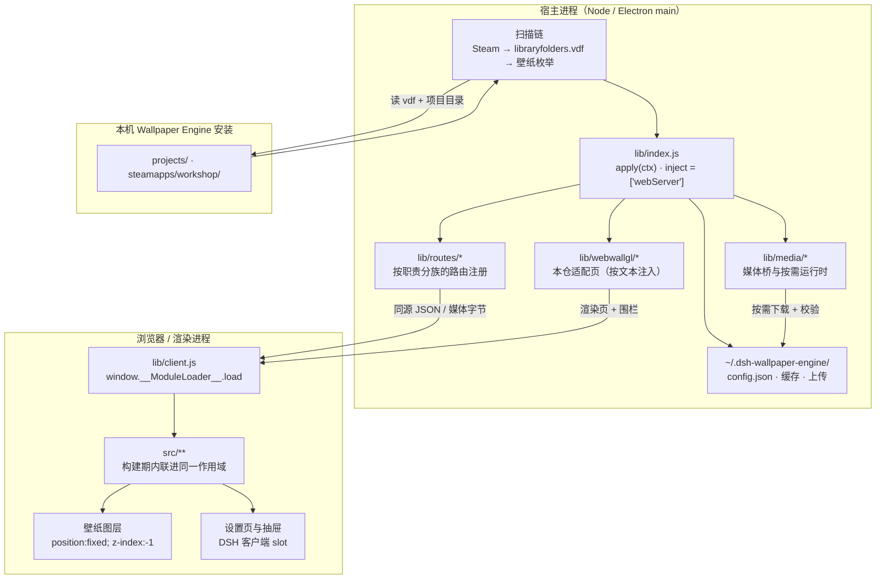
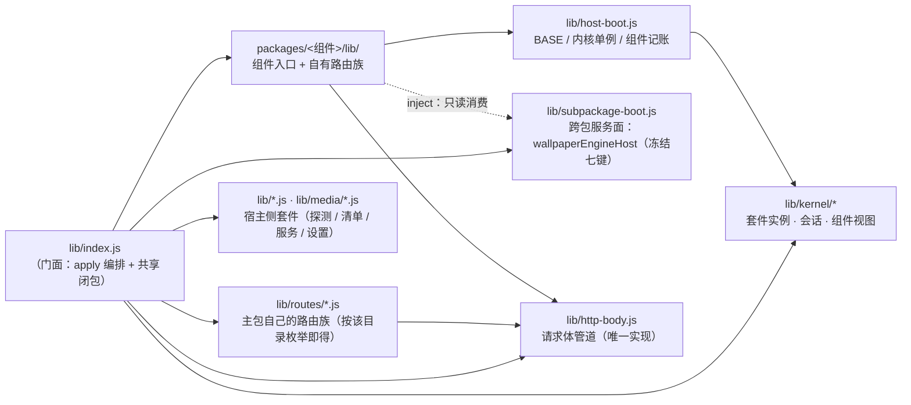
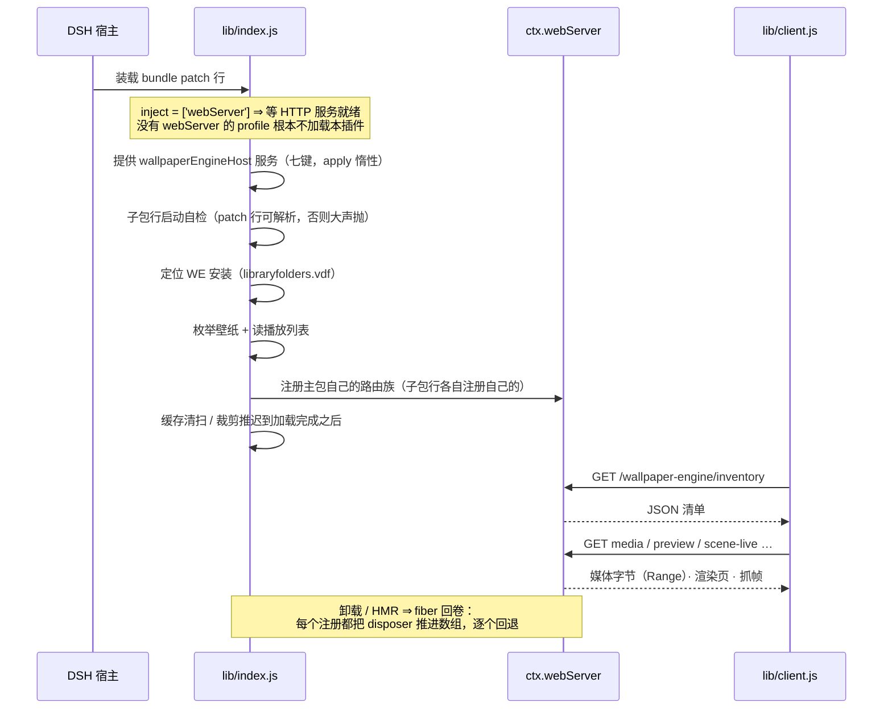
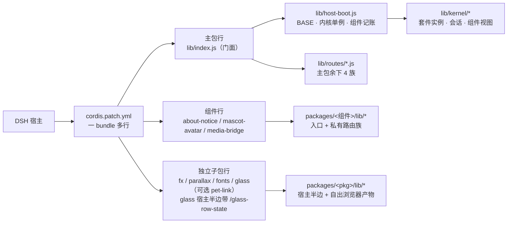
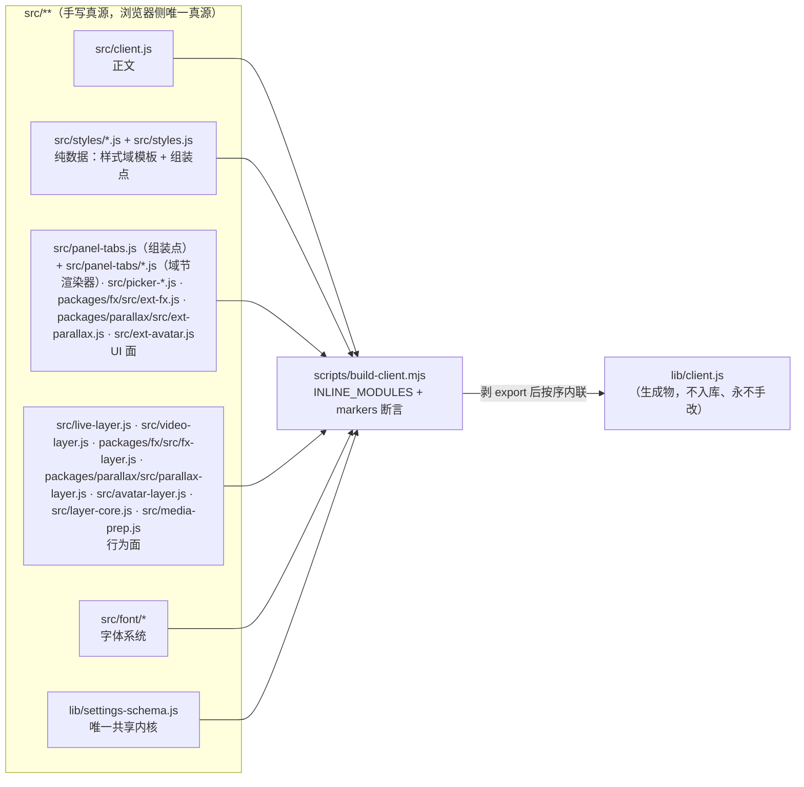
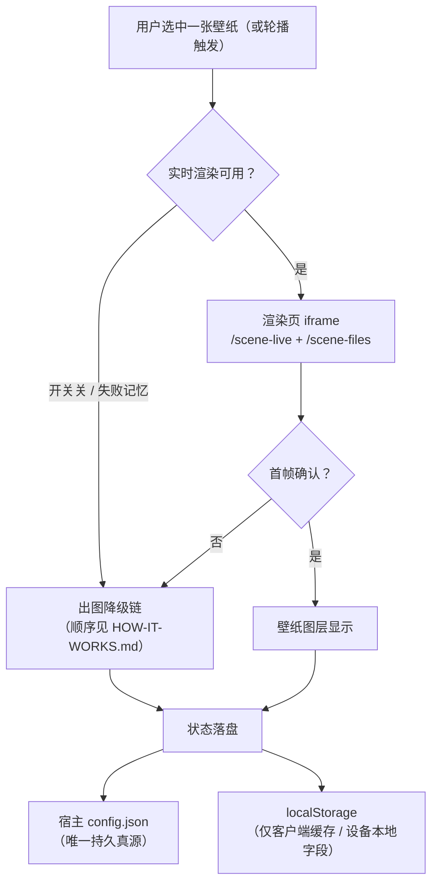
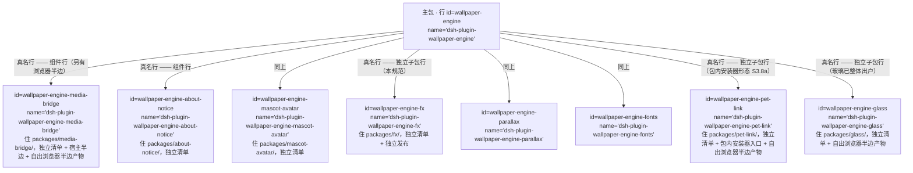
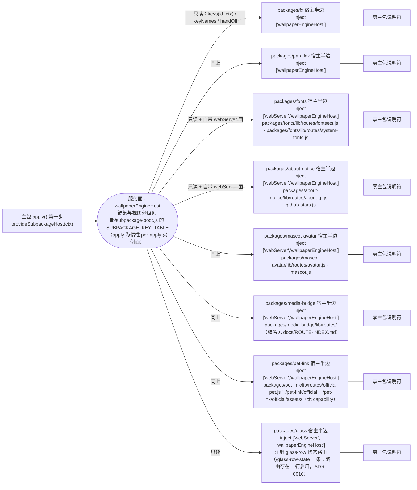
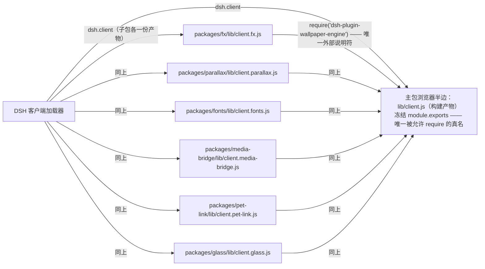

# 代码结构与边界（Code structure）

> **本文回答三件事**：**代码放哪**（新文件落点）、**结构长什么样**（谁调用谁、数据往哪流）、**边界在哪**（什么算越界）。
> **为什么这么选**写在 [`adr/`](./adr/)；**机制与不变量**写在对应文件的头注释里（本仓纪律：能写在代码旁的规则不单写文档）；**怎么加一个东西**见 [`DEV-GUIDE.md`](./DEV-GUIDE.md)。
>
> **改动纪律**：改本文的**规则**时，若该规则在 §6 有配套守卫，必须**同一次提交**里一并改掉（反之亦然）；
> **没有配套守卫的规则靠约定成立**，不许为了凑"有守卫"而新加一条读散文的判据
> （[`adr/0006`](./adr/0006-comment-discipline-as-written-convention.md)）。
> **不写会漂的数值**（条数 / 行数 / 门槛 / 体积）：一律指向真源或给复算命令。

## 读者路径

| 你想知道 | 读哪里 |
|---|---|
| 用户可见行为、出图降级链、路由表 | [`HOW-IT-WORKS.md`](./HOW-IT-WORKS.md) |
| **代码放哪 / 结构 / 边界** | **本文 §1–§8** |
| 某个设计为什么是这样 | [`adr/`](./adr/) |
| 怎么加一个路由 / 设置项 / 浏览器端模块 / 守卫 | [`DEV-GUIDE.md`](./DEV-GUIDE.md) |
| 跑测试、写测试、两档判据 | [`DEV-GUIDE.md`](./DEV-GUIDE.md) §4 |
| 改 Linux 壳窗遮挡（契约 / 实现 / 验收 / 运维） | **本文 §9** |
| 改桌面 / 浏览器媒体与实时渲染的实现 | **本文 §10** |
| 查子包依赖图 / `test/tools/` 清单 / 宿主 UI 接口台账 | **本文 §11 / §12 / §13** |
| 权限与升级 | [`UPGRADING.md`](./UPGRADING.md) · [`TROUBLESHOOTING.md`](./TROUBLESHOOTING.md) |

## 目录（按部分）

| 部分 | 章节 | 回答什么 |
|---|---|---|
| 一 · 结构手册 | §1–§8 | 一条轴与两个半边、新文件放哪、构建期内联、硬约束、守卫、状态真源、数据流 |
| 二 · 实现细节 | §9 遮挡通路 | Linux 壳窗遮挡：背景、契约、数据通路、生产端、注入、验收、降级、运维 |
| 二 · 实现细节 | §10 浏览器媒体与实时渲染 | 媒体供给、抓帧、空帧门禁、主题取色 |
| 三 · 参考台账 | §11 子包依赖图 | 组件行 vs 独立子包行、两张平面、允许/禁止边、登记点 |
| 三 · 参考台账 | §12 `test/tools/` 清单 | 每个工具回答什么问题、怎么跑 |
| 三 · 参考台账 | §13 DSH UI 接口台账 | 我们依赖了宿主哪些 UI 接口、各自稳定度与复核时机 |


---

> **第一部分 · 结构手册（§1–§8）**：给「要加代码 / 改结构」的人——落点、边界、约束与守卫。

---


## 1. 一条轴，不是两条

分工不是"`lib` = 服务端 / `src` = 客户端"，而是两个**正交**属性：

| 属性 | 判据 | 它决定什么 |
|---|---|---|
| **跑在哪个进程** | 要在浏览器里跑吗？ | 放 `src/` 还是 `lib/` |
| **是否随包发布** | 在 `package.json` 的 `files` 里吗？ | 能不能留死码 / 能不能放只给开发用的东西 |

组合出的四格，就是本仓的全部落点：

| | **随包发布** | **不发布（开发面）** |
|---|---|---|
| **浏览器进程** | `lib/client.js`（主包）+ 各子包 `packages/<pkg>/lib/client.<pkg>.js` —— **生成物** | `src/**` 与 `packages/<pkg>/src/**` —— 浏览器侧的**唯一真源** |
| **宿主进程**（Node / Electron main） | `lib/index.js` ＋ 它 import 的 `lib/**` 模块 ＋ `lib/webwallgl/`（本仓渲染页适配层：`index.html` + `renderer.js` + `occlusion-bridge.js`；引擎本体走 npm 依赖 `webwallgl`，运行期由 `/scene-live/engine/` 从 `node_modules` 直出） ＋ `lib/types/` | **`test/`（守门：`verify-*` + `*-smoke` + `e2e-*`）· `test/tools/`（诊断/分析/生成工具）** · `scripts/`（构建与发布期用；**枚举 `scripts/` 目录即得**，本文不列清单）· `docs/` ＋ 本机未跟踪的研究 / 取证目录（由忽略规则覆盖，**不入库、也不被入库文档引用**） |

### 1.1 一份代码，两个半边（两种运行形态）

本插件是**一个 npm 包**，但同时是两种东西 —— 两条加载路径**互不知道对方存在**：

| 身份 | 入口 | 谁加载它 | 跑在哪 |
|---|---|---|---|
| **Cordis 宿主插件** | `lib/index.js` 的 `inject` / `apply(ctx)` | DSH 宿主按 bundle patch 行装载 | Node（Electron 主进程侧） |
| **DSH 客户端插件** | `lib/client.js`（`exports["./client"]` + `package.json` 的 `dsh.client` 清单） | DSH **客户端加载器**按包元数据取（宿主不提供任何路由发它） | 浏览器 / 渲染进程 |

各自能写什么、改完怎么生效：

| | **宿主半** | **浏览器半** |
|---|---|---|
| 入口 | `lib/index.js`（`package.json` 的 `main`；`apply(ctx)`） | `lib/client.js`（由客户端加载器 `window.__ModuleLoader__.load({ id, factory })` 消费） |
| 源码在哪 | **就是 `lib/*.js` 本身**（手写、直接发布） | **`src/**`**：`src/client.js` 是正文，其余是构建期内联的模块 |
| 可用什么 | `node:*`、`worker_threads`、`child_process`、`fs` | `document`、`fetch`、DSH 客户端 ctx 服务；**无 `node:`、无 `import`** |
| 改完怎么生效 | **必须重启 DSH**（`lib/*.js` 启动时加载，不热更） | `npm run build` 重新生成 `lib/client.js` |



> 两条路径的**唯一接口**是 HTTP 路由表。因此路由表是**生成物**
> （`docs/ROUTE-INDEX.md`，由 `test/tools/host-route-index.mjs` 重算并逐字节核对）—— 手写必烂，本仓有过教训。

---

## 2. 宿主半边：门面、内核、路由族、组件行与子包行

`lib/index.js` 是**门面**：它做注册与协议聚合，**不装新逻辑**。宿主半边里住着这几类东西
（"主包 + 组件行 + 内核化"这套形态、它与上游单包形态的差异与迁移路径见
本文 §2.4）：

- **宿主内核** `lib/kernel/*` —— 门面在**模块加载期**一次建成的各套件实例（`host-kernel.js`）、
  一次 apply 的会话段（`host-session.js`）、组件行消费的组件视图与迷你会话（`component-session.js`）、
  配置与数据目录（`config.js` / `data-dir.js`）。
- **路由族**（一文件一族）：`lib/routes/<族>.js` 是**主包自己**的族（按该目录枚举即得，本文不列清单）；壁纸域（场景 / 媒体 / 上传 / 遮挡 / 现在播放 / `we-assets` /
  token 簇）住 `packages/media-bridge/lib/routes/<族>.js`，其余组件行的私有族各自在
  `packages/<组件>/lib/routes/`。无论住哪，各族都拿一个显式 context 对象、各自注册自己的路由。族的成员是
  **派生量**，本文不列：路由枚举的真源是 `test/tools/host-route-index.mjs` 的 `buildIndex()`（它按调用点把每个族
  放回所属行），路由级视图是生成物 `docs/ROUTE-INDEX.md`（`verify-route-index` 重算并逐字节比对）。
  `verify-route-families` 按它自己的 `FAMILY_TRIGGER` 盯「某族条数超线 ⇒ 拆族或改线」（阈值、归族规则
  与负对照都在 `test/verify-route-families.mjs`）。
  族的实现落点可以再分层：族文件只留 HTTP 面；读写 / 消毒 / 落盘这类**存储层**在体量大时折进同域实现文件
  `lib/<域>-store.js`（现有 `lib/routes/presets.js` + `lib/glass-presets-store.js`），契约扫描按
  「族文件 + 实现文件」的拼接面做（`verify-inject-contracts` 的 `FAMILY_IMPL`），文本判据同样拼接
  （`verify-presets` 的 `presetsFamilySrc`）—— 拼接面等价于拆分前的单文件面。
- **组件行**（**组件包** `packages/<组件>/lib/` —— `packages/about-notice/`、`packages/mascot-avatar/`、`packages/media-bridge/`）—— 一个 bundle 多行（[`adr/0013`](./adr/0013-bundle-multi-component-rows.md)）：
  组件入口 `index.js` + 它自己的路由族实现 + 该行消费的组件视图。行的开关是宿主的
  （`cordis.patch.yml`）；"哪个实现属于哪一行"由 `test/verify-route-ownership.mjs` 钉住，
  行的装载形态由 `test/verify-bundle-rows.mjs` 钉住。
- **子包行与跨包服务面**（分包形态；契约 = [`adr/0014`](./adr/0014-subpackage-contract.md)）——
  根 `cordis.patch.yml` 是**行集唯一真源**：主包一行 + 组件行（about-notice / mascot-avatar / media-bridge）＋
  独立子包行（fx / parallax / fonts / glass，可选 pet-link；glass 的宿主半边自带 `/glass-row-state` 状态路由 ——
  路由存在 = 行启用，ADR-0016），行的 `name` 一律是子包**真名**（不是主包子路径）。
  主包 `apply()` 的**第一步**经 `lib/subpackage-boot.js` 的 `provideSubpackageHost()` 提供 Cordis 服务
  `wallpaperEngineHost`，值 = `createSubpackageHost()` 的**冻结七键** `ids` / `keyNames` / `keys` /
  `handOff` / `schema` / `http` / `apply`（`apply` = 惰性的 per-apply 实例视图）；子包宿主入口
  `packages/<pkg>/lib/index.js` 经 `inject` 声明 `wallpaperEngineHost`（需要 HTTP 的再加 `webServer`），
  只读消费该服务，**零主包说明符**（`test/verify-subpackage-purity.mjs` 钉）。主包 `apply()` 另按 patch 行做**启动自检**
  （`subpackageSpecifiers()` + `assertSubpackagesResolvable*()`）：行解析不到就**大声抛错**（宿主对行级
  失败是静默的）。浏览器半边同理：声明了 `dsh.client` 的子包各有包内构建配方 `client.build.json` 与产物
  `packages/<pkg>/lib/client.<pkg>.js`，唯一条外部说明符是 `require("<主包真名>")`。
- **宿主侧套件**（`lib/*.js` 与 `lib/media/*.js` 里的非路由模块）—— 纯逻辑，不碰 `ctx.webServer`：发现与探测
  （`steam-discovery` + `wallpaper-scan` / `media/mp4-probe` / `media/scene-probe`）、清单与文件服务
  （`inventory` / `serve` / `mp4-vfs` / `faststart` / `pkg-read` / `scene-manifest`）、
  设置与配置（`settings-schema` / `kernel/config`）、清扫与诊断（`startup-sweep` / `diag-trace`）。
  **哪些是活的以 §2.2 那张表和 `node test/verify-reachability.mjs` 为准**。
- **共享管道** `lib/http-body.js` —— 请求体读取的唯一实现，路由族共用，不各写一份。

组件的**浏览器可见面**另有单一真源：`lib/component-visibility.js`（"哪个组件渲染哪一块"的宿主侧声明，
门面再导出一次使它在 import 图上），两侧对账由 `test/verify-component-visibility.mjs` 承担；
组件能拿到什么由 `test/verify-component-face.mjs` 按内核的组件视图逐键对账。



**族的形态有明文规定**（§4 第 1 条）：路由模块从 `apply(ctx)` 拿一个**显式 context 对象**
（字段就是它用到但不属于它的东西），而不是继承 `lib/index.js` 的 import。这条边界由守卫
`verify-module-layout` 的『路由模块不得"继承" lib/index.js 的 import』一节钉住。

**为什么门面不拆干净**：一部分共享可变状态（媒体源地址、载荷账本、缓存索引）必须与 `/inventory`
同作用域。当前形态把这组闭包放在 `lib/kernel/host-session.js`（一次 apply 一段，工厂在 `apply()` 里
被调用），但仍只能以**访问器**跨模块出去 —— 传值就是陈旧快照。

### 2.1 启动与生命周期



- 四条生命周期不变量 —— `webServer` 硬依赖（无 HTTP 的 profile 根本不加载）、一切注册经 fiber 回卷、
  `ctx.webServer` 防御性读取、`wallpaperEngineHost` 先于任何子包行就位且第七键是惰性访问器（传值只会拿到
  `null`）—— 逐条写在 `lib/index.js:1-33`、`lib/kernel/host-session.js:1-24`、
  `lib/subpackage-boot.js:1-36` 的文件头。**改生命周期前先读那三段，本文不复制。**

### 2.2 非路由套件：职责与「为什么单独成模块」

抽模块的接缝判据只有一条：**同一份推导被两个互不相干的消费者读到**（或者反过来，同一件事存在
两个可以出错的实现）。下表把宿主半边**在 import 图上**的套件逐个说明 —— 每条的落点都是内核
（`lib/kernel/host-kernel.js`）真正 import 的那个文件：

| 模块 | 职责 | 一句话判据（完整理由见文件头） |
|---|---|---|
| `lib/media/mp4-probe.js` | MP4/MOV 容器探测（尺寸 / 编码 / 帧率 / 时长 / moov 落点） | 同一份走读被面板提示、转码决策、faststart 三处读 |
| `lib/media/scene-probe.js` | scene 音轨与内嵌 MP4 两本探测账 | 消费者完全重合；两份缓存 / 两套陈旧判定会互相漂 |
| `lib/steam-discovery.js` + `lib/wallpaper-scan.js` | 安装发现与目录扫描两族 | 「扫描根少算一个」的病根只能有一处推导 |
| `lib/startup-sweep.js` | 启动 3s 后的缓存清扫与容量上限 | 共享「只清够旧的孤儿」一条纪律，只管时点与顺序 |
| `lib/kernel/config.js` | `config.json` 读、原子发布与读改写串行化 | 所有读改写必须过同一条队列，否则后写吞先写 |
| `lib/diag-trace.js` | 诊断行落盘与请求追踪 | 多族共用的同一条环形账，各写各的就各丢一段 |

> ⚠️ **别按上游的文件名找这些套件**：`node test/verify-reachability.mjs` 按 import 图判哪份代码还活着
> （发布面只留活代码），**改套件前先跑它**，别照着旧路径改。

每个模块「为什么单独成模块」的完整理由与不变量写在文件头 —— `lib/media/mp4-probe.js:1-22`、
`scene-probe.js:1-17`、`steam-discovery.js:1-21`、`wallpaper-scan.js:1-30`、`startup-sweep.js:1-30`、
`lib/kernel/config.js:1-21`、`lib/diag-trace.js:1-30`。动它们之前先读那一段。共同的一条：**套件不自己决定"缓存放哪"** ——
音轨产物落点（`ensureFrameCacheDir`）、原子落盘（`atomicWriteFileP`）、转码 / ffmpeg / 缩略图各
目录（`transcodeCacheDir` / `ffmpegDataDir` / `videoPreviewCacheDir`）都由内核装配时注入，
路径访问器本身住 `lib/kernel/data-dir.js`（锚点在 `test/verify-cache-dir.mjs` 的读点里现取）。
`lib/kernel/config.js` 的调用点真源也现取：

```sh
grep -rn 'enqueueConfigWrite(' lib/
```

**门面与套件的边界**：套件只 `import` node 内建与同层纯函数；凡是要 `ctx.webServer`、要 fiber
disposer、要门面闭包状态的，留在路由族或 `apply()` 里。

### 2.3 `lib/index.js` 现在还剩什么

当前形态的门面是**薄适配层**（P0 库化 / P1 内核化）：它只 import 各段、把内核返回的键按**真实引用面**
投影回模块作用域、在 `apply()` 里按族注册并按 disposer 回卷。剩下的只有三类，且逐条理由都写在源码头：

- **注册与编排**：`apply(ctx)` 调 `createHostSession()`、按族注册路由、把 disposer 推进 fiber；
- **一次 apply 的共享可变状态与访问器**：媒体源地址、载荷账本、token 表、faststart 账、缓存索引
  —— 住 `lib/kernel/host-session.js`，与 `/inventory` 同作用域，跨模块只能以**访问器**形式出去（传值就是陈旧快照）；
- **组件分发与账本**：`componentImpls()`（组件名 → 实现的声明面唯一真源）与 `applyComponent()` 在门面，
  实例与唯一记账入口 `runComponent()` 在 `lib/host-boot.js`。

这些块的完整理由与不变量见 `lib/index.js:1-33`、`lib/kernel/host-session.js:1-24`、
`lib/kernel/component-session.js:1-45`、`lib/host-boot.js:1-31`、`lib/subpackage-boot.js:1-36` 的文件头；
跨包七键与启动自检见 §2.1 与 [`adr/0014`](./adr/0014-subpackage-contract.md)。

⚠️ 组件 / 路由族的**注入面是显式契约**：每个族的 `DEPS` 声明与门面 / 组件入口调用点的实参键集
**双向对账**（`test/verify-inject-contracts.mjs`），组件只从内核取**它那一格的组件视图**
（`componentViewFrom()`，键集见 `lib/kernel/component-session.js`）⇒ 少一个键不是静默 `undefined`，
而是当场报红。

### 2.4 与上游形态的差异与迁移

上游（`origin/main`）的宿主半边是**单包单行**：`cordis.patch.yml` 只插一行 `wallpaper-engine`（`name` = 裸包名），
`lib/index.js` 是"门面即宿主" —— 定位 WE 安装、枚举壁纸、服务清单与字节、注册全部路由族都在同一个文件里。
当前形态把它拆成**主包 + 组件行 + 内核化**三段；决策与代价见
[`adr/0013`](./adr/0013-bundle-multi-component-rows.md)，浏览器半边的构建期内联见
[`adr/0003`](./adr/0003-build-time-module-inlining.md)。



| 维度 | 上游：单包单行 | 当前形态：主包 + 组件行 + 内核化 |
|---|---|---|
| patch 行 | 1 行，`name` 是裸包名 | 多行，全部用**真包名**（`dsh-plugin-wallpaper-engine` + 各子包真名）；行可单独 disable |
| 关掉一行会怎样 | 关掉整包 | 只丢该组件的宿主路由族 + 它的浏览器可见面；其余行不动 |
| 门面体量 | 门面即宿主 | 门面 = 装配 + 协议聚合；行数现算：`wc -l lib/index.js` 与 `git show origin/main:lib/index.js \| wc -l` |
| 依赖注入 | 门面内自由引用 | 每个路由族带**显式 `DEPS` 声明**，与调用点实参**双向对账**（`verify-inject-contracts`） |
| 组件能拿到什么 | —（没有这层） | 内核的**组件视图**（`componentViewFrom()`，缺键即抛；`verify-component-face` 对账） |
| 内核对外面 | 无此概念 | 稳定面 / 内部面两级：内部面本文件外不得直接解构，跨族复用要先升稳定面 + 补契约 |
| 浏览器可见面 | 整包一套 | 宿主侧单一真源 `lib/component-visibility.js`，经 `/inventory` 的 `components` 字段下发（`verify-component-visibility`） |
| 释放纪律 | 一次加载一次卸载 | 内核单例 + **引用计数租约**（`acquireKernelLease` / `releaseKernelLease`）：多行共享内核，最后一个卸载者才 dispose；组件行**有意不 acquire** |

**迁移上游改动**（把 `origin/main` 的改动搬到这条形态上）：

1. **先分类**：发现 / 传输 / 设置 / 字节出站 → **主包叶子**（`lib/*.js`、`lib/media/*.js`，由内核装配）；
   系统媒体桥 / 关于页 / 头像立绘 → **组件行**（`packages/<组件>/lib/`）；两侧共用的规则 →
   `lib/settings-schema.js`（改它必须重新 `npm run build`）。
2. **路由族归属三问**（任一为"是"就进组件行）：它的浏览器可见面是否**随行开关启停**？它是否自成一条与主包
   零交叉的边（自带子进程 / 自带磁盘载体）？它的实现是否只被这一族消费？
3. **纯搬移**：只改声明住哪，不改做什么；搬完 `npm run verify:all`（含真跑构建、逐字节比对）。
4. **补三个键集对账**：族的 `DEPS` ↔ 族自身消费面 ↔ 调用点实参。漏一个键的形态是"不抛错、不判红，
   只是闸门不再工作"（真机踩过）。判据：`node test/verify-inject-contracts.mjs`。
5. **补行级登记**：根 `cordis.patch.yml` 加一行（`name` 用组件的**真包名**）；在 `packages/<pkg>/package.json`
   登记 `exports` 三连（`./lib/index.js` 入口 / `./package.json` 清单 / `./locale/*.json` locale）+ `files` 覆盖
   本包四类文件（入口 / 清单 / 图标 `icon.png` / locale）。判据：`node test/verify-bundle-rows.mjs`、
   `node test/verify-route-ownership.mjs`、`test/verify-package-files.mjs` P1。
6. **生成物与产物**：动了路由 ⇒ `node test/tools/host-route-index.mjs --write`（`docs/ROUTE-INDEX.md` 是生成物，
   别手改）；动了守卫 ⇒ 模块映射 ⇒ `node test/tools/guard-targets.mjs --write`；动了共享内核 / 浏览器半边 ⇒
   `npm run build`（`lib/client.js` 是产物，不入库）。

**上游已删的东西不要搬回来**：vendored WebWallGL 同步工具与 `.upstream.json` 已删除（最后的样子用
`git show <历史提交>:<path>` 取），更早退役的线只在 `CHANGELOG` 与 git 历史里。搬任何东西之前，先确认它在
import 图上活着（`node test/verify-reachability.mjs`）。

**已知缺口以守卫现算**（不维护"还差哪几项"的活账本）：

```sh
node test/verify-reachability.mjs        # 发布面不可达（孤儿）必须为 0
node test/verify-undefined-refs.mjs      # 全仓零未定义引用
node test/verify-guard-map.mjs           # 覆盖例外表只留"确实零覆盖"的模块
```

判据本身是唯一真相；历史沿革见 [`CHANGELOG.md`](./CHANGELOG.md) 与 git 历史。

---

## 3. 浏览器半边：构建期内联，不是模块系统

浏览器半边的真源是 `src/**`，但**运行时没有本地模块解析器**（加载器的 `require` 只服务外部包）。
因此拆出去的模块由 `scripts/build-client.mjs` 在**构建期**按 `INLINE_MODULES` 清单
剥掉 `export` 后注入 `lib/client.js` 的**同一个工厂作用域**。



详细取舍见 [`adr/0003`](./adr/0003-build-time-module-inlining.md)。

**"同一作用域"最容易被低估的后果是名字**：模块被剥掉 `export` 后**平铺进一个作用域**，于是

| 名字这件事 | 由什么兜住 |
|---|---|
| 模块名 ∩ `client.js` 正文 | 构建期**机器提取**（每个模块的顶层声明名 + `export {…}` 列表名）后比对，冲突即 `exit 1` |
| **模块之间**重名 | 构建期的**产物语法检查**（`vm.Script`）—— 平铺后就是 `Identifier '…' has already been declared`，构建失败并点名 |
| `markers` 锚点缺失 | 逐条断言，缺任一即硬失败（所以"这段还在"不是靠人看） |
| 每个 `src/` 模块都被内联 | `verify-module-layout` ①（除 `client.js` 外零孤儿） |
| 搬动后相对说明符仍可解析 | 同守卫 ④（Node 式解析 —— 动态 `import()` 的失败是运行期，必须静态判定） |
| 浏览器安全（无 `import` / `require` / Node API） | 构建期逐条断言，且**先剥注释再判** |

> ⚠️ 唯独**漏登记 `INLINE_MODULES` 不报错** —— 那个文件永远不进产物，调用点一到运行期就是
> `ReferenceError`（本仓踩过一次）。这是本路线最危险的失效模式。

### 3.1 "同一作用域"到底意味着什么（模块分工与依赖方向）

**这是浏览器半边最容易误判的一层**：模块之间**不 import**，却共享**一个扁平符号命名空间**
⇒ "这个模块从哪拿外界"不是靠 import 表达的，而是靠**谁在文件头声明了它**。
（逐模块的契约与依赖清单住在**各文件头**，本文不复制。）

| 角色 | 模块 | 谁给它外界 |
|---|---|---|
| **状态真源 + 装配（门面）** | `src/client.js`（正文） | 自己持有：设置 store（`selection`）、持久化、`apiFetch`、`weT` 接线、React 根、`ctx` 的组装点 |
| **接收 `ctx` 的渲染 / 行为层** | `live-layer` · 页签族：`panel-tabs.js`（**组装点**：只留 `render*Tab` 与 `extensionModules`；导出清单 = 该文件尾的 `export {…}`）+ `panel-tabs-{wallpaper,appearance,mascot,effects,advanced}.js`（按域搬出的节渲染器 `render*Section`；**构建期内联在组装点之前**，同作用域靠扁平符号协作） · `ext-fx` · `ext-parallax` · `ext-avatar` · `sidebar-right` · `picker-modal` · `picker-props-panel` · `theme-follow` · `fontset-editor` · `font/apply` · `font/color-roles` | **门面在调用点组装 `ctx` 传进来** —— 这一层里**不**直接读 `selection` |
| **基座（无 `ctx`，读扁平符号）** | **`we-base`**（最小地基：`weClampTo` / `weNow` / `weBody` 的唯一实现，零依赖） · `media-prep` · `picker-model` · `video-layer` · `fx-layer` · `parallax-layer` · `avatar-layer` · `effects` · `quick-panel` · `i18n` · `api-client` · `adapter` · `we-cond` · `persistence` · `fontset-store` | 直接读**同作用域**的符号；自己的符号反过来被正文读 |
| **纯数据 / 常量表** | 样式族 `src/styles/*.js`（域模板）+ `src/styles.js`（组装点）· i18n 词表 `src/i18n/i18n-copy-*.js`（域词表）+ `src/i18n/i18n-copy.js`（组装点，另含宿主文案表）· `about-assets.js` · `font/typography.js` · `font/components.js` | 无外界 |
| **通道 / 工具** | `layer-core`（两条通道共用的切换核心） · `nav-icon` · `persistence` · `fontset-store` · **`preset-store`**（玻璃预设的客户端通道：清单与正文住宿主文件 `glass-presets/<id>.json`，应用走 settings 通道） | 见各自文件头 |

玻璃的浏览器半边（`glass` / `glass-surfaces` / `glass-extra` / `glass-layer` / `glass-panel` / `glass-css`）随 `packages/glass` 出户，不再内联进主包；包内配方与构建产物见该包的 `client.build.json`，跨包边界见本文 §11「子包依赖图」。

**依赖方向单向，但两侧含义不同**：

- 正文 → 模块（给 `ctx`，或读模块的顶层声明）＝ **常规**；
- 模块 → 正文的**顶层读**是**禁止**的：注入点在 bundle **顶部**、早于正文 ⇒ 撞 TDZ（§5 第 2 条）；
- 反过来"模块把符号导出给正文读"是**允许**的（`live-layer` 的 `LIVE_FIRST_FRAME_MS` 就因此导出）。

⇒ **改一个常量前必须先确认它住哪个文件**：改错了地方会"看起来改了却没生效"。

> 为什么这条值得单独写：§1.1 的两半图只画到"`src/**` 内联进同一作用域"，
> 而"同一作用域"**到底意味着什么**（谁能读谁、改哪里才算改对）此前没有任何一处写下来 ——
> 每个模块头只讲**自己**的契约，跨模块的这张分工表**只能靠读遍 20+ 个文件头重建**。

**函数族（"这几块是一伙的"）—— 登记在这里；目录只是人类的提示。** `src/` 的目录不承载机器含义
（§4 第 1 条），所以"谁和谁一伙"这件事以本表为准；目前 `src/font/`、`src/styles/`、`src/panel-tabs/`、`src/live-layer/`、`src/i18n/` 走目录（门槛见 §4 第 1 条）。
判据是**家族内部**互相读取，不是文件名前缀，也不是被多少模块读（fan-in 高多半只是**门面装配耦合**）：

| 族 | 成员 | 家族内耦合（方向） | 目录 |
|---|---|---|---|
| **字体子系统** | `font/apply` · `font/components` · `font/color-roles` · `font/typography` | `components → apply` · `→ color-roles` | ✅ `src/font/`（门槛①见 `test/verify-module-layout.mjs` 的 `SRC_DIR_MIN_MEMBERS` + 门槛② 本文 §3.3） |
| **样式族** | `styles`（组装点 `src/styles.js` + 各域模块 `styles/{base,shell,chrome,settings,panel,quick,ext}.js`） | 组装点按 `INLINE_MODULES` 顺序相加；域模块**互相零读取** | ✅ `src/styles/`（组装点留根；`src-scope` 按前缀 `src/styles` 读 ⇒ 搬动改零判据，判据仍是"拼回 CSS 逐字节相同"） |
| **词表族** | `i18n`（组装点 `src/i18n/i18n.js`）· `i18n-copy`（组装点 `src/i18n/i18n-copy.js` + 各域词表 `i18n/i18n-copy-{core,ext,font,glass,live,panel,pet-link,picker}.js`） | 域词表**互相零读取**；组装点按 `INLINE_MODULES` 顺序相加 | ✅ `src/i18n/`（组装点留根；成员同职责=域词表、每族 ≥3 成员；`src-scope` 前缀改成 `src/i18n/i18n-copy`，判据仍是「双向对账逐条相同」） |
| **picker** | `picker-model`（纯函数、零外界） · `picker-modal` · `picker-props-panel` · `quick-panel` | `modal → model` | 平铺（见下） |
| **渲染器层** | `panel-tabs`（族：组装点 + 各域模块，成员与内联顺序真源 = `scripts/build-client.mjs` 的 `INLINE_MODULES`，按 `src/panel-tabs.js` 前缀读） · `picker-modal` · `picker-props-panel` · `fontset-editor` · `ext-fx` · `ext-parallax` · `ext-avatar` | **互相零读取**（只读门面与纯函数工具） | ✅ `src/panel-tabs/`（组装点 `src/panel-tabs.js` 留根；`src-scope` 按前缀 `src/panel-tabs` 读 ⇒ 搬动零改判据） |
| **媒体管线** | `live-layer`（组装点 `src/live-layer.js` + 各域模块 `live-layer/{diag,probe,watch,pointer,gate,underlay}.js`） · `video-layer` · `media-prep`（组装点 `src/media-prep.js` + 各域模块 `media-prep/{prepare,probe,budget}.js`） · `layer-core` · `effects` | `live-layer` → 家族内；`media-prep` 域模块按 `INLINE_MODULES` 顺序相加、彼此零读取 | ✅ `src/live-layer/`（组装点留根；`src-scope` 按前缀 `src/live-layer` 读 ⇒ 搬动零改判据）；`src/media-prep/`（组装点留根；判据走 bundle 文本与 `src/media-prep.js` 直读） |

**客户端正文的助手模块**（`src/client-*.js` → `src/client/*.js`：`audio-playback` · `media-frame` · `rotation` · `rope-dock`）**不在上表**：
它们不是一族，而是从 `src/client.js` 正文里按职责搬出的助手（正文仍在 `src/client.js`，由 `clientSources()` 拼）。搬进 `src/client/` 只是让"助手住哪"一眼可见，读法前缀 `src/client` 不变。
| **点击与拖尾（「扩展」二号模块的两半）** | `fx-layer`（画布层：零 `ctx`、只读 `selection`、自带输入监听与内容驱动的 rAF） · `ext-fx`（扩展岛：收 `ctx`，动作走具名 `on*`） | 两者**互相零读取**（岛不读画布层的任何符号；画布层只在帧里现读 `selection`） | 平铺 |
| **3D 纵深（「扩展」三号模块的两半）** | `parallax-layer`（行为层：零 `ctx`、只读 `selection`、不建 DOM，每帧把最终位移写进目标层自己的 `translate`；左栏与输入卡例外，走相对定位 `left`/`top`）与 `ext-parallax`（收 `ctx` 的扩展岛）。组结构、`STEP_DIV`、组选择器、气泡上限、插件组豁免的完整规则见 `packages/parallax/src/parallax-layer.js:1-60` 与 `src/styles/ext.js` 视差段 —— 本文不复制。 |
| **设置与宿主通道** | `persistence` · `fontset-store` · `adapter` · `api-client` · `i18n` | 互读少 | 平铺 |

**为什么不给上表其余族建目录**（用户裁决：`styles` / `panel-tabs` / `live-layer` / `i18n` 四族先走目录 —— 成员同职责、互相零读取、每族 ≥3 成员；其余仍不建，理由如下）：

| 族 | 不建的理由 |
|---|---|
| **picker** | 门槛②需要**新建一份权威文档**（本文 §3.3 的对应物）；成员里 `picker-model` 是纯数据层、`quick-panel` 是组件，**形态不同**，是否同收取决于"选择器"被定义为数据 + 视图还是再加一层外壳。收益上限只是"一眼看出是一伙的"，而成本见 §4 第 1 条的"搬动的成本" |
| **渲染器层** | 它是同一**架构层**，不是一伙人（成员**互相零读取**）。且与 picker **归属冲突**（`picker-modal` / `picker-props-panel` 同属两族），而规则没写优先级 ⇒ **同一优先级只开一个** |
| **媒体管线** | （`live-layer` 族已单列目录，见上表；以下针对其余成员）`src/video-layer.js` 头注释写明它独立的**全部理由**就是"**不**在实时那条路里"（真机踩过十几秒纯色帧）；`src/layer-core.js` 的围栏专门钉"与壁纸类型无关"。把它们与 `live-layer` 收进同一目录**正好从目录上抹掉这条边界** |
| **点击与拖尾** | 同上一条：`fx-layer` 零 `ctx`、`ext-fx` 收 `ctx`，两半跨两张角色清单。共同点同样由**文件名前缀（`fx-`）+ 设置键前缀（`fx*`）+ 扩展岛**表达；额外理由：画布层是**纯客户端**的（不读任何宿主路由），与宿主那半边毫无关系，收成目录反而会暗示"这两半要一起改" |
| **3D 纵深** | `parallax-layer`（零 `ctx`、不建 DOM，只写目标层 `translate`）+ `ext-parallax`（收 `ctx`）：共同点由文件名前缀 + 设置键前缀 + 扩展岛表达；行为层与岛连"运行时对象"都不共享，收成目录只会暗示必须一起改 |
| **设置与宿主通道** | `src/fontset-store.js` 头注释写明"**另立一条**而不是并进 `persistence.js`"（真源/键集/失败语义都不同）；目录名会传递"这些是一回事"的**误读** |

**四条通用反例**（同样适用于今后新增的族）：按**文件名前缀**机械分组（`video-layer` 与 `live-layer`
前缀相同却是两条**刻意分开**的通道）· 按 **fan-in/cluster** 聚类 · 把"**不读 `selection`**"当分组依据
（那是一张**角色清单**，成员之间零耦合）· **同时开两个新目录**（归属冲突，见上）。

### 3.2 样式与令牌：三层入口，各改一处（`src/styles/`）

界面样式**不在任何 `.css` 文件里**（除了 `lib/webwallgl/` 那套渲染页适配层 —— 引擎本体走 npm
`webwallgl`，见 §4 第 4 条；它与插件 UI 无关）。
它分三层，**每一层只有一个入口**：

| 层 | 真源 / 入口 | 怎么生效 | 改哪里 |
|---|---|---|---|
| **整份样式表** | 样式族 `src/styles/*.js` 的域模板 + 组装点 `src/styles.js`（纯数据；成员与内联顺序的真源 = `scripts/build-client.mjs` 的 `INLINE_MODULES`） | 构建期内联进 bundle；运行时 `ensurePluginCss()` 把同一个 `<style>` 挂进 `document.head`，带 `data-plugin-css` 标记与**代际**标记，重挂载时按当前 bundle 内容刷新 | 改 `src/styles/*.js`（或组装点）→ `npm run build` |
| **运行时令牌**（`--we-*`） | `src/effects.js`：`applyEffects()` 往 **`document.body.style`** 写整族 CSS 变量（**玻璃那一族住玻璃包 `packages/glass/src/glass.js`**：`applyGlass()` 写各面釉层变量与门控属性；其余写点分散在 `src/live-layer.js` 与 `src/font/apply.js`，各管自己那几项——**要数当前有几处就复算**：`git grep -c 'setProperty(' -- src packages/glass/src`） | 样式表里的规则读 `var(--we-*)`；设置一变就重写那几个属性 | 改 `src/effects.js` / `packages/glass/src/glass.js`（**不是**样式族） |
| **字体自定义** | `src/font/apply.js`（宿主默认值快照 + 组件作用域样式表） | 单独一条通道，见本文 §3.3 | 改 `src/font/` |

> **判据落在哪也照这个分**：`verify-readability` 会**从产物里抽出** `src/effects.js` 的钳制函数
> 复算对比度网格（所以"改样式表就能过判据"不成立）；`verify-host-paint-scope` 从产物里取样式表
> 判"满屏浮层放行拖拽"。⇒ **改哪一层，就去哪一层对应的真源改** —— 这是本仓"一处定义"在样式上的形态。

### 3.3 字体子系统（src/font/）

这个目录是**字体系统的全部实现**。之所以单独成目录：字体有三个**互不相同的作用通道**，
如果不放在一起，改动时很容易用错通道（症状是"改了没反应"，且在真机上才看得出来）。

**目录里的文件分两类**：多数是**纯计算**（角色表 / 令牌 / 钩子生成，不碰 DOM），
`apply.js` 是**唯一碰 DOM 的那个**（宿主默认值快照 + 组件作用域样式表）。效果应用层
（`src/effects.js`）只调用它的入口，不再夹带任何字体实现。

> **本小节是索引，不是机制说明。** 实现、不变量与取值口径住在
> [`src/font/`](../src/font/) 各文件的头注释里（本仓纪律：能写在代码旁的规则不单写文档）。
> 决策与取舍见 [`adr/0002`](./adr/0002-settings-schema-single-source.md)（值的单一真源）。
> 官方令牌层约束（原 `V1–V10`）**由守卫执行，不靠散文**：白字保护与对比度见
> `test/verify-readability.mjs`，玻璃合成与令牌落点见 `test/verify-glass-compositing.mjs`。
> 那条约束的实测结论由上面那些守卫的断言持有；历史记录见 [`CHANGELOG.md`](./CHANGELOG.md)。

**三个通道（用哪个，取决于"字体从哪来"）**

| 通道 | 代码 | 覆盖对象 | 机制 | 守卫 |
|---|---|---|---|---|
| ① **角色令牌** | [`color-roles.js`](../src/font/color-roles.js) · [`typography.js`](../src/font/typography.js) | DSH 的**角色**（正文 / 次要 / 弱化 / 标题 / 代码 / 表格…） | DSH `theme` 服务的 `overrideTokens`（body 内联，**免 `!important`**） | `test/verify-theme-layer.mjs` |
| ② **官方组件钩子** | [`components.js`](../src/font/components.js) 的 `DSL_FONT_HOOKS` | 代码块 / 终端 | 官方 `--dsl-*` 钩子，**作用域 = 该钩子在样式表里的定义点**（`scanHookScopes` 推导） | `test/verify-component-fonts.mjs` |
| ③ **模块名直接命中** | 同上，`COMPONENT_FONT_TARGETS` 的白名单项 | CSS-module 前缀可命中的组件 | `body [class*="_<模块名>_"]` 直接命中（**等特异性**，不用 `!important`） | 同上 |

> **①②③ 的机制、失效模式与不变量全部写在 [`components.js`](../src/font/components.js) 与
> [`apply.js`](../src/font/apply.js) 的文件头** —— 包括"为什么模块名必须实测"、
> "为什么 ② 不许按模块名生成作用域"、"为什么真实属性通道必须跳过 hooks 组件"。
> 改通道前先读那两份头注释；本文不重复它们。

**路由规则（用哪个通道，来自静态分析，不是偏好）**：字体的值来自 **DSH 角色令牌** ⇒ ①；
字体来自**后代元素上的 `font:` 简写** ⇒ 只有 ② 的钩子这条腿有效（在容器上写 `font-size` 无效，
简写压过继承）；字体是组件自己写死的声明且无 `font:` 简写 ⇒ ③。
每个目标的 `route` 字段（`tokens` / `hooks` / `props`）就是这条判断的落地，判据见 `components.js` 头注释。

**值的真源在哪（与三个通道正交）**：真源是 `fontsets/<活动 id>.json`（随包 `lib/fontsets/` 只读 + 用户层
`<pluginDataDir>/fontsets/`，同 id 用户层胜；改随包那份会写时复制成用户层）。`config.json` 只留根字段，字体键的
kind 元数据在 `lib/settings-schema.js` 的 `FONTSET_KEYS`，客户端 `src/fontset-store.js` 与宿主
`packages/fonts/lib/routes/fontsets.js` 共用同一份消毒。**加键是加性的**（老文件缺键回落默认，
`FONTSET_SCHEMA_VERSION` 不随加键升）。导入导出按整份 `.json`、写回只落当前这一套 —— 详见
`lib/settings-schema.js:1581` 与 `src/fontset-store.js` 文件头。

**字族的两类值与「全局」槽**（完整口径见 `src/system-fonts.js:1-16`、`src/font/typography.js:1-16`、
`src/font/apply.js:130-168` 与 `lib/settings-schema.js:1512` 的文件头）。

- 取值域 = **内置族键**（`FONT_FAMILY_VALUES`，CSS 栈写死在客户端）+ **本机字体键 `sys:<族名>`**
  （宿主枚举，见 `packages/fonts/lib/routes/system-fonts.js` 与 [`adr/0009`](./adr/0009-system-fonts-from-the-os.md)）；
  两类都只存**键**，CSS 栈由客户端 `fontFamilyStack` 现拼（历史值照样认，老字体集零迁移）。
- `globalFamily` 是**默认**而非强制：只写 DSH 基准令牌 `--dsw-font-family`，且只落在本来就被接管的角色上。
  「终端字体」同一个键要投到两个终端（DSH 终端块走官方钩子；SSH 面板的 xterm 只从选项读 ⇒ 必须给具体字体列表，
  并在正文顶层抢跑一次）。两处坑与投递时序见 `font/apply.js` 文件头。

**加一个新角色 / 新组件时要动的地方**

**三处必须同时改**（守卫会要求它们一致）：

| 想加什么 | 改哪里 | 必须同步 |
|---|---|---|
| 排版角色 | `typography.js` 的 `THEME_TYPE_ROLES`（表达式**照抄 DSH**） | `lib/settings-schema.js` 的 `THEME_TYPE_ROLE_IDS`（两份必须一致） |
| 颜色角色 | `color-roles.js` 的 `THEME_COLOR_ROLES` | schema 的 `THEME_COLOR_ROLE_IDS` |
| 组件 | `components.js` 的 `COMPONENT_FONT_TARGETS`（`id` + **实测** `prefix` + `source` + `route`/`dslHooks`） | schema 的 `COMPONENT_FONT_KEYS`（比对的是 **id**，不是模块名） |

**加组件的三步**（细节与判据见 `components.js` 头注释）：

1. 在 `@deepseek-ai/dsh-client-ui-primitives` 的 `*.module.css` 里**实测**模块名，
   把那个文件路径填进 `source`（本机装了 DSH 时守卫会打开它核对 `prefix` 真的在里面）；
2. 加白名单项并**同步 schema 键**；
3. 想清 `route` —— 只有 `hooks` 那条腿能盖住"后代 `font:` 简写"的情形。

> ⚠️ 白名单**有条数上限**（棘轮），且 `source` 必须非空并以 `.module.css` 结尾 ——
> **上限与当前条数以守卫和 `COMPONENT_FONT_TARGETS` 为准，本文不写死它们**。

DSH 升级后**重取角色表**的命令写在 [`typography.js`](../src/font/typography.js) 文件头（跑一遍即可核对基准值有没有变）。

**这些模块怎么进浏览器包**：目录内模块由 `scripts/build-client.mjs` 的 `INLINE_MODULES` 构建期内联（机制见 §3 与 `scripts/build-client.mjs:1-26`）。⚠️ 漏登记**不报错**、只是那个文件永远不进产物；`verify-component-fonts.mjs` 按「模块在位 + 已内联 + 不在正文」三件套断言 `apply.js`。
> 目录语义与准入门槛见 §4。

---

## 4. 新文件放哪（决策程序）

按顺序问六句，第一句命中就停：

1. **要在浏览器里跑吗？**
   → `src/**`，**并且必须登记进 `scripts/build-client.mjs` 的 `INLINE_MODULES`**（含 `markers` 锚点）。
   ⚠️ 忘了登记**不会报错**，只是这个文件永远不进产物（本仓踩过一次）。
   **`src/` 默认平铺**：根目录就是默认落点。只有当一个子系统**同时**满足两条时，才为它建子目录
   （现有族目录：`src/font/`、`src/styles/`、`src/panel-tabs/`、`src/live-layer/`、`src/i18n/`，
   见 §3.1 函数族表；`src/client/` **不是族目录**，是客户端正文助手（§3.1 中段），不受门槛②约束；
   顶层文件数另有棘轮，只许缩小）：
   - ① **成员数达到准入门槛**（`.js 计数，含嵌套`）—— 门槛的**唯一真源**是守卫里的
     `SRC_DIR_MIN_MEMBERS`（`test/verify-module-layout.mjs`），本文不抄那个数字；
     同一条守卫还挂着**顶层文件数棘轮** `SRC_TOP_LEVEL_MAX`（只许缩小）：新增顶层模块要么进已有族目录，
     要么先论证并显式改那个数字 —— 否则"拍平"这个零成本选项会把刚收好的族慢慢又摊开；
      ⚠️ 这条棘轮挂在 `verify:docs` 的**软档**（只出声、不挡 PR）—— **刻意如此**：目录在这一侧不承载
      机器含义（见下段），棘轮只能提示"族又被摊开了"，无法证明行为退化；要让它挡 PR，是把这条 step
      从 `DOCS_STEPS` 移进 `VERIFY_STEPS` 的**改档**决定，不是改判据；
   - ② **有自己的一份权威文档**，且那份文档**点名这个目录** —— 样本：`src/font/`（§3.3
     字体子系统）· `src/styles/`（§3.2 样式与令牌）· `src/panel-tabs/`、`src/live-layer/`、`src/i18n/`（§3.1 函数族表）。
      ⚠️ **这一条是纯约定，无守卫**：它守的是标题措辞，且**空壳文档（标题对、正文空）照样通过** ——
      守形式不守实质，故按 [`adr/0007`](./adr/0007-machine-checks-target-code-not-prose.md) 不设判据。
   **为什么门槛这么高**：`src/` 模块之间**没有 `import`**（§5 第 4 条），构建期被拍平进同一个工厂作用域
   ⇒ 目录在这一侧**不承载任何机器含义**：没有解析器、也没有守卫能验证"层次"。它唯一的作用是
   "让人一眼看出这几块是一伙的"，而只有一两个文件的目录做不到这件事，只多一层路径与一次搬动。
   反过来 `lib/` 的目录是**承重**的（Node 真解析相对说明符、`files` 逐文件登记）⇒ 两侧准入条件
   不同，别互抄。**① 由 `verify-module-layout` ⑥ 判（带负对照），② 靠约定。**
   **搬动的成本（用来判断"值不值得"）**：搬一个模块要同步改 —— `INLINE_MODULES` 条目
   （含它的 `markers`）· **`test/` 里对 `src/*.js` 的路径引用**（多数只是注释与字符串 ——
   **不报错，只会悄悄变成错的话**；真读磁盘的会被 `verify-module-layout` 当场判红）· `src/` 注释里的
   互引 · `docs/` 与各 README 里的路径 · `scripts/` · 重建 `lib/client.js` · 若动了路由则重算
   `ROUTE-INDEX.md`。⇒ 成本按上面这几处引用面现数，收益上限是"一眼看出是一伙的"。逐族的裁决与"为什么不建"
   见 §3.1 末尾那张表（**别在那里重新讨论**）。
2. **两侧都要用吗？**（同一份数据/规则同时被宿主与客户端消费）
   → 放 `lib/`（宿主 ES `import`）**并**登记进 `INLINE_MODULES`（客户端构建期内联）。
   这就是 `lib/settings-schema.js` 的形态（设置键单一真源），因此它同时受 §5 全部约束（浏览器安全）。
   **这是唯一被允许的共享形态**，第二个共享内核要显式登记（§6 的共享内核白名单）。
3. **是宿主自己的实现吗？**
   → `lib/<语义名>.js` **并加进 `files`**。按职责分子目录（现状：`lib/kernel/`、`lib/media/`、
   `lib/routes/`、`packages/<组件>/lib/routes/`）。
   门面 `lib/index.js` 只做注册与协议聚合，**不装新逻辑**。
   ⚠️ 若这份实现属于**某个组件行**（它的路由与浏览器可见面随行开关启停），落 `packages/<组件>/lib/`
   （**组件行**的实现在 `packages/<组件>/lib/`：`packages/about-notice/`、`packages/mascot-avatar/`、`packages/media-bridge/`）
   并由该行入口装配 —— 别放进 `lib/routes/`（归属判据见本文 §2.4）。
   → **随包的数据文件**（不是代码，但要跟包走）也放 `lib/<语义名>/`，**同样加进 `files`**：
   现状 `lib/fontsets/`（随包预设，只读；用户的编辑按写时复制落 `pluginDataDir()`）。
   `verify-package-files` P1 要求 `files` 覆盖 `lib/` 下**每一个**文件 —— 漏一条这里就红。
4. **是第三方副本 / 类型声明吗？**
   → **不引入**第三方 vendored 副本：引擎走 npm 依赖 `webwallgl`（运行期从 `node_modules` 供给），
   `lib/webwallgl/` 只放本仓的适配页；
   → 类型放 `lib/types/*.d.ts`，**必须与代码一致**。
5. **是开发面的东西吗？**（不进发布包）
   → **守门与冒烟 → `test/`**（`verify-*.mjs` 结构守卫、`*-smoke.mjs` 节点级冒烟、`e2e-*.mjs` 真浏览器端到端）；
   → **诊断 / 分析 / 生成工具 → `test/tools/`**（无 CI 消费者的手动工具）；
   → **构建与发布期脚本 → `scripts/`**（只放 `build-client.mjs` / `prepare.mjs` 这类只在本仓与发布流程里跑的）；
   ⚠️ `test/tools/` 比 `test/` **深一层** ⇒ 用 `import.meta.url` 推仓库根时要退**两层**
   （`verify-module-layout` 的『相对说明符必须解析到真实文件』有断言钉住）。
6. **是设计源资产吗？**（原始素材，不进发布包）
   → `assets/<用途>/`，与代码同仓、**不进 `files`**；运行时要用的那版是**派生物**，放
   `lib/<用途>/` **并进 `files`**（`verify-package-files` P1 盯着）。
   现状两处：`assets/mascot/` 与 `assets/about/`（二维码源图 → 裁码后的 `lib/about/*.png`，
   由 `packages/about-notice/lib/routes/about-qr.js` 直出。
   ⚠️ 这类目录里的 `README.md` 是**该目录的自述**（替代不了文件头注释时就写在那里：派生口径、
   替换素材的步骤、"源资产不进包"这条不变量），**与 `lib/**` 的 `README.md` 同类**；
   它们**有意不进 `docs/` 的生命周期规则**（不是常青文档，也不随版本演进），
   但**必须能从别处走到** —— 例如 `assets/about/README.md` 由根 `README.md` 的「联系方式」段引用。

**一句话版**：*浏览器手写 → `src/` 且登记内联；两侧共用 → `lib/` 且登记内联；只有宿主 → `lib/` 且登记 `files`；第三方 → vendored 子目录；守门 → `test/`；工具 → `test/tools/`；用户脚本 → `scripts/`；设计源资产 → `assets/`（派生物进 `lib/`）。*

**反例（不要这么做）**
- 把"顺手拆出来的工具函数"放 `lib/`，然后又内联进浏览器 —— 边界就从这里开始烂。
- 在 `src/` 建一个文件却不登记 —— 它静默不生效（本仓有过一例）。
- 为了少改一个 import，把宿主模块搬进 `src/` 或反向搬 —— 两侧的**依赖方向是单向**的（§6）。
- 手改 `lib/client.js` 让产物"看起来对"。
- 把一次性诊断脚本丢回 `scripts/` —— 那里只放用户与发布流程真的会跑的脚本（`test/tools/` 才是手动工具的家）。

### 4.1 扩展点速查（加东西时落在哪）

| 要加什么 | 落在哪 | 还必须在哪登记 |
|---|---|---|
| 一条宿主路由 | `lib/routes/<族>.js`（成族才单独成文件，否则就近）；属于某组件行 ⇒ `packages/<组件>/lib/routes/<族>.js` | 路由索引由生成器自动重算；组件归属另由 `verify-route-ownership` 判 |
| 某族的存储层（读写 / 消毒 / 落盘） | 同域实现文件 `lib/<域>-store.js`（现有 `lib/glass-presets-store.js`，由 `routes/presets.js` 纯搬移折出） | `package.json` 的 `files`（P1 判）；`verify-inject-contracts` 的 `FAMILY_IMPL` 与 `verify-presets` 的族拼接面同步 |
| 某族的子域模块（同作用域组装） | `src/<族>/<域>.js`，族根/组装点留 `src/<族>.js`（现有 `src/styles/` · `src/i18n/` · `src/panel-tabs/` · `src/live-layer/` · `src/media-prep/`） | `INLINE_MODULES` 按"域模块在前、组装点在后"的顺序登记（新增模块另有 `markers`）；族目录成员数达 `SRC_DIR_MIN_MEMBERS` |
| 一个设置项 | `lib/settings-schema.js` 的 `DEFAULTS` + `KINDS` | 面板读取即可，**不要另写一张 UI 表**。⚠️ 若涉及**字体角色 / 字号上下限**，浏览器侧那份副本（`src/font/color-roles.js` / `typography.js`）**也要改**（见 §7 第 1 行） |
| 两端都要用的状态 | `lib/<语义名>.js` | `INLINE_MODULES`（构建期内联；这是**唯一**被允许的共享形态） |
| 浏览器端一块 UI / 行为 | `src/<语义名>.js` | `INLINE_MODULES`（**漏登记静默失效**） |
| 字体相关 | `src/font/`（子目录有准入门槛） | 见本文 §3.3 |
| 随包的数据文件 | `lib/<语义名>/` | `package.json` 的 `files`（P1 会判） |
| 设计源资产（原始素材，不进包） | `assets/<用途>/` | 运行时要用的那份是**派生物** ⇒ `lib/<用途>/` 并进 `files`；源图口径写在 `assets/<用途>/README.md` |
| 一条守卫 | `test/`（守门）或 `test/tools/`（手动工具） | 视档位挂进 `verify` / `verify:docs` |

逐步配方（含"改错了会怎样"）见 [`DEV-GUIDE.md`](./DEV-GUIDE.md)。

### 4.2 拆分既有代码：先纯搬移（零行为改动）、再改

拆一个上帝函数 / 大文件时，**分两相做，不混在同一次改动里**：

1. **纯搬移**（默认这一相）：只改声明**住在哪**，不改它**做什么**。搬完行为必须**等价**
   —— 靠 `npm run verify:all`（含 `verify-client-sync` 真跑构建、逐字节比对）兜底。
2. **行为改动**（可选的独立一刀）：真要改语义 / 加参数，也在纯搬移**之后另起一次**做，
   别和搬移缠在一起 —— 否则一旦回归，分不清是"搬错了"还是"改错了"。

**纯搬移的判据**（一个声明能不能提到**外层作用域**）：

- **能搬** —— 它只读**模块级单例**（`selection` 一族）、只调**模块级函数**，不引用原作用域的局部名
  （`src/` 模块间"同一作用域"⇒ 这些是自由变量，可以解析）。提到模块级后身份反而**稳定**
  （原先跟着渲染每次重建一份 ⇒ 函数 / 对象身份每次都变）。
- **不能搬（反判据）** —— 读**可变** store 算出的**派生值**（例：`group` / `candidates`）。
  提到模块级会退化成"只在模块初始化时算一次"的**冻结快照**，必须留在消费点每次重算。
- 同一条界线要能**双向**判：守卫既断言"该在模块级的名字在组件 / 函数**之前**声明"，也带一条
  **负对照**证明"仍住原处的名字会被同一条判据判出"（否则判据可能恒真）。

**机制（本仓踩过的坑，照做即可）**：内容锚定（精确行 + 唯一性断言）→ **行索引 splice** →
逐行保留**行尾**（`src/` 多为纯 CRLF：`split('\r\n')` 留下的尾随空元素**不得**再补一个 `'\r\n'`，
否则每跑一次文件尾多一个空行）→ 搬完 **`npm run build` + `npm run verify:all`** →
一次性脚本**用完即删**（不留在仓库）。
⚠️ **按函数名取体**的守卫（如 `balancedBody(liveSrc, 'syncLayers')`）不受搬移影响；但**按名字切片**的
守卫（如 `verify-windows-caption` 取 `setWallpaperActive` → `syncLayers` 之间那段）会把落在两者之间的
新声明一并切进去 —— 纯函数声明（无顶层副作用）安全，仍要留神。

> 本小节是**约定**，不对文档措辞设守卫（[`adr/0006`](./adr/0006-comment-discipline-as-written-convention.md)）；
> 对**代码**的判据（"某声明在模块级 / 在前"）可以机器守，且鼓励带负对照。

---

## 5. 硬约束（都由构建期/打包期断言兜住，不是建议）

1. **内联模块必须浏览器安全**：不得出现 `import` / `require(` / `export default` / `process.*` / `__dirname` / `__filename`（`build-client.mjs` 逐条断言，且**先剥注释再判**）。
2. **内联模块不得有顶层可执行语句去读宿主状态**：它们被注入在 bundle 顶部（早于 `src/client.js` 正文），顶层读正文里的 `const` 会撞 TDZ。
3. **名字必须唯一**：内联后与 `src/client.js` 同作用域 ⇒ 重复声明的名字会被构建**机器提取**后断言，冲突即构建失败。
4. **`src/` 模块之间不得 `import`**：它们靠"同一作用域"协作，靠模块头写下的**契约**（需要的外界、对外提供什么）而不是显式依赖。
5. **导出形态**：`src/` 模块用 `export { … }` 列出对外名字；构建剥掉 `export` 关键字与 `export {}` 块。**导出清单同时是守卫的接口**（守卫直接 `import` 模块做行为断言）。
6. **产物出库**：客户端产物（主包 `lib/client.js` + 各子包的 `packages/<pkg>/lib/client.<pkg>.js`）都是生成物、**不入库**（v1.4，取舍见 [`adr/0012`](./adr/0012-artifact-untracking.md)；产物集合由 `scripts/build-client.mjs` 与各包的 `client.build.json` 配方决定）；本地 / CI / `prepack` 三条路径各自 `npm run build` 现场生成，CI 断言「客户端产物与 `docs/images` 不被 git 跟踪」，新鲜度由 `verify-client-sync` 真跑构建逐字节判。**永不手改这些产物。**
7. **打包面**：`files` 覆盖 `lib/` 全部运行期文件（P1）；具名入口既存在又被发布（P3）；每个运行时模块的**相对导入目标都在磁盘上**（P7）；`dependencies` 每条都真的被 `lib/` import（P4）；build/verify/smoke 链**零裸依赖**（P5）；发布面文件**不得带 UTF-8 BOM**（P8）。
8. **发布面必须"装上就能跑、且不多带东西"**（npm 方向的四条，见 `verify-package-publish`）：
   ① 活的代码所需文件（从 `lib/index.js` 出发的**可达闭包**）必须全在 `files` 里，且闭包里的每个相对
      导入目标都**真实存在于磁盘** —— 指向不存在文件的 import 在仓库里是死路径，装到用户机器上才炸成
      `ERR_MODULE_NOT_FOUND`；
   ② 发布集里不得出现 `src/` `scripts/` `test/` `docs/` 等开发目录（白名单为**空**，棘轮只许收紧：
      安装期不跑任何仓库脚本，构建挂在 `prepack` 上 —— `prepack` 只在打包/发布时于发布者工作区跑）；
   ③ 发布文本里不得带**同步机器**的用户目录路径（占位符不算）—— 那是不可复现的元数据；
   ④ `dependencies` 每一条都必须被**可达闭包**加载（死码 import 不算 ⇒ 否则是白下载）。

### 5.1 层间边界（什么算越界）

| 边界 | 规则 | 由什么兜住 |
|---|---|---|
| 宿主 ↔ 浏览器 | 只经**同源 HTTP 路由**；浏览器半边不得 `import` 宿主代码 | 无本地模块解析器（结构上不可能） |
| 主包 ↔ 子包（宿主半边） | 只经 Cordis 服务 `wallpaperEngineHost`（冻结七键、**只读**）；子包宿主半边**零主包说明符** | `verify-subpackage-purity` · `verify-subpackage-boot` · `verify-inject-contracts` |
| 主包 ↔ 子包（浏览器半边） | 构建期产物只允许一条外部说明符 `require("<主包真名>")`；子包源码面不许写 `require` / `import` | `verify-subpackage-client-half` · `verify-subpackage-purity` |
| `lib/` → `src/` | **禁止**：`lib/**` 不得 import `src/**`（依赖方向单向） | `verify-module-layout` ②（零容忍） |
| 发布面 | 留在 `lib/` 的一切都会被发布 ⇒ 死码不许留 | `verify-package-files` · `verify-reachability` |
| 门面 | `lib/index.js` 只做注册与协议聚合，不装新逻辑 | `verify-module-layout`『路由模块不得继承门面 import』 |
| 注释与文档 | 机制写文件头、决策写 ADR、数值指向真源 | **约定**（无守卫，见 [`adr/0006`](./adr/0006-comment-discipline-as-written-convention.md)） |

---

## 6. 守卫（与本文结构规则同名的那批；全量清单的真源是 `test/run-guards.mjs`）

> **本表只登记"与本文结构规则直接相关"的机器判定**，不是全量名册。**全量清单的真源是
> `test/run-guards.mjs` 的 `MANIFEST`**（`verify` / `docs` / `smoke` 三组步骤表；读它即得 ——
> `node test/run-guards.mjs verify --list`，抄一份进本文就是多一个无人复算的副本）——
> 两档判据、逐条约定与运行矩阵见
> [`DEV-GUIDE.md`](./DEV-GUIDE.md) §4（链条结构与改法见 §4.8）。
>
> 因此**不在表里 ≠ 没有机器判定**。链上还有一批同属"读**代码**"的结构性判据（路由索引生成物
> 对照、i18n 双向对账、跨半边契约、`/about-qr` 资源在包内、死声明、可达性棘轮、退役线、
> 模块布局的 ⑤/⑦/⑧、产物同步）—— 它们与本文 §1–§5 的边界**不重叠**，故不逐条搬进来。
> 边界纪律本身见 [`adr/0006`](./adr/0006-comment-discipline-as-written-convention.md) /
> [`adr/0007`](./adr/0007-machine-checks-target-code-not-prose.md)：
> **读代码的守卫照留，读文档散文的守卫不加**。

| 规则 | 现状（含档位：硬档挡 PR / **软档只出声**） | 缺口 |
|---|---|---|
| 内联模块浏览器安全 / `markers` 在位 / 名字不与正文冲突 | ✅ `scripts/build-client.mjs`（构建期硬失败） | — |
| `files` 覆盖 `lib/`；具名入口在位；相对导入目标都在磁盘上；依赖无死声明；工具链零裸依赖；**发布面无 BOM**；内联产物可被 `node --check` 解析 | ✅ `test/verify-package-files.mjs` P1–P8（**其中六条各带负对照**；P1/P3 复用 P2 的判据，不另设对照） | — |
| **发布面自洽（npm 方向）**：可达闭包 ⊆ `files` 且闭包目标在磁盘上在位；发布集无开发目录（白名单为空）；发布文本无**同步机器**的用户目录路径；`dependencies` 每条都被**活的代码**加载；入口/导出目标都在包里；发布出去的 `lib/client.js` 是加载器形态且可解析；**安装期不得跑任何仓库脚本**（无 `prepare`/`preinstall`/`install`/`postinstall` 构建钩子 —— git 直装不得要求 allowBuilds，issue #141；构建挂 `prepack`） | ✅ `test/verify-package-publish.mjs`（**七组，六组带负对照**；"入口与导出目标"那组是正断言） | — |
| `lib/client.js` 新鲜度 + 产物不入库 | ✅ `test/verify-client-sync.mjs` —— **`verify` 链首条**：真跑构建、折行尾后逐字节比对（不用 git）+ `git ls-files` 判产物未被跟踪（带正/负对照）；CI 另有同名「产物不入库」步，打包面由 `prepack` 现建 | — |
| **`src/` 无孤儿**：除 `src/client.js` 外每个文件都必须在 `INLINE_MODULES` 里 | ✅ `test/verify-module-layout.mjs` ①（全量扫描 + 负对照）・**软档** | — |
| **依赖方向单向**：`lib/**` 不得 import `src/**` | ✅ 同守卫 ②（零容忍，不需要棘轮）・**软档** | — |
| **共享内核白名单**：允许被内联进浏览器的 `lib/**` 文件只许来自一张显式清单（现状见守卫里的 `SHARED_KERNEL_WHITELIST`） | ✅ 同守卫 ③（再加一条必须改清单 ⇒ 共享是**决策**而不是顺手）・**软档** | — |
| **`src/` 子目录准入（① 成员数）**：`.js` 计数达 `SRC_DIR_MIN_MEMBERS`（§4 第 1 条门槛之一；② "有自己的一份权威文档"是**约定，无守卫**） | ✅ 同守卫 ⑥（带负对照）・**软档** | — |
| **相对说明符必须解析到真实文件**：搬动代码后相对路径按新位置重解析（动态 `import()` 的失败是运行期、且常被吞成业务错误 ⇒ 必须静态判定） | ✅ 同守卫 ④『相对说明符必须解析到真实文件』（Node 式解析 + 负对照）・**软档** | — |
| **类型面与代码同源**：`lib/types/*.d.ts` 必须与实现一致 | ✅ `test/verify-types.mjs`：`.d.ts` 的**声明集 == 手工钉住的必需字段集**，且每个字段在实现里确有生产者 | — |
| **收 body 的路由必须有上限，且收完只解码一次**：逐块累加而不比较长度 ⇒ 宿主堆无界增长；逐块 `toString()` ⇒ 跨 TCP 分片的多字节码点被切成 U+FFFD（用户可见字符串被静默写坏） | ✅ `test/verify-body-caps.mjs`（**从磁盘枚举**每个 `req.on('data')` 站点，正/负对照 + 覆盖面地板；"裸标识符回调"是**结构性**豁免，不是名单）・**硬档** | —（共享读体器在 `lib/http-body.js`，两条棘轮分别钉住内联收集器的流式豁免数与共享读体器的调用点数） |
| **路由族触发线**：某个路径首段族的条数超过触发线（`FAMILY_TRIGGER`）⇒ 回来裁决（按族拆出 `lib/routes/<族>.js`；壁纸域的族拆到 `packages/media-bridge/lib/routes/<族>.js`） | ✅ `test/verify-route-families.mjs`（枚举口径 = `host-route-index` 的 `buildIndex()`；归族规则与 `analyze-host-apply.mjs` ② 组逐字相同；带正/负对照与覆盖面地板）・**硬档** | — |

**本文怎样才算"规范"**：§5 的硬约束与 §6 在册的守卫同时成立即可 —— 两者现在都成立。

---

## 7. 状态住哪（唯一真源清单）

| 状态 | 真源 | 谁读 | 结构 |
|---|---|---|---|
| **设置的全部键**（默认值 / 范围 / 枚举） | `lib/settings-schema.js` | 宿主 **和** 客户端 | 构建期内联给浏览器（唯一共享内核）。⚠️ **但文字颜色角色的 id、排版角色的 id 与字号上下限各有一份逐字副本**在 `src/font/color-roles.js` / `src/font/typography.js` —— 因为宿主也 `import` schema，而 `src/font/**` 只进浏览器包（该文件自己的注释原话："两份必须一致"）⇒ **改角色必须同时改两份**，由 `verify-theme-layer` / `verify-component-fonts` 机械对账。**副本的条数与取值一律看这两处源码**，本文不抄 |
| **持久化的值** | 宿主 `config.json` | 宿主写；客户端读 inventory、写经保存接口 **+ 根字段端点**（`/we-assets-dir` · `/upload-dir` · `/fontsets` 的 `activate`） | 客户端 `localStorage` = 设置的**缓存** + **设备本地字段**（`rope-pos` / `picker-tab` / `qp-view` / `weLive*` —— 这些**不落 `config.json`**，也不在 schema 白名单里） |
| **界面语言 + 译词表** | **宿主 locale 服务**的 `getSnapshot().active`（不是插件设置，缺省 `zh`，`?we-lang` 可覆盖） | `src/i18n/i18n.js` 订阅广播 ⇒ 客户端 `weT(...)`；非 React 的 DOM 补丁走 `weOnLocaleChange` | 词表住 `src/i18n/i18n-copy.js` 两张（客户端 / 宿主）；键集由 `verify-i18n` **双向对账**（漏译、孤儿键、`weT` 未包的中文各一条判据）。**不落 `config.json`** |
| **活动字体集** | `config.json` 的根字段 `fontSetId` ⇒ `lib/fontsets/*.json`（随包只读预设）+ `pluginDataDir()/fontsets`（用户层，写时复制） | 宿主路由 `/fontsets`；客户端 `src/fontset-store.js` | **与设置平行的另一条真源**（`build-client.mjs` 的 `why` 原话）—— 字体键**不在** settings 白名单里；`localStorage` 的 `we-fontset-active` 只是缓存 |
| **路由表** | `docs/ROUTE-INDEX.md`（生成物） | 人 + 守卫 | 由 `test/tools/host-route-index.mjs` 复算 |
| **子包行 / 跨包服务面** | 根 `cordis.patch.yml`（行集唯一真源）+ `lib/subpackage-boot.js` 的 `SUBPACKAGE_KEY_TABLE` | 主包 `apply()` 的启动自检 + 各子包 `inject` | 服务名 `wallpaperEngineHost`，冻结七键；契约 = [`adr/0014`](./adr/0014-subpackage-contract.md) S5.4；判据 = `verify-subpackage-boot` / `verify-inject-contracts` / `verify-subpackage-manifests` |
| **客户端产物（主包 + 子包）** | `scripts/build-client.mjs`（主包 `INLINE_MODULES`）+ 各子包的 `client.build.json` 配方 | 构建 + `verify-client-sync` | 产物集合**不在文档里写死**：构建打印清单，守卫重建后逐字节比对并判不入库 |
| **构建期内联清单** | `scripts/build-client.mjs` 的 `INLINE_MODULES` | 构建 + 守卫 | 带 `markers` 锚点 |
| **发布面** | `package.json` 的 `files` | 守卫 P1–P8 | 留在 `lib/` 的一切都会被打进包 |
| **star 数缓存**（全插件唯一出站请求的状态） | `packages/about-notice/lib/routes/github-stars.js`：进程内 TTL + `pluginDataDir()/star-count.json` | 客户端 `src/client.js` 的 `starCount` 镜像（**自己一份同量级 TTL**） | 仓库地址的真源是 `package.json` 的 `repository`，宿主**现读**（不另抄字面量）；拉到失败**不写**时间戳 |
| **「关于」页静态数据** | `src/about-assets.js`（仓库地址 + 两条路由路径） | 客户端渲染 + `packages/about-notice/lib/routes/about-qr.js` 直出 PNG | 二维码**源图**在 `assets/about/`（不进包），随包的是裁码后的 `lib/about/*.png`；文件名白名单在服务侧**另有一份逐字副本**（换码只换 PNG，不重建产物） |
| **退役线 / 死码基线** | `test/verify-retired-lines.mjs` · `test/verify-reachability.mjs` | 守卫（**软档**：失败只出声） | 前者 = "退役线里的东西**不许复活**"；后者 = 不可达计数**只许缩小**（棘轮） |
| **对上游的宿主要求** | `package.json` 的 **`engines.dsh`** | **插件市场与 DSH 自己的插件管理 UI** 直接从已发布的 manifest 读它（社区目录不参与），显示在插件卡片上并与运行中的宿主比对；人类读各 README 与 [`UPGRADING.md`](./UPGRADING.md) 里的同一段散文 | 机读的那份**只有这一处**；散文是它的回声，**改一处就要改全部**。`dsh-better-sidebar` 这类**非** `@deepseek-ai/*` 的依赖**表达不了**，只存在于散文里 |

> **文档一律不抄这些值**。想知道当前值：设置看 `lib/settings-schema.js`，路由看生成物，
> 守卫条数看 `test/run-guards.mjs` 的 `MANIFEST` —— 抄一份就是多一个无人复算的副本。
>
> **本表与 §8 用同一口径**：`localStorage` 里既有"设置的缓存"，也有**只属于这台设备**的字段
> （见上表第 2 行）—— 后者不是任何宿主状态的回声，因此**不能**被"清缓存即可重建"这句话覆盖。
>
> **派生缓存不在此表**：GPU 帧 / 静态帧、转码产物（`tc_*.mp4`，按大小 LRU）、**虚拟 faststart 布局
> （不落盘：`lib/mp4-vfs.js` 只读源算出「moov 前置 + chunk 偏移整体平移」的段表，`lib/serve.js`
> 在服务期按段表合成字节；成因与口径见 CHANGELOG 的未发布段）**、视频预览、
> live 帧、诊断目录、inventory 的扫描索引（`inventory-index.json`：扫描签名 + 扫描原料 +
> 逐条目探测记忆，见 `lib/inventory.js` 的文件头）、Steam / 内嵌 MP4 探测（后者未命中一律
> **未知 → null，绝不猜**）。它们的真源都是**壁纸源文件本身**，全部可删、可重建。

---

## 8. 一次壁纸的生命周期（数据流）



> **降级链的成员与顺序只在 [`HOW-IT-WORKS.md`](./HOW-IT-WORKS.md) 定义一处** —— 本文只把它当
> 一个结构节点画出来，**不复制它的步骤**（复制一份就会在下一次调整降级顺序时漏改一处）。

**关键结构性质**：

- **降级是链式的，不是二元的**：任何一级失败都有下一级接手，最后一级允许"诚实留空"。
- **失败记忆分两层**：**共享设置**（所有窗口共用，会被落盘）与**会话内软失败**（不落盘）。
  传输类失败只进后者 —— 一次被饿死的传输不该变成每个窗口的永久降级。
- **隐藏 / 未播放的实例根本不拉载荷**：建层时延迟赋 `src`、切后台摘成 `about:blank`，
  否则它会和看得见的那个抢带宽与解码器。

---

> **第二部分 · 实现细节（§9–§10）**：给「要改这条链路」的人——只写代码头注释之外的取值口径与取舍，用户可见行为见 HOW-IT-WORKS。

---


## 9. 遮挡通路（Linux X11 → WebWallGL）

只给开发者：Linux 壳窗遮挡从「壳窗之上有哪些窗口」到「渲染器降帧 / 暂停 / ROI 剔除」的完整链路（背景、契约、数据通路、生产端、注入、验收、降级、运维）。用户可见行为与入口在 [`HOW-IT-WORKS.md`](./HOW-IT-WORKS.md)；机器判据在 `test/verify-occlusion-hub.mjs` 与 `test/verify-scene-live-occlusion.mjs`。

> **范围**：仅 Linux 会话（X11 已实现；Wayland 后端与降级矩阵尚未实现，缺口与依赖登记在 [`wip/UNIMPLEMENTED.md`](./wip/UNIMPLEMENTED.md)）。Windows/macOS 数据通路不同，另行立项、未开始。
> **本节不是进度真源**：机制 → 实现文件头注释、判据 → `test/`、取舍 → [`adr/`](./adr/)。

### 9.1 背景与目标

壁纸是壳窗口内的 DOM 层（[`src/styles.js`](../src/styles.js) 的 `.we-layer`，`fixed; inset:0;
z-index:-2`），不是独立 OS 窗口。目标：宿主侧获取「壳窗口之上有哪些窗口、各自矩形」，换算成
壁纸画布坐标喂给 WebWallGL 渲染器（npm 依赖，见 §9.2）既有的遮挡管线，实现**分档降帧（heavy/light）、
完全遮挡暂停（pause）**与 ROI 剔除，省 GPU/CPU/电池。

Chromium 在 Linux **没有**原生窗口遮挡追踪（其 WindowOcclusionTracker 文档明说
"On non-Windows platforms, this does nothing"），`document.visibilityState` 只反映显隐/最小化
⇒ 必须自建生产端。

### 9.2 消费端契约

渲染页控制器（bundle 内含 `setOcclusion` 方法的那个对象）提供：

```js
setOcclusion({
  occluders: [[x, y, w, h], ...] | null, // 画布本地 CSS px；null = 清除、回 run
  ratio?: number,                        // 可见率；缺省时按矩形并集面积自算
  epoch: string,                         // 数据源标识；变更 → 重置迟滞状态机
  gen: number,                           // 单调递增；回退视为过期数据
});
```

渲染器内部行为（生产端必须遵守的硬约束）：

1. **四档调频**：可见率 → `pause`(≤0.05，全停含 `<video>`) / `heavy`(≤0.3 → 24fps) /
   `light`(≤0.7 → 40fps) / `run`(sceneFps)；迟滞 0.05、驻留 400ms（bundle 默认 `occlusionCfg`）。
2. **3 秒过期**：数据超过 3s 未更新，渲染器自动重置回 run ⇒ **推送节律必须 ≤3s**
   （设计：事件驱动 + 1Hz 心跳兜底）。
3. **矩形不只调帧**：`rects` 同时进 ROI 剔除 ⇒ 喂精确矩形能省真实 GPU 绘制，不要只喂 ratio。
4. 阈值等由渲染器 `occlusionCfg` 管，生产端不复制数值。

#### 锚点定位法（vendored 期遗留；现引擎是 npm 依赖、不再改上游产物，见 §9.5）

bundle 是压缩产物，符号名（`me`/`Qb` 等）会随上游同步变化。定位改点**只用行为锚点**，且
守卫测试只做行为断言、不引用压缩符号名。pin `4ba71c40` 版本下的两个已知锚点：

- 控制器创建点：`const me=Xb({fullscreen:!0})`（全 bundle 唯一）；
- 遮挡入口：`setOcclusion(t){const e=me.occlusion?.band`（控制器方法体开头）。

上游 `webwallgl` 升级后（版本真源 = `package.json` 的 `dependencies.webwallgl`；引擎已从 vendored
副本改为 npm 运行期依赖）必须重新定位锚点并复验 §9.6 验收。

### 9.3 数据通路与快照 schema

```
[packages/media-bridge/lib/occlusion] OcclusionHub（Node，插件宿主进程）
   会话判定 → 适配器(X11) → 事件驱动 + 1Hz 心跳 → 快照
        ↓  HTTP 轮询（沿插件既有 client↔host 模式）
[packages/media-bridge/lib/routes/occlusion.js]  GET /wallpaper-engine/occlusion
        ↓  1Hz 轮询（仅 live 层挂载且页面可见时）
[src/occlusion.js] 像素→CSS 换算 → postMessage 进 .we-live-iframe
        ↓  {__weLive:1, op:'setOcclusion'|'clearOcclusion', …}
[lib/webwallgl/occlusion-bridge.js]（scene-live 页内注入脚本）
        ↓  window.__weSetOcclusion(payload)
渲染器遮挡管线（§9.2）→ run/light/heavy/pause + ROI
```

#### 9.3.1 快照 schema（hub → 路由 → client 的唯一契约）

```jsonc
{
  "ok": 1,
  "backend": "x11",            // "none" = 无后端可用（含非 Linux / 连接失败）
  "epoch": "x11::display=:1",  // 稳定的数据源标识；适配器重连不变，换后端才变
  "gen": 42,                   // 快照序号，每次矩形内容可能变化 +1
  "own": { "w": 1280, "h": 800 },   // 壳窗内容区尺寸（物理/逻辑像素，同 rects 口径）
  "rects": [[x, y, w, h]],     // 自窗内容区左上角为原点的遮挡矩形（像素口径同 own）
  "ts": 1760000000000
}
```

无数据/降级：`backend:"none"` 且 `rects:null`（client 收到即下发 clearOcclusion）。
**坐标口径**：X11 是全局物理像素；Wayland 后端（后续）是逻辑像素。client 用
`innerWidth / own.w` 推 scale 换算成 CSS px——**hub 不依赖任何 Electron API**（插件宿主
是纯 Node 上下文，拿不到 BrowserWindow/screen）。

### 9.4 生产端 OcclusionHub


#### 9.4.1 文件布局

| 文件 | 职责 |
| --- | --- |
| `packages/media-bridge/lib/occlusion/index.js` | Hub：会话判定、适配器装载、快照组装、epoch/gen 管理、1Hz 心跳、失联降级 |
| `lib/occlusion/rects.js` | 纯矩形运算：裁剪到自窗、矩形差集（自底向上扣减）、并集面积、合并；无 IO，可单测 |
| `lib/occlusion/x11.js` | X11 适配器（当前唯一后端，见 §9.4.2） |

#### 9.4.2 X11 适配器

- **连接**：npm `x11`（纯 JS 协议客户端，可订阅事件；加入 dependencies）连 `DISPLAY`；
- **自窗定位**：遍历客户窗匹配 `_NET_WM_PID === process.pid`（插件宿主与壳同进程）；
  找不到时再按 WM_CLASS/标题二次匹配；两级都失败 ⇒ `backend:"none"`；
- **堆叠序**：根窗口属性 `_NET_CLIENT_LIST_STACKING`（EWMH §3.2，自底向上；override-redirect
  窗不在其中——瞬态小窗漏判方向安全）；
- **过滤**：`map_state === IsViewable`、无 `override_redirect`、非自身 XID、无
  `_NET_WM_STATE_HIDDEN`；几何用 `GetGeometry`+`TranslateCoordinates` 转全局坐标，
  `_NET_FRAME_EXTENTS` 修正 frame；
- **计算**：只取与自窗相交的矩形，按堆叠序自底向上做矩形差集（`rects.js`），得到自窗的
  **可见区域**；`occluders = 自窗全幅 ∖ 可见区域`（或等价地直接推可见率与补集矩形）；
- **节律**：订阅根窗 `PropertyNotify(_NET_CLIENT_LIST_STACKING)` + `ConfigureNotify` 事件
  （按 `send_event` 标志过滤伪造），触发即重算；另有 1Hz 心跳兜底轮询；
- **降级**：连接失败 / X11 不可用 ⇒ `backend:"none"`，**绝不抛错影响宿主**（全入口 try/catch）。

### 9.5 宿主路由与渲染页注入链路

#### 9.5.1 宿主路由（`packages/media-bridge/lib/routes/occlusion.js`）

- `GET /wallpaper-engine/occlusion` → 快照 JSON（鉴权、JSON 响应族沿
  [`packages/media-bridge/lib/routes/now-playing.js`](../packages/media-bridge/lib/routes/now-playing.js)
  等同族路由先例；
  `lib/json-response.js` 工具）；
- 加路由后**必须**跑 `node test/tools/host-route-index.mjs --write` 重算
  [`docs/ROUTE-INDEX.md`](./ROUTE-INDEX.md)（`verify-route-index` 会机检）。

#### 9.5.2 渲染页桥（`lib/webwallgl/`，两处改动）

1. **渲染页曝光**：引擎改为 npm 依赖 `webwallgl` 后，渲染页是本仓的
   [`lib/webwallgl/renderer.js`](../lib/webwallgl/renderer.js)，在其中定义
   `window.__weSetOcclusion = (payload) => inst.setOcclusion(payload ?? null)`（带 try/catch）。
   不再改任何上游产物，也不再需要同步后重放打点。
   （原方案：在 vendored bundle 的 §1 控制器创建锚点后追加一行曝光，由 `sync-webwallgl` 同步后重放。）
2. **新文件 `lib/webwallgl/occlusion-bridge.js`**：监听 `window message`，只认
   `e.source === window.parent` 且 `e.data.__weLive === 1`：
   - `op:'setOcclusion'` → 校验 `payload.occluders` 为数组后调 `window.__weSetOcclusion`；
   - `op:'clearOcclusion'` → 调 `__weSetOcclusion(null)`；
   - `window.__weSetOcclusion` 未就绪时静默丢弃（渲染器晚启动是正常态）。
3. **注入**：[`packages/media-bridge/lib/routes/scene-serve.js`](../packages/media-bridge/lib/routes/scene-serve.js) 响应
   `/scene-live/index.html`（现状 no-store）时注入一个 `<script>`，其 `src` 指向
   `<BASE>/scene-live/occlusion-bridge.js`；注入方式沿该文件既有的
   shim 注入先例；桥文件经 `WEBWALLGL_DIR` 围栏天然可服务。

#### 9.5.3 客户端（`src/`，构建产物 `lib/client.js`）

- 新文件 `src/occlusion.js`：
  - **轮询**：1Hz `GET /wallpaper-engine/occlusion`（走既有 api-client 鉴权通道）；
    仅当 live 层挂载且 `!document.hidden` 时轮询，其余时候停；
  - **变换**：`scale = innerWidth / own.w`（防御 0/NaN），`occluders = rects.map(r => r*scale)`；
  - **下发**：`postMessage` 到 `.we-live-iframe.contentWindow`，消息形
    `{__weLive:1, op:'setOcclusion', payload:{occluders, epoch, gen}}`；`rects:null` 或轮询
    连续失败 ⇒ `op:'clearOcclusion'`；
  - 挂载/卸载 live 层时启停轮询（挂进 [`src/live-layer.js`](../src/live-layer.js) 既有
    生命周期，改动最小化）。

### 9.6 验收清单（DoD）

1. `npm run build` 成功；`node test/verify-occlusion-hub.mjs` /
   `verify-scene-live-occlusion.mjs` / `verify-occlusion-client.mjs` 全过；
2. `npm run verify` 全绿（现 40 项零回归）；`npm run verify:docs` 无新增告警；
3. `rects.js` 单测覆盖：裁剪、自底向上差集、多矩形、退化（空/全遮/零面积）；
4. scene-serve 注入机检：真实请求 `/scene-live/index.html` 含桥 script（沿
   `test/verify-scene-live.mjs` Level E 真实请求模式）；
5. X11 真机手动 QA（本机 `DISPLAY=:1` 可用）：开壁纸 → 拖窗覆盖半屏 ⇒ 日志见 heavy/light
   降帧；全屏覆盖 ⇒ 暂停；移开 ⇒ 恢复；`?resources=` 诊断行可见 band。

#### 9.6.1 实例拉起与真机 QA

插件被父仓 `dsh-my-ui`（Electron 发行版）引用，真机验证必须按下述**已核实**链路拉起，
`DSH_HOME` 只允许 `~/.dsh-dev`（开发隔离家），不得触碰在跑的 `/opt` 打包版（其用 `~/.dsh`）：

1. **装载链**（证据：`dsh-my-ui/scripts/prepare-dependencies.mjs` 头注释、`src/first-run.js`
   `BUNDLED_PLUGINS`、`src/main.js:313`）：
   - `postinstall` 把 `custom-plugins/<name>`（按插件自身 `files` 清单）**拷贝**为
     `dsh-my-ui/node_modules/<name>` 真实目录——运行时**不读**源码树；
   - dsh 0.2.0 `resolveBundleDir` **安装锚优先**：插件实际从 app 的 `node_modules` 拷贝加载；
   - `ensureBundledProfile({ force: app.isPackaged })`：开发态 **不** 强制重写 profile；
     `~/.dsh-dev/profiles/web/package.json` 的 `dsh.profile.bundles` **已含**
     `dsh-plugin-wallpaper-engine`，无需任何接线动作。
2. **修改插件后的刷新**（本仓库改动 → 可测）：在 `dsh-my-ui` 根目录跑
   `node scripts/prepare-dependencies.mjs` 重新物化 `node_modules` 拷贝，然后重启实例
   （patchReload 已随 0.2.0 移除，别指望热载）。
3. **拉起**：`cd dsh-my-ui && npm start`；未打包运行时 `src/main.js:73-74` 自动设
   `DSH_HOME=~/.dsh-dev`（显式 `DSH_HOME=~/.dsh-dev npm start` 亦可，**禁止**指向其他路径）。
   与打包版 userData/DSH_HOME 双重隔离，可并存。
4. **自动化 QA 钩子**：`npm start -- --remote-debugging-port=9333`（官方 smoke 脚本同款，
   见 `scripts/smoke-*.mjs` 头注释），CDP 连入后可在页面上下文 `fetch('/wallpaper-engine/occlusion')`
   读快照、读渲染器 `getOcclusion()` 的 band；遮挡源用 `xdotool` 拖动覆盖窗制造。
   单实例纪律：同一时刻只跑一个 dev 实例。

### 9.7 降级矩阵

非 X11 会话的备用路径（CLI 轮询、IPC、portal 像素差、最小化二值）尚未实现；设计矩阵与逐会话路线登记在 [`wip/UNIMPLEMENTED.md`](./wip/UNIMPLEMENTED.md)。当前非 X11 会话 hub 返回 `backend:"none"`，渲染器保持 `run`（不做遮挡优化）。

⚠️ Wayland 会话**禁止**走 X11/xwininfo（XWayland 隔离，看不见原生 Wayland 窗口，漏判 = 白渲染）。

### 9.8 观测点（QA 契约：三层日志）

1. **生产端结果**：hub 快照内容变化即打一行（1Hz 心跳不刷屏）：
   `[occlusion] snapshot gen=N own=WxH rects=K visible=0.xx epoch=x11::display=…`
   并经 `appendDiagLine` 落**诊断档案**：`~/.dsh-wallpaper-engine/diag/http.jsonl`
   （`kind:"occlusion"`，`ev:"snapshot"|"degrade"|"get"`，带轮转）——utility 子进程的
   console 在本架构不回终端，**档案是宿主侧唯一可靠落点**。
2. **插件响应**：`DSH_WE_OCCLUSION_TRACE=1` 时路由逐请求打一行并同落档案
   （`ev:"get"`：gen/backend/rects/ms）；默认关。
3. **WebWallGL 分档结果**：客户端 op 切换经 `liveLog` 落同一档案
   （`kind:"renderer"`，`[we-live …] occlusion · op=setOcclusion gen=N rects=K`）；
   渲染器侧用 CDP 读 `window.__wp.getOcclusion()`（band/ratio/gridCoverage）。
   契约行为：注入近全遮后 **1–2s 进入 `pause`**；**停止喂给 3s 后渲染器自动回 `run`**
   （`getOcclusion()→null`）——客户端必须每拍下发。

### 9.9 运维事实

- **profile 锚点**：`~/.dsh-dev/profiles/web/node_modules/dsh-plugin-wallpaper-engine` 若是实体目录（旧拷贝），会以更高优先级遮蔽 app 侧新拷贝（installation-anchor-first）；正确形态是指向 app 拷贝的**符号链接**（`ensureBundledPluginLinks` 仅 force 时重建，dev 永不 force）。
- **x11 依赖**：物化拷贝不带 node_modules，`import('x11')` 在实例内解析不到 ⇒ hub 降级 `backend:"none"`（不崩）。x11 作为插件正式依赖随 npm 包分发（用户侧由 dsh 插件管理器的 profile pnpm 安装；win/mac 也会装但永不 import，死重 5.2MB，可接受），解析不到即优雅降级。
- **归属候选集**：插件宿主是 runtime utility 子进程（`--expose-internals`），窗口属于 Electron 主进程 ⇒ own 判定用候选集 `[process.pid, process.ppid]`（§9.4 按此修正）。

### 9.10 调研引用（关键一手来源）

- EWMH 堆叠序/帧扩展：https://specifications.freedesktop.org/wm-spec/latest/ar01s03.html ·
  https://specifications.freedesktop.org/wm/latest-single/#_net_frame_extents
- XQueryTree/XGetWindowAttributes：https://man7.org/linux/man-pages/man3/XQueryTree.3.html ·
  https://man7.org/linux/man-pages/man3/XGetWindowAttributes.3.html
- npm x11：https://github.com/sidorares/node-x11
- Chromium 无 Linux 遮挡：https://chromium.googlesource.com/chromium/src/+/refs/heads/main/docs/windows_native_window_occlusion_tracking.md
- sway IPC：https://man.archlinux.org/man/sway-ipc.7.en · Hyprland：https://wiki.hypr.land/ipc ·
  niri：https://github.com/niri-wm/niri/wiki/IPC
- KWin scripting：https://develop.kde.org/docs/plasma/kwin/api/ ·
  plasma-window-management 独占：https://wayland.app/protocols/kde-plasma-window-management
- GJS D-Bus 导出：https://gjs.guide/guides/gio/dbus.html ·
  get_frame_rect：https://gnome.pages.gitlab.gnome.org/mutter/meta/method.Window.get_frame_rect.html
- portal ScreenCast（restore_token）：https://flatpak.github.io/xdg-desktop-portal/docs/doc-org.freedesktop.portal.ScreenCast.html
- ext-foreign-toplevel-list-v1（无几何）：https://wayland.app/protocols/ext-foreign-toplevel-list-v1
- XWayland 隔离：https://wayland.freedesktop.org/docs/book/Xwayland.html ·
  Electron 平台选择：https://github.com/electron/electron/issues/48001

---

## 10. 浏览器媒体与实时渲染细节

只给开发者：媒体供给、抓帧、空帧门禁与主题取色的实现口径。用户可见行为与入口在
[`HOW-IT-WORKS.md`](./HOW-IT-WORKS.md)，本文不重复「为什么」。

**独立 loopback 媒体源**（`lib/media-origin.js` + `lib/media-origin/*`）：为什么存在 —— DSH Desktop 给
每条插件路由套能力头栅栏（`x-dsh-desktop-renderer`，只注入给同源 frame 的请求），严格沙箱 iframe 是
不透明源、拿不到该头 ⇒ 壁纸入口恒 `403`（症状：预览图正常、随后全黑）。因此网页壁纸入口 HTML 与全部
子资源、以及场景 `scene.pkg` 都改由宿主自建的随机端口媒体源供给；媒体源不经过栅栏，第三方 HTML
也不再共享宿主 origin（第二层隔离）。**场景载荷与适配器形态无关**：它要独立源的理由是带宽，
`inventory.sceneMediaBase` 不因观测到浏览器而落空串；网页载荷仍按能力头 / UA 的 `Electron/` 门控，
原生浏览器（两者皆无）没有栅栏，直接走应用源相对路径。**按需懒启动**：库里有网页壁纸、或库里有可实时
渲染的场景（`sceneLive`）时才起；`GET /wallpaper-engine/media-origin` 是显式探测（按需起、不走门控）。
`scene.pkg` 响应带 `ETag`（size+mtime）+ `Last-Modified`，条件请求命中即 `304` 无体；入口 HTML 保持
`no-store`（带注入的 shim 与属性种子）。客户端把 `sceneMediaBase` 当层键的一格，值端出来后重建渲染页。

**抓帧几何校验**：宿主在 `HEAD /scene-frame/<token>` 上附 `X-WE-GPU-W/H/AR`（读 PNG 的 IHDR，纯文件头，
不触发提取）。客户端拿它与当前视口比对：相对差 > 2%（与渲染器自身的 fit 容差同口径）或几何未知
（旧宿主 / 读不出）⇒ 先抓帧过内容门禁，再清槽，再 `PUT`（顺序不能反：抓帧失败留空槽会退回 CPU 帧，
比留一张旧构图的帧更糟）。落地后就地重挂屏上静帧并记 `gpu-frame-stale` / `gpu-frame-recaptured`
诊断行，旧帧在下次挂载 / 轮换时自愈。

**空帧门禁**：体积阈值不可靠（headless 全黑 PNG：960×540 ≈ 12KB、1080p ≈ 44KB、4K ≈ 165KB），
因此抓帧前把 canvas 降采样到 `LIVE_FRAME_SAMPLE` 见方看亮度分布，近全黑或几乎无对比度判「还没渲染出
画面」并放弃回填（保留 CPU 帧），另加分辨率相关的体积地板。采样边长与全部阈值是 `src/live-layer/watch.js`
的常量（`LIVE_FRAME_SAMPLE` / `LIVE_FRAME_LIT_RATIO` / `LIVE_FRAME_MIN_VARIANCE` / `LIVE_FRAME_BYTES_PER_PX`），
可调，不在文档抄数值。

**主题随壁纸**（`src/theme-follow.js`）：取色顺序 ① `project.json` 的 `general.properties.schemecolor.value`
（宿主 inventory 已转 `rgb()`；面板覆盖值优先；作者值恰好 `0 0 0` 视作没填，面板显式纯黑照用）→
② 画面占比最大色（缩到 `LIVE_FRAME_SAMPLE` 见方、4bit/通道量化取众数桶；作者 `preview` 与真实渲染帧各判
一次，不一致取深色）→ ③ 保持当前主题。判定用 WCAG 相对亮度（与 `test/verify-readability.mjs` 同一套系数），
阈值 `THEME_FOLLOW_LIGHT_ABOVE` 取「明显偏亮」档。写入走宿主客户端 Cordis 服务 `theme`（`setTheme`），
与令牌层共用同一个 `ctx.get("theme")` 句柄、刻意不声明 `inject`；自我约束：结论与偏好相同不写、用户手动
改过就让位、宿主无主题服务则整体不生效。

---

> **第三部分 · 参考台账（§11–§13）**：查表用——依赖图、工具清单、宿主接口台账；能重算的都由工具/守卫重算。

---

## 11. 子包依赖图（原 SUBPACKAGE-GRAPH.md）

> 人工维护速查，可能滞后；以代码、ADR-0014 与守卫为准。原 `docs/SUBPACKAGE-GRAPH.md` 已并入本节（正文未改写，标题层级随本文调整）。**本节内的 `§一`–`§七` 指本节自己的章号（沿用原文档编号）；引用全文其它章节时写「全文 §N」。**


> **规范在 [ADR-0014](./adr/0014-subpackage-contract.md)**（条款号 `S*`）—— 本文只画"长什么样、谁连谁"，
> 不复述条款，也不定义契约。
> **本文没有机器判据**（ADR-0014 的 D3/D4）；按 ADR-0017 D5，它只保留"长什么样、谁连谁"的索引，
> **不抄条数 / 键表 / 日期**，包一改请以守卫输出与生成物为准。语言：维护者向，只出中文。

### 改本文之前 / 读本文之后：复算命令

下面几条都是**只读扫描**（最后两条会重算生成物）。它们是本文的"防腐化手段" ——
仓库**不**拿它们判本文对错（用户口径：针对 markdown 的机械判据一律不设）。

```bash
ls packages/*/package.json                                # 在册独立子包
git grep -n "id: wallpaper-engine" -- cordis.patch.yml    # 主包 patch 里的行（两种行都在这里）
git grep -n "file:packages/" -- package.json              # 开发期依赖形态（S8.1）
git grep -n "from '" -- packages                          # 宿主半边的 import 面（S5.1 / S5.3）
git grep -n 'require("dsh-plugin-wallpaper-engine")' -- packages   # 浏览器平面唯一说明符（S5.2）
node test/tools/host-route-index.mjs --write              # 重算 docs/ROUTE-INDEX.md
node test/tools/guard-targets.mjs --write                 # 重算 docs/GUARD-MAP.md
```

### 一、行树：主包挂的两种行

`cordis.patch.yml` 里两种行**名字形态不同、寿命不同**（术语见 S1.1），混读是这张图最常被误读的地方。



- **组件行**：代码在主包 `files` 里、随主包发布，清单就是主包清单；本仓现存的三格
  （`about-notice` / `mascot-avatar` / `media-bridge`）都已出户到 `packages/<pkg>/` ⇒ 它们**同时**是
  组件行（由 `COMPONENT_VIEW_KEYS` 声明面回答"是不是组件"）与独立子包行（S3–S10）。
- **独立子包行**：真名行，代码在自己目录、有独立清单 / 独立发布 / 独立开关（S3–S10 管的是它）。
- **host-only 形态仍然合法**：宿主侧功能为主的子包可以只有宿主半边；不要为了"看起来统一"补空 `./client`（S3.4）。

### 二、宿主平面（进程内、cordis 行）

主包在 `apply()` 的**第一步**把跨包通道 `provide` 成一个服务；子包 `inject` 之后**只读**取用，
宿主半边里**零主包说明符**。



- 每个子包能拿到**哪些键**由主包 `lib/subpackage-boot.js` 的 `SUBPACKAGE_KEY_TABLE` 按 **id**（= 行 id 去掉
  `wallpaper-engine-` 前缀）供给，**双向对账**：表里多一项、少一项都红（S10.1）。
- 行的**位置与顺序**是主包 `cordis.patch.yml` 的事；子包自己那份 `cordis.patch.yml` 只在"把它当独立 bundle"
  时生效，两处的 `(id, name)` 必须逐字相等（S4.2）。
- 主包行被关掉 ⇒ 服务面消失 ⇒ 子包 fiber **级联 park**（不是"半挂"，S7.2）。
- **`apply` 键是惰性 per-apply 实例视图**（S5.4）：`provide` 排在 `apply()` 第一步（早于会话构造），
  读取发生在子包 apply / 组件行装载时；**实例必须同源** —— `mediaMap` / `tokenFor` / `serveFile` / `serveLayout` /
  `handleSceneFiles` 取主包本会话那份，不得用组件会话自建的第二张 `mediaMap`（否则 token 全 404，
  判据 `test/verify-token-domain.mjs`）。纯符号走 `schema` / `http` 视图，不混进实例面。

### 三、浏览器平面（构建产物、客户端加载器）

浏览器半边**不能**在运行时互相 import：子包产物**唯一**允许的外部说明符是主包真名，
由构建期发出（S5.2）；主 bundle 的 `module.exports` 就是那条冻结面。



- 子包产物由**包内配方** `packages/<pkg>/client.build.json`（`artifact` / `entry` / `inline[]`）驱动
  `scripts/build-client.mjs` 逐项构建（产物被 `.gitignore` 排除、**不进 git**）；声明面
  （`exports['./client']` + `dsh.client`）与配方、盘上产物三方对账（S3.4 / S10.2）。
- 本仓今天**两种形态并存**：带浏览器半边的子包（`fx` / `parallax` / `fonts` / `media-bridge` / `pet-link` / `glass`）
  与 host-only 的子包（`about-notice` / `mascot-avatar`，浏览器半边仍内联主包 `src/**`）。
  **不要**为了"看起来统一"给 host-only 包补一个空的 `./client`（S3.4）。

### 四、边表（允许 / 禁止）

| # | 从 → 到 | 允许？ | 依据 |
|---|---|---|---|
| 1 | 主包 `apply()` → 服务面（`provide`） | ✅ | S5.4 |
| 2 | 子包宿主半边 → 服务面（只读 `keys` / `keyNames` / `handOff` / `schema` / `http` / `apply`） | ✅ 只读取用（`apply` = 惰性 per-apply 实例面，必须与主包会话**同实例**） | S5.4 |
| 3 | 子包宿主半边 → 主包（任何 value import，含旧叶子写法） | ❌ | S5.1 / S5.3 |
| 4 | 子包宿主半边 → 另一个子包 | ❌ | S5.3 |
| 5 | 主包实现 → 子包实现文件（绕过行名直接 import） | ❌（主包只按**行名**挂载） | S5.3 / S4.4（例外见 S5.3） |
| 6 | 子包产物 → 主包真名 `require` | ✅ **唯一** | S5.2 |
| 7 | 子包源码（`src/**`）→ `require` / `import` | ❌（说明符只许构建期发出） | S5.2 |
| 8 | 子包 ⇄ 主包 / 子包 ⇄ 子包的 **npm 依赖**（任一侧把对方名写进 `dependencies` / `peerDependencies`） | ❌ | S3.5 |
| 9 | 子包 `peerDependencies` → 主包 `peerDependencies` | ✅ 且 `@deepseek-ai/*` 范围**逐字**取根 | S3.5 |
| 10 | 行 ⇄ 清单（主包 patch 行 ↔ `packages/*/package.json` 的 `name`） | ✅ **双向**（无死行、无未登记的包） | S4.1 |

判据名（谁钉住这些边）：`verify-subpackage-boot`（1/2 的服务面键表与 `apply` 惰性）、`verify-subpackage-purity`（3/4/5）、
`verify-subpackage-client-half`（6/7）、`verify-subpackage-manifests`（8/9 与清单面）、
`verify-bundle-rows` + `test/tools/host-route-index.mjs`（10）、`verify-token-domain`（2 的"同实例"）、
`verify-occlusion-hub`（壁纸包宿主半边的 hub 构造唯一性）。

### 五、新增子包的登记点

登记点由守卫自动发现：`verify-subpackage-manifests` / `verify-subpackage-boot` / `verify-package-files`，
生成物用 `node test/tools/host-route-index.mjs --write` 与 `node test/tools/guard-targets.mjs --write` 重算。
需要人做的只有 `(id, name)` / `icon.png` / `locale` / `client.build.json` —— 契约见
[`adr/0014`](./adr/0014-subpackage-contract.md) S3–S10。

`glass` 是最近的完整样例：宿主半边有一个 `glass-row` 状态路由族（`/glass-row-state`，路由存在性 = 行启用，
供浏览器半边在停行后即时中性化，ADR-0016），浏览器半边由 `client.build.json` 自出 `lib/client.glass.js`
（`exports['./client']` + `dsh.client` 三方对账），运行时与 CSS 都在该包内；行 / 键表项 / 根清单 `file:`
依赖 / 同批重算的 `package-lock` 齐全即入册。登记点矩阵不在这里维护 —— 按本节开头的生成物 / 守卫自动
发现口径即得（ADR-0016 D2）。

### 六、这张图会怎么漂

1. **新增 / 删除一个独立子包**：三张图与边表要一起改；清单面 / 登记点由守卫兜住。
2. **行的 id / name 改名**：图里的标签失真；`id` 是用户覆盖面锚点（S4.3），改名代价很大。
3. **半边搬迁**（host-only ↔ 自出产物）：§三 的两类要一起改，并同步 S3.4 的说明。
4. **真发布**（S8.2 从开发期切到发布期）：§四 边表之外没有要改的格 —— 发布面由
   `verify-package-publish.mjs` 钉"全有或全无"。

改本文时**不必**改 ADR-0014（那是决策记录）；除非触发 ADR-0014 §复核触发线四条之一。

## 12. `test/tools/` 工具清单（原 TOOLS.md）

> 只是索引，不是必须维护的名册（ADR-0017）：`test/tools/` 的磁盘枚举才是权威。原 `docs/TOOLS.md` 已并入本节（正文未改写，标题层级随本文调整）。


> 本文原为 [`DEV-GUIDE.md`](./DEV-GUIDE.md) §4.6，整节拆出：工具很多，放在主指南里会让「怎么加一个 X」的正文被一张长表挤到很后面。
> 本表只是索引，**不是必须维护的名册**：新增工具不必更新本表（ADR-0017）。`test/tools/` 的磁盘枚举才是权威。
> 与判据的关系见 [`DEV-GUIDE.md`](./DEV-GUIDE.md) §4.7 约定 4：新守卫按域判定、没有登记动作；唯独 `test/tools/*.mjs` 与 `test/compat-*.mjs` 仍要在本文点名。


> 本表只是索引，**不是必须维护的名册**：新增工具不必更新本表（ADR-0017）。`test/tools/` 的磁盘枚举才是权威。

| 工具 | 回答什么 | 怎么跑 |
|---|---|---|
| `analyze-host-apply.mjs` | 宿主 `apply(ctx)` 的拆分评估取证（路由数 / 按首段归组 / 巨石体量） | `node test/tools/analyze-host-apply.mjs` |
| `assert-harness.mjs` | 两个大守卫（`test/verify-scene-live.mjs` / `test/verify-client.mjs`）共用的**判据工具**：计数打点 `createCheck()`、CRLF 归一 `normCrlf()`、取函数体 `fnNameBody()`（首个 `\n}`，朴素截断是契约）、配平大括号 `braceBody()`（跳过字符串 / 模板串 / 注释里的花括号）。**行为逐字节冻结**：迁移前后守卫的 PASS 数必须一致 | 守卫 `import` 消费，无 CLI |
| `audit-fixture-coverage.mjs` | **夹具是不是把被测行为中和掉了** | `node test/tools/audit-fixture-coverage.mjs` |
| `audit-guard-teeth.mjs` | 守卫"牙齿"普查 A–F（对照没被评估 / log 式伪判据 / 零引用判据 / 恒真 / 无红出口 / 朴素剥注释吃代码）—— **只给候选** | `node test/tools/audit-guard-teeth.mjs` |
| `audit-import-closure.mjs` | `lib/` 的**运行时导入闭包** vs `package.json` 的 `files`（缺文件 ⇒ registry 装上就崩） | `node test/tools/audit-import-closure.mjs` |
| `audit-write-only-state.mjs` | `test/**` 里**只被写、从不被读**的局部变量与对象字段（eslint 作用域 + AST 引用面）—— **只印候选、不判红、不登记进链**：四类结构性假阳（外部工具参数 / 断言期望值字面量 / 身份标记桩字段 / DOM 桩完整性字段）说明这条规则现在还不是机械可判的，文件头写了升级成守卫的前置条件 | `node test/tools/audit-write-only-state.mjs [--all]` |
| `branch-notify.mjs` | **分支级**"改了 store 却没通知" —— **只印候选供人读**：改动 `src/client.js` 的 store 处理器之后跑一遍，逐条判"这条路径该不该通知"（该通知 ⇒ 改代码；误报 ⇒ 属文件头「已知边界」那几类）。真正的判据是 `verify-client` ①h/①i（与本工具共用同一份实现） | `node test/tools/branch-notify.mjs audit` |
| `child-out.mjs` | **拿子进程输出的唯一方式**（本仓）：受限环境**禁子进程管道**，而 `execFileSync` / `spawnSync` 默认就是 pipe ⇒ `EPERM`，判据里"读 runner 的 `--list-json` / 检查子进程输出"会因此**假红**（看起来像链坏了）。收敛到这一处：`runNodeCaptured()` 把 stdout 落到 `.test-cache` 临时文件再读回，`runNodeStatus()` 只要退出码（`stdio: 'ignore'`，不建管道） | 守卫 `import` 消费（如 `test/verify-package-files.mjs`），无 CLI |
| `ci-routing.mjs` | **CI 变更分类 + 文档快通道 + 公告快通道**的判据库（`scripts/ci-routing.mjs` 是它的薄 CLI 壳）：把"哪些改动算纯文档 / 纯公告"变成机器事实 —— 文档白名单逐个列（不用 `assets/**` 通配）、`docs/TOKEN-CONTRACT.md` 这类机器派生契约不豁免、删除 / 重命名 / 未知状态 / 差异超 `DIFF_FLOOR=300` / 取不到差异一律 fail-closed 走 `full`。四条路径常量 `MODE_DOCS` / `MODE_DOCS_ASSETS` / `MODE_NOTICE` / `MODE_FULL` 就是 `ci/result` 只认的那四个值。**公告快通道是内容级的**（`judgeNoticeEdit`）：公告文件的 `UPDATE NOTICE COPY` 区块**外**逐字节一致、区块**内**代码骨架一致（`noticeSkeleton` 挖空字符串内容但保留引号 / 逗号 / 括号）⇒ 只许改引号里的字；增删条目 / 改 props / 加分支都会让骨架变 ⇒ 回落 `full`。**允许只改单文件**（改中文措辞时英文常可原样复用），漏译由 `noticeKeysWithoutTranslation` 单独核：区块内每个 `weT("原文")` 都必须在**词表族**（含 `i18n-copy-core.js`，不只是公告词表文件）里有键。**不读盘、不写盘、无副作用**：正判据与负对照都喂同一个纯函数 | 守卫 `import` 消费；CLI 在 `node scripts/ci-routing.mjs check\|docs\|notice` |
| `ci-routing-red.mjs` | 分流第一阶段的**最小**守卫（链上正式硬档）：对着 `.github/workflows/verify.yml` 原文断言两件事 —— 有固定名 `ci/result` 汇总作业、分类 / 文档审计 / 汇总真的在跑 `node scripts/ci-routing.mjs`。防的是工作流被整体换回旧的单 `verify` 矩阵时链上无声脱钩；**完整**的作业结构 / 覆盖责任 / 负对照不在这里 | `node test/tools/ci-routing-red.mjs` |
| `ci-routing-selftest.mjs` | **分类器与文档审计的自检**（条数以工具输出为准）：白名单边界、删除 / 重命名 / 未知状态 / 超大差异的 fail-closed、`--base-mode` 档位（PR=merge-base、push=exact、dispatch 保守 full）、`judgeResult` 的失败 / 取消 / 缺失 / 意外跳过 / 未知 mode 五种不放行。断言对象是 `test/tools/ci-routing.mjs` 的纯函数，不碰真工作流 | `node test/tools/ci-routing-selftest.mjs` |
| `ci-workflow.mjs` | **CI 步骤表自身**的解析与判据（`test/verify-ci-steps.mjs` 用它，R-7）：刻意**零 import**（链上零裸依赖，也不引 YAML 库）⇒ 手写行扫描把 `.github/workflows/verify.yml` 折成步骤表，`auditCiWorkflow()` 判 `npm run` 序列恰好、脚本名真实存在、`continue-on-error` 只允许且必须出现在 `verify:docs`、存在带 `git ls-files` 的 bash 出库步、`npm ci …` 在首个 `npm run` 之前（**逐行**判，多行 `run` 里藏在第二行也算，见 `installsDeps`）、顶层 `permissions:` 存在且 `contents: read` 且无任何 scope 取 write；**正判据与全部负对照共用这一个纯函数**（变异文本喂回它，真文件不动） | 守卫 `import` 消费，无 CLI |
| `css-text.mjs` | **CSS 源码的文本级工具**（剥块注释的**唯一真源**）：逐字符扫描、等长替换且保换行（行号不漂）、未配对即抛错。为什么不复用 `js-text.mjs` —— 那个认 `//` 行注释，而 CSS 里 `url(//host/x)` 是合法值，套 JS 词法会把 URL 后半段当注释删掉。`token-contract` 与玻璃样式侧的剥注释都走这一处 | `node test/tools/css-text.mjs selftest` |
| `diagnose-web-blank.mjs` | 网页壁纸「白屏」排查台（无头真浏览器） | `node test/tools/diagnose-web-blank.mjs` |
| `guard-chain.mjs` | **守卫链与冻结 fixture 的对账判据**（`test/verify-guard-chain.mjs` 用它）：把 `test/run-guards.mjs --list-json` 折成可比形状，逐条比成员 / 顺序 / 档位 / 参数，另有地板、死路径、组合三组派生判据 —— 抽出来是为了**正判据与负对照走同一段代码**（§4.7 约定 5） | `node test/verify-guard-chain.mjs [--write-fixture]` |
| `guard-targets.mjs` | **「哪个守卫管哪个模块」的派生映射**（从守卫**代码**里派生，不维护清单）：`--write` 重算生成物 `docs/GUARD-MAP.md`；改了某模块后查"该跑哪几条"就看它 | `node test/tools/guard-targets.mjs [--write] [--json]` |
| `host-route-index.mjs` | 生成 / 核对**宿主路由索引**（产出 `docs/ROUTE-INDEX.md`） | `node test/tools/host-route-index.mjs [--write]` |
| `i18n-scan.mjs` | 源码里的**中文字面量**扫描（判"进没进 `weT(...)`"；迁移与 `verify-i18n` 共用同一实现） | `node test/tools/i18n-scan.mjs [--json] [paths…]` · `selftest` |
| `js-text.mjs` | JS/TS 源码的**文本级**工具（字符串 / 正则感知的剥注释） | `node test/tools/js-text.mjs selftest` |
| `m2-facade-code-share.mjs` | **门面「非装配代码」占比（M2 口径）的复算**：逐字符扫描（跳过字符串 / 模板串 / 注释 / 正则）求出每行净括号增量 ⇒ 把**顶层语句**分成 `assembly`（体内出现 `ctx.` 或 `registerXxxRoutes(`）/ `code` / `other`，报 `nonAssemblyShare` 等四数。段窗走**内容锚点**（锚点全缺即非 0 退出 —— 宁可不算，也不输出一份可能误导的段表）；`--plan-legacy` 复现计划时代的硬编码段窗 | `node test/tools/m2-facade-code-share.mjs [文件] [--list] [--plan-legacy] [--self-check]` |
| `multi-source-mutants.mjs` | **多源变异体加载器**（守卫共用的基础设施）：一条负对照可能横跨多个模块，本工具按"源键 → 文件 / 工厂导出名"把 `[源键, find, replace]` 的编辑打在该源的文本上，并内置三件纪律 —— **命中自检**（锚点落空 / 空转编辑 / 未知源键 / 取不到工厂导出都即抛，防"变异体 = 原版 ⇒ 负对照假绿"）、源码先归一 LF（锚点写的是 `\n`）、相对说明符改写成绝对 `file:` URL（变异体住 `.test-cache/` 仍能 import 真源模块）。消费者：`verify-asset-paths` / `verify-cache-prune` | `import { makeMultiSourceMutants } from './tools/multi-source-mutants.mjs'`（库，无 CLI） |
| `official-performer.mjs` | **官方 pet 演出的三个夹具**（`clientEntryFixture` / `performerFixture` 一族）：把 `packages/pet-link/src/official-pet.js` + `pet-link.js` 的源码拼成工厂、喂一份假 facade 求值，得到可驱动的 `createOfficialPetPerformer`；时间与锁／播放态全部捏在夹具手里（不连官方插件、不起宿主）。消费者：`verify-pet-official` / `verify-pet-hotplug-client` / `verify-pet-hotplug-integration` / `verify-pet-tuner` | 守卫 `import` 消费，无 CLI |
| `official-pet-case.mjs` | **官方 pet 路由的端到端台架**（真 `node:http` 服务 + 真路由注册）：起一个只认官方 pet 协议（`config` / `lock` / `play` / `position` 一族）的桩服务，把 `verifyOfficialPet` 喂给守卫，断言协调器在锁冲突、进度缺失、动作失败下的排播与退场 | 守卫 `import` 消费（`test/verify-pet-hotplug-host.mjs`），无 CLI |
| `regen-golden.mjs` | **设置 golden 夹具的漂移核对与重录**：逐侧列出与当前 `lib/settings-schema.js` 的差异（host 侧的值有判据管、client 侧没有），写入必须先声明意图（`--intend`）—— 防止把缺陷输出自动录成"期望" | `node test/tools/regen-golden.mjs [--write --intend <host\|client>:<键>]` |
| `repo-face.mjs` | **「仓库扫描面」的唯一口径**（本机脏面 ⇒ **假绿**）：判据自己 `listFiles + SKIP_DIRS` 现算面时，**本机多出来的副本**会一起进面（仓库里嵌着另一个完整 git worktree、被 `.gitignore` 忽略的本地目录）⇒ 本机恒绿、CI 才红。两条口径都要：① **嵌套仓库一律不扫**（任何目录里出现 `.git` —— 目录，或 linked worktree 的 `.git` 文件）；② **gitignore 的本地目录按 `DEFAULT_SKIP` 名单不扫**（名单是**实测**出来的，加条目要写理由，不许"把不确定的都塞进来"）。另有 `gitTrackedFiles()` / `gitViewDiff()` 拿 **`git ls-files` 当独立真源**对账：走出来的文件不在 git 视角 ⇒ 要么是被有意忽略的产物（`allowedExtra` 逐条说明）、要么判红；git 视角里的代码文件没被走到 ⇒ 面变窄 ⇒ 判红 | 守卫 `import` 消费（如 `test/verify-settings-schema-exports.mjs`），无 CLI |
| `sidebar-props-scroll-rig.mjs` | 侧栏「壁纸属性」下钻的**真浏览器滚动判定台**：属性多的壁纸能不能滚到底（官方壳的页签内容区固定高 + overflow:hidden，面板必须自带滚动） | `node test/tools/sidebar-props-scroll-rig.mjs [bundle.js] [label]` |
| `subpackage-shapes.mjs` | **`packages/*` 包形态的唯一真源**：目前只登记一种形态（一般子包 = `<主包名>-<目录名>` + 同号版本）；上游 fork 形态表 `UPSTREAM_FORKS` 目前为空（分支代码与判据全部保留、等 provider 重新接入时按原口径复活）。形态判定**只读本文件、不读清单自称字段**，防止包给自己写个标记就跳过判据 | `node -e "import('./test/tools/subpackage-shapes.mjs')"`（被 `verify-subpackage-*` 一族直接 import） |
| `source-locator.mjs` | **真源定位器**：给符号名 / 文件名，回答"它**唯一的**声明处 / 落点在哪" —— 命中恰一处才 `ok`；命中 **0 处**（符号被重命名/删除）或 **多处**（出现第二份真源）都判红，判据因此能写"**缺锚即红**"而不是"找不到就用默认值兜底"。三条硬口径：先剥注释（共享 `js-text.mjs`，散文里的符号不算声明）、只认可缩进的真实声明语句（**缩进不作为"是不是顶层"的判据**，唯一性才是契约）、生成物 `lib/client.js` 不算真源（否则 `src/` 每个符号都"命中两处"而恒红） | `node test/tools/source-locator.mjs <符号\|文件> [--in lib\|src]` · `--selftest` |
| `src-scope.mjs` | **构建期内联族**（组装点 + 域模块）的按序读法：清单从 `scripts/build-client.mjs` 的 `INLINE_MODULES` 现算（单一真源），供守卫读"同族并集"：`parseInlineModules()` / `scopeFiles(prefix)` / `scopeText(prefix, sep?)`（API 已冻结，空族抛错防静默全绿） | 守卫 `import` 消费，无 CLI |
| `token-contract.mjs` | **`--dsw-*` 令牌契约的生成与核对**（共存审计 S2）：从 `src/styles.js` 的 CSS 模板现算「改写了哪些 token、在哪个门控下」，`--write` 重算生成物 `docs/TOKEN-CONTRACT.md`（守卫 `verify-token-contract` 逐字节比对） | `node test/tools/token-contract.mjs [--write] [--stats]` |
| `underlay-pixel-rig.mjs` | **画布兜底色**的真浏览器像素对照：壁纸的像素没送到屏上时，页面自己画的是什么颜色（掉层 → 白闪还是同色底） | `node test/tools/underlay-pixel-rig.mjs <bundle.js> [label]` |
| `fx-perf-rig.mjs` | **光效层帧耗时对照**（issue #190）：真浏览器里跑真的 `packages/fx/src/fx-layer.js`，灌固定指针轨迹 + 周期性点击，报帧间隔 mean / p50 / p95 / max。A/B 走两份 `fx-layer.js` | `node test/tools/fx-perf-rig.mjs <fx-layer.js> [label]` |
| `weT-shim.mjs` | 给**单独 import `src/**`** 的守卫装身份译文层（`weT(k) === k`，与 bundle 里中文态逐字一致） | `node test/tools/weT-shim.mjs` |

> 其中 `host-route-index.mjs` / `js-text.mjs` / `css-text.mjs` / `branch-notify.mjs` / `guard-chain.mjs` /
> `src-scope.mjs` / `assert-harness.mjs` / `child-out.mjs`（被 `verify-package-files` 直接 import）/
> `source-locator.mjs`（被 `guard-targets.mjs` 消费，其 `--selftest` 由 `verify-guard-map` ⑥e 挂上链）/
> `repo-face.mjs`（扫描面口径，被 `verify-settings-schema-exports` 等直接 import）
> **同时是守卫的库** ⇒ 改它们等于改判据，走 `npm run verify:all`。
> 另有 **`test/warn-only.mjs`**（不在本清单里）：两档共用的**入口包装** —— 降级退出码
> 与"本环境起不了子进程就显式 SKIP"。它自己不是判据，所以没有独立守卫覆盖它。

## 13. DSH UI 接口台账（原 DSH-UI-INTERFACES.md）

> 我们去依赖了 DSH 的哪些 UI 接口，以及各自的稳定度与复核时机。原 `docs/DSH-UI-INTERFACES.md` 已并入本节（正文未改写，标题层级随本文调整）。**本节内的 `§0`–`§5` 指本节自己的章号（沿用原文档编号）；引用全文其它章节时写「全文 §N」。**


> 这份文档回答一个问题：**本插件（dsh-wallpaper-engine）依赖的 DSH UI 接口，到底是宿主刻意提供的稳定契约，
> 还是我们顺手拧上的内部实现？** 结论按"接口 → 是否存在 → 归属 → 稳定性 → 影响面"记账，便于将来升级前复核。
>
> **只读核查**：全程不改 DSH 本体。文档记录的是**某一次**核查的结论；DSH 升级后应当**重跑复算**（见下）。

### 0. 复算方法（不依赖任何本机专用路径）

DSH 桌面端把整份客户端 + node 宿主打进 `resources/app.asar`（Electron 的明文容器：头部是一段 JSON 文件索引，
后面是各文件内容拼接）。于是**任何接口都能定位到"真源码里的哪个文件、哪个包"**，步骤：

1. 读头部拿到文件表：`jsonLen = buf.readUInt32LE(12)`，`JSON.parse(buf.slice(16, 16 + jsonLen))`，
   递归 `files` 收集 `{ path, offset, size }` 并按 offset 排序 ⇒ 得到"偏移 → 路径"索引；
2. 用 `buf.indexOf(needle)` 在全量字节里找接口名 ⇒ 命中处按索引反查**归属包**
   （路径里的 `node_modules/((?:@[^/]+/)?[^/]+)`）；
3. 类名这类"构建哈希 + 后缀"的接口，不要用裸子串下结论 —— 要读**CSS-module 映射表**
   （形如 `{ "body": "<hash>_body", … }`）里的后缀全集再比对，否则会把"映射表里出现过"误判成"选择器会命中"。

⚠️ 两条踩过的坑：① 打包后的 JSX 里属性写成 **`"data-slot": 值`**（键带引号），搜 `data-slot="` 会漏；
② 值的**归属**要看是宿主写的字面量，还是**运行期由插件注册名决定的变量**（后者在产物里查不到值）。

### 1. 接口不止一层（这本身就是一条结论）

| 层 | 在哪 | 例子 | 我们能查到吗 |
|---|---|---|---|
| **客户端产物** | `app.asar` 里的 `dsh-client-ui-*` 包（浏览器半边） | `data-slot` 槽出口、`--dsw-*` 设计令牌、宿主组件的 CSS-module 后缀 | ✅ 直读 asar |
| **node 宿主 / CLI** | 同一个 `app.asar` 里的 `dsh/*`（`dsh-api-*` / `dsh-host*` / `dsh-plugin*` / `dsh-settings` …） | 插件清单与加载、设置持久化、路由、**URL 查询参数** | ✅ 直读 asar |
| **桌面壳** | 由桌面端进程传给页面（**不在客户端产物里**） | `?dsh-desktop-mode=` / `?dsh-desktop-mica=`（本插件据此判定"壳模式"） | ⚠️ 只能在 node 侧/壳侧查 |
| **第三方插件** | 各自的包 | `data-dsh-better-sidebar`、`.dsh-browser-seat-wrap` | ❌ **不在 DSH 里**（0 命中） |

> ⇒ 一张台账必须**按层**记，否则很容易把"第三方插件的私有属性"当成"DSH 的接口"来赌稳定性。

### 2. 台账（宿主版本以 `package.json` 的 `peerDependencies` 与 `engines.dsh` 为准）

#### 2.1 设计令牌（`--dsw-*`）——**目前唯一"完全对上"的一类**

本插件 CSS 里提到的 `--dsw-*` 令牌**全部存在于 DSH**（复算：从 `src/styles.js` 抽出 `--dsw-[a-z0-9-]+` 后逐个
在 asar 里 probe）。而且能查到**归属包** ⇒ 它们是宿主自己的契约面，例如：

| 令牌 | 归属（示例） | 本插件怎么用 |
|---|---|---|
| `--dsw-alias-bg-layer-1/2/3` | `dsh-client-ui-theme` 定义、多个消费 | 接管它做面板玻璃（设置窗口 / 侧栏 / 内容面） |
| `--dsw-specific-input-major` / `--dsw-specific-bubble` | `dsh-client-ui-chat` 等 | 输入卡片 / 消息气泡的透明底 |
| `--dsw-alias-turn-trigger-bg`（+ `-hover`） | `dsh-client-ui-chat` + `-theme` | 思考触发条的**专属底色**（本插件接管，见 §3） |
| `--dsw-static-neutral-bluish-*` | `dsh-client-ui-theme` | 浅/深底色的取值来源 |
| `--dsw-mask-blur` | `dsh-client-ui-theme`（在**裸 `body`** 上定义，默认 `none`）→ 消费方 `dsh-client-ui-primitives` 的 Modal 遮罩（`.mask{backdrop-filter:var(--dsw-mask-blur)}`） | 宿主**自己的**浮层模糊通道：在 `body[data-we-glass-page]` 上重声明一次，就能一次覆盖该通道上的所有宿主浮层（#156① 的修法）。⚠️ 调用方若显式传 `backdropBlur=false`，遮罩上会带**行内** `backdropFilter:none`，那条能压过非 `!important` 的样式表规则 |
| `--dsw-alias-markdown-code-block-banner` | `dsh-client-ui-primitives`（声明在 `.md-code-block` 根上，`.banner` 消费） | 代码块吸顶条的内层底色。⚠️ 真正的吸顶载体是**外层 `.bannerWrap`**，它的底板读 `--dsw-alias-bg-base`（被本插件置成 `transparent`）⇒ 光改这个令牌铺不出板（#156④） |
| `--dsw-alias-scrollbar-bg-l1/l2` · `--dsw-alias-scrollbar-hover-l1/l2` | `dsh-client-ui-theme`（主题块里定义成静态中性色；`body` 上的滚动条基座把它们接成 `--dsh-scrollbar-thumb: var(--dsw-alias-scrollbar-bg-l1)` 等） | 滚动条拇指色（#157）。**关键结构性事实**：宿主另有多处局部重声明，写的都是 `--dsh-scrollbar-thumb: var(--dsw-alias-scrollbar-bg-l2)` 这一层**间接**（例：`agent-preset` / `conversation` / `plugin-manager` / `input-trigger` / `primitives`；条数与归属按 §0 的 asar 直读 + 偏移→包索引复算，搜这条声明即可）⇒ 在 `body[data-we-glass-page]` 上换掉这四个**底层** `--dsw-*` 令牌，全部局部重声明都会解析到本插件的值（自定义属性按**元素**解析，不是按声明处），一处覆盖全应用、不需要逐锚点补。⚠️ `--dsh-scrollbar-*` 是宿主自己那一层（宽度 / 边框 / 轨道留白），**不在**接口棘轮的抽取口径里（`test/compat-harness-surfaces.mjs` 的正则只收 `--dsw-`） |

**稳定性判定：高。** 令牌是宿主"给主题用的公开面"，改名会比改类名慎重得多；但**语义**（某令牌代表哪一层）
仍可能被宿主重新分配 ⇒ 只对"值"稳定，不对"观感"作保。

#### 2.2 DOM 锚点（数据属性）——**分三档**

| 锚点 | DSH 里 | 归属 | 判定 |
|---|---|---|---|
| `data-composer-card` | ✅ | `dsh-client-ui-conversation` 等 | 源码作者写的属性（会话根），**稳**（但注意它不是"气泡" —— 气泡的锚点是 `data-chat-flow-kind`，见下） |
| `data-chat-flow-kind`（+ `data-chat-*` 一族） | ✅ | `dsh-client-ui-schedule` | 聊天流条目盒子上的**语义化**锚点；取值来自节点种类（`user` / `steering` / `context` / `turn-trigger` / `turn-process` / `assistant-text` …）⇒ `user` / `steering` 即用户气泡那一行，**稳**（类名是构建哈希，只能兜底） |
| `data-question-key` / `data-plan-review-key` / `data-approval-key` | ✅ | `dsh-client-ui-user-questions` / `-approval` / `-conversation` | 工具弹卡的**容器**属性，稳 |
| `data-turn-trigger` | ✅ | `dsh-client-ui-chat`（`TurnTriggerNodeView`） | 思考触发条的锚点，稳 |
| `data-composer-seat`（+ `data-conversation-region="composer"`、`data-content-phase`、`data-phase`） | ✅ | `dsh-client-ui-conversation` | 输入**座位**（sticky 底板）的锚点，稳。⚠️ 它和 `[data-chat-flow]` **不在同一棵子树**里（座位是 ChatView 那一列在 `[data-conversation-scroll]` 里的兄弟）⇒ 会话流作用域在这一面用不了（#156③）。**玻璃底板不用它**（输入座位不铺底板，`verify-glass-surfaces` 有反向棘轮）；**UI 配色以它为作用域**（`src/styles/base.js` 的 `body[data-we-ui-color] [data-composer-seat]`，给发送键令牌定作用域 —— 纯配色、不画釉层，所以不算玻璃子面）。宿主里这个锚点仍在 |
| `data-composer-stats`（+ `data-composer-card` / `data-composer-input` … 一族） | ✅ | `dsh-client-ui-chat` | 底部统计行 / 输入卡片的锚点，稳 |
| `data-install-registry` | ✅ | `dsh-client-ui-plugin-manager` | 插件源浮层：写在 `<fieldset>` 上、portal 到 `document.body` ⇒ **body 的直接子节点**（不在 `[data-chat-flow]` 里，也不走宿主的半透明菜单通道 `[data-menu-material]`）（#156②） |
| `data-code-block-banner` | ✅ | `dsh-client-ui-primitives`（`CodeBlock` 的 `.banner`） | 代码块吸顶条的内层行；**吸收顶的是它的父 `.bannerWrap`**（只有哈希类、没有 data-*）⇒ 用 `.md-code-block > :has(> [data-code-block-banner])` 认父（#156④） |
| `data-sidebar-right-panel` / `data-sidebar-right-open` | ✅ | `dsh-client-ui-sidebar-right` | **既有**右栏适配的落点，稳（上游曾改过隐藏机制，见 `test/compat-harness-surfaces.mjs` 的活判据） |
| `data-slot`（**值由宿主槽注册表决定**） | ✅ 属性存在；`settings.section` ✅ | `dsh-client-ui-renderer` 写出口 | **这是"槽出口"，不是普通属性** —— 见 §3；出口自己写死 `display: contents`（**不生成盒子**），**不能**拿它当位移 / 定位的落点 —— 见 §3.5 |
| `data-windows-titlebar`（在 `html` 上） | ✅ 桌面壳写 | **桌面壳**（不在客户端产物里） | Windows 标题栏形态门：壳把窗口切到"自绘标题栏"布局（顶栏高度进 CSS 变量 `--dsh-windows-titlebar-height`）时挂在 `html` 上。本插件抄左栏那条玻璃规则时用它当**形态门**，与 `data-we-adapter^="desktop-"` 两道门同时成立才生效 |
| `data-shell-overlay` | ✅ | `dsh-client-ui-layout`（AppFrame 的 `.overlayLayer`） | **AppFrame 本体的稳定锚点**：写在 AppFrame 的**直接子节点**上 ⇒ `:has(> [data-shell-overlay])` 认父（宿主自己的壳层 CSS 也用它上底）。壁纸让位用它清 AppFrame 底；不要用哈希类 `_frame` 拼直系路径（AppFrame 外面可能有包装层，直系选择器会静默失效） |
| `data-dsh-desktop-mode` | ❌ 客户端产物 0 命中 | 桌面壳的 **URL 查询参数**，由本插件的 `src/adapter.js` 写到 body | **不是 DSH 客户端接口**（见 §3） |
| `data-dsh-better-sidebar` / `.dsh-browser-seat-wrap` | ❌ 0 命中 | **第三方插件**（better-sidebar / dsh-webui） | 不在 DSH 保证范围内 |

#### 2.3 类名后缀（`[class*="_x"]`）——**一半是第三方的**

宿主组件的类名是 **构建哈希 + 后缀**（如 `oE-XyW_root`）⇒ 只能按后缀约定匹配。
复算：从产物里抽 CSS-module 映射表的**后缀全集**，再比对本插件用到的后缀：

| 本插件用的后缀 | 在 DSH 里 | 说明 |
|---|---|---|
| `_bubble_` / `_card` / `_panel` / `_editorHeader` | ✅ 存在 | 会话 / 卡片族用得上。**但 `_bubble` 不是"聊天气泡专属后缀"** —— 见下面那条 |
| `_boundaryError` / `_browserBar` / `_explorerHeader` / `_gitHeader` / `_pane` / `_paneCard` / `_tabBar` / `_terminalWrap` | ❌ 不存在 | 这些是 **dsh-better-sidebar 的类名**（第三方）⇒ 只能随该插件漂移 |
| `pI_x6G`（写成 `div[class*="pI_x6G_frame"]`） | ✅ **完整哈希子串**（实测命中） | 不是后缀 —— 见下面那条 |

**⚠️ 还有第三种形态：拿完整哈希名当子串**（`div[class*="pI_x6G_frame"]`，标题栏玻璃用）。它是
`oE-XyW_root` 那种"哈希 + 后缀"里的**整串**（`<hash>_frame`）⇒ 比后缀更窄、更不会误伤，但**每次宿主重建
哈希都会漂**，最坏结果是"这一块不生效"（锚点失配不会误伤别的元素）。**棘轮有盲区**：
`test/compat-harness-surfaces.mjs` 的抽取正则只收 `[class*="_xxx"]` 这种**下划线开头**的后缀 ⇒
`class*="pI_x6G_frame"` 抓不到，`test/fixtures/harness-ui-surfaces.json` 里也就没有它；目前只有
`test/verify-glass-surfaces.mjs` 的 `anchors: ['[data-windows-titlebar]']` 单独兜一层。

**⚠️ 后缀会撞车：`_bubble` 同时是宿主 Tooltip 的类名**（`dsh-client-ui-primitives` 的
`Tooltip.module.css`，编译名 `_bubble_<hash>`）。Tooltip 是 `position:fixed` + portal 到 body 的
浮层、**不在 `[data-chat-flow]` 里**，于是任何"按 `_bubble` 后缀刷气泡玻璃"的规则都会顺手把它刷成
半透明浅底 —— 而它的文字是近白色 ⇒ 几乎不可读（#161 的根因）。
⇒ 认气泡**不能只看类名后缀**，必须带一个与 DOM 位置无关的排除式：`[class*="_bubble_"]:not([role="tooltip"])`
（`role="tooltip"` 是该气泡元素上宿主写死的 ARIA 属性；用 `[data-chat-flow]` 作用域也行，但那条依赖
"tooltip 一定在流外"这个未被产物证实的假设）。语义化锚点（`data-chat-flow-kind`）是更稳的第一选择。

**⚠️ 撞车之二：`_bubble` 还会命中同族的无圆角 wrapper**（实测 0.2.2-rc.1）：新组件
`QuestionReplyView`（AI 提问框）把气泡包在 `Xxx_bubbleWidth` 里 —— 该 wrapper 没有 `border-radius`、
与气泡同盒，裸 `[class*="_bubble"]` 会把它也刷成方形玻璃，于是圆角气泡外侧露出四个方角
（用户可见的「四角方形残留」）。⇒ 气泡族锚点改用**哈希形态** `[class*="_bubble_"]`
（`_bubble_<hash>_<n>`）：不命中 camelCase 的 `*_bubbleWidth`，而气泡本体（共享原语
`_bubble_<hash>`）照样命中。判据：`verify-readability` 的 F2dN（role 豁免）+ F2dN2
（禁止裸 `_bubble`，附 wrapper 类名负对照）。

**稳定性判定：低。** 即使后缀存在，哈希前缀每次宿主重建都会变；后缀本身也不是契约（宿主可以把 `_panel` 改名），
**而且后缀不是唯一的**（上面那条撞车就是后果）。
⇒ 这类锚点只能当"尽力而为的兜底"，**不能**把用户可见功能挂在它上面。

#### 2.4 node 侧（宿主 / 插件清单 / 服务注入）

| 接口 | 我们怎么用 | 宿主侧证据 | 判定 |
|---|---|---|---|
| `package.json` 的 **`dsh.bundle.patch`** | 指向 `./cordis.patch.yml`，由它插入插件条目 | 宿主文档（`host-plugin.md`）："A **bundle** is a package whose `package.json` declares `dsh.bundle.patch`; the YAML patch inserts plugin entries" | **官方机制**，稳 |
| **`dsh.client.platform` / `.immediately` / `.inject`** | 声明 `platform: "web"`、`immediately: true`、`inject: ["@deepseek-ai/dsh-client-runtime"]` | 宿主文档（`ui-plugin.md`）：`dsh.client` 段就这三项 + `./client` 导出；`practices.md` 另说 `dsh.client.inject` 条目**"only order activation"**，且 **"They change without notice"** | **明确不保证稳定**（但我们只用它排序激活 ⇒ 风险有限） |
| `dsh.client.external` | **未使用** | 同一文档：非基线的运行时 import 要在这里声明 | 与我们无关（客户端半边没有外部 import） |
| `exports["./client"]` | 导出 `lib/client.js` | 宿主文档：浏览器产物注册一个 **id 等于包名的 lazy factory**；React 由浏览器模块表提供 | 我们符合（有 `./client` 导出 ✓） |
| **peer 包** | `@deepseek-ai/cordis` · `@deepseek-ai/dsh-client-runtime` · `@deepseek-ai/dsh-client-ui-slots` · `@deepseek-ai/dsh-host-webserver` · `react`（范围以 `package.json` 的 `peerDependencies` 为准；宿主要求另见 `engines.dsh`） | 已装版本按 §0 从目标宿主产物复算（`dsh-client-runtime` / `react` 的形态见右列） | 是否满足以现读结果为准；⚠️ `dsh-client-runtime` / `react` 在产物里**找不到同名磁盘包** ⇒ 它们是**客户端模块表里的运行时 id**（文档："React comes from the browser module table"），我们声明它是**激活排序**用途 |
| **cordis 服务注入** | `ctx.effect` / `ctx.on`（注册即清理，官方要求的形状）· `ctx.slots` · `ctx.webServer` · `ctx.logger` · `ctx.locale` | 宿主文档（`ui-plugin.md` / `practices.md`）："register styles, timers, listeners… inside `apply` with `ctx.effect`/`ctx.on` and return their cleanup functions" | **官方机制**，稳 |

⚠️ 统计口径的一个坑：`lib/**` 里还有 `ctx.canvas` / `ctx.drawImage` / `ctx.getImageData` / `ctx.fit` ——
那些是**我们自己的渲染上下文**（canvas 2D / 内部渲染 ctx），不是 cordis 注入面。审计时别把两者混成一类。

### 3. 与预想不同的几条（本次核查的主要产出）

#### 3.1 DSH 有一套**正式的、带文档的槽系统**，而我们钉的是"渲染后的 DOM"

- 包：`@deepseek-ai/dsh-client-ui-slots`（纯核心：注册表 / 类型推导 / store 席位）+ `dsh-client-ui-renderer`（渲染器）；
- **asar 里就带中文文档**（`dsh-client-ui-slots/README.zh.md`）：四种 kind —— `single` / `list` / `keyed` / `chain`；
  插件用 `ctx.slots.registerFactory()` 注册，父级声明 slot；渲染器往出口写 `data-slot={slotKey}`；
- 宿主真实槽名（从产物里的点号字符串字面量抽，示例）：`settings.section`、`conversation.chat.node`、
  `conversation.composer`、`conversation.input.dock`、`sidebar.right.pane.tab`、`shell.overlay`、`tool.call.toolview` …
- ⇒ **本插件的接法是"注入 + 给渲染结果上色"**：我们**用**了槽系统（`ctx.slots.inject("settings.section", …)`
  与 `ctx.slots.inject("sidebar.right.pane.tab", …)`，随后 `ctx.slots.register(…)`），
  宿主把注册内容渲染进那个槽出口，我们的 CSS 再对**同一个出口**（`[data-slot="…"]`）上色 ——
  这条链是自洽的：**锚点对着的是我们自己注册的槽**。

**怎么拿到权威槽名**（复算）：槽名在 TS 里是类型（运行期被擦除），所以**调用点的字符串字面量才是权威** ——
在产物里抽 `renderSlot("…")` / `renderSlotChain("…")` / `entriesOf("…")` / `slotKey: "…"` /
`registerSlot("…")` / `slots.register("…")` 这几种形状。⚠️ 别用"点号命名的字符串"启发式（会把非槽名也算进来）。

**本插件依赖的两个槽名，都已确认是宿主定义的**：

| 我们钉的 `data-slot` | 是否真实槽名 | 用在哪 |
|---|---|---|
| `settings.section` | ✅ 是 | 设置窗口玻璃（`[data-slot="settings.section"]`） |
| `sidebar` | ✅ 是 | 左侧栏液态玻璃（`div:has(> [data-slot="sidebar"])`；开关键 `leftSidebarGlass`） |

（顺带排除了一个猜法：**没有** `settings.sidebar` 这种名字 —— 设置窗口那一族是 `settings.*`，
左栏那一族是 `sidebar.*`，两者不同前缀。）

**⚠️ 槽名清单是"会漂的枚举"** ⇒ 本文**不抄全量**（复算：按上面的形状扫一遍已装产物）。
宿主提供的槽远多于我们用的两个（例如 `root` / `main.conversation` / `shell.overlay` /
`conversation.composer` / `conversation.input.dock` / `tool.call.toolview` / `sidebar.right.tab.*` …）——
它们是**插件注册 UI 的正式入口**，本插件目前只用 CSS 覆盖，不需要注册；将来若要做"真正插进去"的功能
（而不是给已有界面换皮），应当先看这份清单里有没有现成的槽。

#### 3.2 `data-dsh-desktop-mode` 不是客户端接口，是**桌面壳的 URL 参数**（而且我们不只是消费者）

复算结论（三层合起来才拼得全）：

1. **壳侧**：桌面壳把它作为查询参数挂上页面 —— `url.searchParams.set("dsh-desktop-mode", mode)`
   （出处：桌面壳自己的 `index.js`；本机这一半**不在**上文审计的那个产物里，而在另一处安装中 ⇒ 复算要按
   "壳安装目录"再查一遍）；
2. **客户端产物侧**：0 命中（所以"客户端产物里没有"**不等于**"这条接口不存在"）；
3. **页面侧**：本插件 `src/adapter.js` 从 `window.location.search` 读 `dsh-desktop-mode` /
   `dsh-desktop-mica`，再写到 `document.body` 上，CSS 才按它分档。

⚠️ **反直觉的一点**：桌面壳自己的客户端 CSS **读** body 上的 `[data-dsh-desktop-mode="extended"|"advanced"]`，
但壳**自己并不写**这个属性 ⇒ 本插件写上去的那一下，同时也在**替壳的样式兜底**。
⇒ 这条接口的"提供方"不止一方，改它要**两边一起看**（我们写、壳读），不能只按"我们在消费宿主接口"来推理。

**影响面**：`src/styles.js` 里按壳模式分档的那几条规则；以及"壳模式"这个前置条件本身。

#### 3.3 我们是**三层混用**的：宿主槽出口 + 设计令牌 + 第三方私有类名

这三类稳定性差一个量级，但它们在 `src/styles.js` 里长得一样（都是选择器）。
清账的价值就在这里：**升级前只需要重点复核低稳定度的那一类**。

#### 3.4 宿主**自带权威文档**（这是本次核查最大的收获）

asar 里带着宿主自己的插件编写文档：`@deepseek-ai/dsh-agent-preset/references/` 下有一组
（`host-plugin.md` bundle 与宿主插件 · `ui-plugin.md` **Web 页里的 UI 插件** · `practices.md` 插件实践 · `verification.md` 等）。
复算：按路径 `**/references/*.md` 从产物里抽（这几份是**宿主的**文档，不入本仓 —— 需要时按 §0 的方法自己抽出来读）。

与我们直接相关的三条**官方口径**（原文引用，出自 `ui-plugin.md` / `practices.md`）：

1. **主题令牌是官方路线**："Plugin UI is part of the Harness UI… a plugin **uses the host's theme tokens,
   locale, and layout patterns**"；"Style with the theme tokens that `cordis_inspect_query` `Theme` lists
   (`--dsw-alias-*`); **literal colors are for artwork only**"。
   ⇒ 本插件大量接管 / 消费 `--dsw-alias-*` 与 `--dsw-specific-*`（存在性逐条见 §2.1 的复算）**正落在官方路线上**；
   我们那些字面量 `rgba(255,255,255,…)`（釉面高光）属于"artwork"，也在允许范围内。
   ⚠️ 宿主还提供一个**查询令牌清单的服务** `cordis_inspect_query`（`Theme`）—— 比我们"按字节翻产物"更正的做法，
   将来要补令牌应当先问它。
2. **UI 应当经槽提交**："Contribute through slots: `ctx.slots.inject(ownerKey, () => ctx.slots.register(...))`"。
   ⇒ 我们的两个注册点就是这个形状（见 §3.1）。
3. **不要靠读 DOM 来估位置**："**Do not read another plugin's DOM, stylesheet, or component source to estimate
   placement; choose a slot that already allocates space.**"
   ⇒ 这条我们要**分清适用边界**：它管的是**新增 UI 的落点**（我们新增的界面正是走槽的 ✓）；
   而**给宿主已有界面换皮**（本插件的主要工作：把玻璃配方套到设置窗口 / 输入卡片 / 侧栏…）
   **不在文档覆盖范围内** —— 没有官方接口能"给已有面换材质"，所以我们只能钉数据属性与令牌（§2.2/§2.3）。
   ⇒ 结论：**换皮这条路是官方文档之外的**，因此它的接口脆性是我们自己承担的（这就是 §2.3 要分档记账的理由）。

⚠️ 一条**边界案例**（如实记录）：本插件的场景渲染页由宿主路由提供、并被嵌进页面（不是"插件 UI 页"，
而是渲染面）。`practices.md` 明确不建议"宿主提供 HTML 页 + iframe 嵌"这种做法 —— 我们这么做的理由与
代价记在 [`adr/0005`](./adr/0005-media-loopback-origin.md)（媒体由宿主自建的独立 loopback 源提供），
属于**有意的例外**，不是漏看了规则。

#### 3.5 槽出口**不生成盒子**，而会话文本区与用户气泡各有自己的盒子（同一次核查的补算）

补算动机：本插件「3D 效果」的**界面跟随**最初只动输入卡片 —— 复算后才发现是"动错了元素"。三条已核实的锚点：

- **槽出口没有盒子。** 宿主槽渲染器（`dsh-client-ui-settings-account/lib/client.js` 的 `SlotOutlet`）给**每个**出口
  写死 `const ANCHOR_STYLE = { display: "contents" };`（注释原文：*`display:contents` keeps the wrapper out of
  layout (grid/flex parents see the slot's own children), so the anchor is purely addressable surface.
  Module-level constant — a stable reference so the wrapper never diffs its style prop.*），渲染形如
  `jsx("div", { "data-slot": slotKey, style: ANCHOR_STYLE, … })`。
  ⇒ 出口是**"可寻址的面"，不是"能动的盒子"**：`display: contents` 的元素不生成盒子，往它身上写
  `transform` / `translate` 屏上**零效果**。要动，得动**最近的有盒子的祖先**（本插件落在
  `parallaxGroupBox()` 上，最多往上 3 层）。这条同时解释了 §3.1 的"给宿主已有面换皮"为什么只能钉出口属性。
- **会话文本区的盒子是 `.…_viewArea`。** 会话骨架（`dsh-client-ui-conversation` 一族）：
  `div[data-conversation-content][data-conversation-region="chat"]`（类后缀 `_body`）>
  `div[data-conversation-scroll]`（后缀 `_scrollBody`，`overflow-y:auto`）> [`conversation.session` 出口（`display:contents`）] >
  `div`（后缀 `_viewArea`）> [`conversation.view` 出口（`display:contents`）] > `…_root`。
  输入卡片（`[data-composer-card]`）是 `Views` 的**兄弟**、同在 scrollBody 里
  ⇒ 动 `_viewArea` 只挪会话文字，不会连带输入卡片。`[data-conversation-scroll]` 是**宿主自己**写的标记
  （本插件"侧栏滚动"那条 CSS 已在用它）。`overflow-y:auto` 这一条是**双向**的坑：
  规范规定一轴不是 `visible` 时另一轴的 `visible` 计算成 `auto` ⇒ 这个容器的 `overflow-x` 实际也是
  `auto`。本插件界面跟随把**容器里面**的真实元素往右推出它的 inline-end（用户光标在左半边时）就会长出
  一条**横向滚动条**；它占掉约一条滚动条高的 scrollport，sticky 的输入卡片只能跟着上移 —— 现象正是
  "输入框底部出现一个黑条、把输入框顶上去"，而光标跨过屏幕中线、位移换向时滚动条出没 ⇒ 文本区与输入框
  一起抖（本插件早先那条设备像素量化迟滞只是次要项）。⇒ 视差段给这个容器**封了横轴**
  （`body[data-we-parallax="on"] [data-conversation-scroll] { overflow-x: hidden; }`）：会话内容本来就不
  横滚（长 token / 宽代码块都在自己的框里滚）；封轴比 `::-webkit-scrollbar:horizontal { display: none }`
  稳 —— 后者会把该元素切到自定义滚动条、连纵向滚动条的外观一起改。
- **用户气泡的稳定锚点是 `data-chat-flow-kind`。** 每个聊天流条目的盒子同时挂着
  `data-chat-anchor-key` / `data-chat-flow-key` / `data-chat-paging-anchor` / `data-chat-node-key` /
  `data-chat-group-part` / **`data-chat-flow-kind`** / `data-chat-turn` / `data-turn-process-member` …；
  `data-chat-flow-kind` 的值来自节点种类（`user` / `steering` / `context` / `turn-trigger` / `turn-process` /
  `assistant-text` …）⇒ **`[data-chat-flow-kind="user"]`（+ `"steering"`）就是用户气泡那一行的锚点**，
  而 `…_userRow` / `…_bubble` 这类类名是构建哈希、只能兜底。
- **"哪条助手行现在看得见"要靠三个属性合判**（issue #231 的频率口径）：① `data-chat-turn`（同一回合
  的助手行只配一张脸）；② `data-turn-process-hidden`（这一行属于**折叠中的**过程窗口 ⇒ 它现在不可见，
  不该占"段首"）；③ 祖先里的 `[data-step-process-body][hidden]`（过程组整组折叠时，成员行自己不带
  `hidden`，是整个 body 被藏起来）。三者都是 `ChatNodeSeat` / `ChatGroupSeat` 直接写在流条目上的
  宿主事实（asar 复算：`"data-turn-process-hidden": processHidden || void 0`、
  `"data-chat-turn": turn`、`useSearchableHidden` 落 `hidden="until-found"`）。
- **左栏那一列不能拿 `translate` 动**（"能量形态"的边界，与上面三条同批核实）。`[data-slot="sidebar"]` 出口的
  **直接父元素**就是左侧栏那一列（本插件自己的 CSS 也这么指它：`div:has(> [data-slot="sidebar"])`，见
  `src/styles.js` 的液态玻璃那一段），而 Windows 标题栏模式下宿主把「收起侧边栏」按钮做成 `position: fixed`
  钉在标题栏左上角（逐字证据：`[data-windows-titlebar] ._2H3hWW_toggle{top:calc((var(--dsh-windows-titlebar-height)
  - 28px) / 2);z-index:30;-webkit-app-region:no-drag;position:fixed;left:12px}`，出自 asar 内
  `@deepseek-ai/dsh-desktop-host/node_modules/koffi/doc/composites.md`）—— 那个按钮就是这一列的后代
  ⇒ 给这一列写任何 `transform` / `translate` 都会让它成为按钮的**包含块**，按钮整体下移一个标题栏高
  （同一类事故见 `docs/CHANGELOG.md` 的 #131；本插件给这一列画玻璃走的是 `::before`，
  见 `src/styles.js` 里那段注释）。
  ⇒ 要动左栏只能走**相对定位**（`position: relative` + `left` / `top`）：它**不**建立包含块，就不会换掉任何
  fixed 后代的锚点。本插件「3D 效果」的界面跟随正是这么做的（`parallaxGroupOffsets()`）。
  **输入卡片也走同一条相对偏移路径**（#257）：它可能在视差已落位后才挂载 fixed 浮层，
  或因子树超过扫描上限而跳过 fixed 后代检查。相对偏移不依赖扫描时机，保留输入卡的跟随距离，
  同时避免浮层改锚后额外增加滚动范围。**并非卡片零溢出承诺**：正向 `left/top` 仍可扩大卡片自身
  的滚动范围；负向偏移不扩大正向滚动边界。本修复保留双向跟随，不裁剪浮层，也不修改跟随距离。
  为 static 卡片补 `relative` 会改变其 absolute 后代的包含块；宿主新增此类装饰需核对锚点。
  `::before` 上的玻璃模糊保持不变。
  浏览器判据见 `test/verify-composer-fixed-browser-case.mjs`（由玻璃运行时守卫调用，含旧分支负对照）。
  可选成本对照：先构建，再执行 `node test/verify-glass-runtime-browser.mjs --composer-benchmark`，
  在 `.artifacts/glass-runtime/report.json` 的 `composerFixed.performanceSamples` 查看原始采样。
  以 1280 CSS px / DPR 1.25、同几何与可见节点数对比侧栏和输入卡，交错三轮，各预热 60 帧再采 300 帧。
  `costMs` 只含产品自检的回调计时（基准旁录原值后补算 p99），**不包含浏览器后续布局、绘制或 GPU 耗时**；
  CDP 的布局与样式耗时另以每采样帧平均值记录，不把它们冒充 p99 或整帧成本。此项为手动测量，不设跨机器性能门槛。

#### 3.6 想"自动认到别的插件注册的前端元素组"，只能扫 DOM，不能靠槽注册表（同一次核查的第三批补算）

补算动机：要求让别的插件注册的前端元素组也参与缓动（面板里逐组可调、设 0 = 该组不缓动；
⚠️ 这一路有**独立的开关 `parallaxPlugin`、默认关**，见下面本节的
结论段与 `HOW-IT-WORKS.md`）。先查的是"运行期能不能问槽注册表"，逐条核实后**否掉**了这条路：

- **注册表在运行期确实可问，但问不出"归属"。** asar 内 `@deepseek-ai/dsh-client-ui-renderer/lib/client.js` 里
  `var SlotRegistry = class extends Service`（`super(ctx, "slots")`）把服务面方法直接转发给 `SlotCore`：
  `entries` / `entriesOfSlot` / `snapshot` / `spec` / `subscribe(key, fn)` / `getVersion`（外加 `register` /
  `registerFactory` / `inject`）⇒ 插件运行期可以调 `ctx.slots.snapshot()` 拿到 `{ name, kind, scope, declaredBy,
  occupants: [{ registrant, key, id, order, priority, active }], children }` 这棵树。**但**注册时的 `registrant`
  默认值就是 `options.registrant ?? this.ctx.fiber?.name`，宿主骨架与第三方 bundle 的 fiber 名**都是 `mf`**
  ⇒ 实况里 `settings.section` 的占用者（宿主自带页 + `bili` / `better-sidebar` / `wallpaper-engine` /
  `market` / `cost-meter` 等；身份与条数按 `ctx.slots.snapshot()` 的 `occupants` 现读）**registrant 全是 `mf`**，认不出谁是宿主、谁是插件。能带身份的只有占用者自己的
  `key` / `id`（常是包名或 section id），而那是**别的插件的自由命名**，不是接口。
- **子槽的注册不会向上冒泡。** `subscribe(key, fn)` 是按 key 订阅、microtask 批量；`snapshot()` 不给 root 时
  返回的只是**顶层槽 + factories** ⇒ 订阅 `'root'` 察觉不到某个已挂载插件后来又声明了一个子槽。
- **宿主自己的文档也把槽信息定位成"开发期工具"**：asar 内
  `@deepseek-ai/dsh-agent-preset/skills/cordis-plugin-development/references/ui-plugin.md` 写的是"follow the
  selected slot's props and options from `Slots.listSubTree`"（即 Inspect），并明确要求
  "Do not read another plugin's DOM, stylesheet, or component source to estimate placement; choose a slot that
  already allocates space."

⇒ 本插件的选择是**认 DOM 的槽出口**（本插件本来就在钉 `[data-slot="…"]`，见 §2.2 / §3.1）：行为层扫
`document.querySelectorAll('[data-slot]')`，跳掉整帧容器（`root` / `main` / `rightbar`）、原生三组的出口本身
（`conversation.view` / `sidebar` / `main.conversation`）与设置、插件管理那几块子树
（前缀 `settings.` / `plugins.` / `shell.` 与子树 `settings.section` / `plugins.bundle.config`），把剩下的出口
**当成"别的插件的前端元素组"**；位移落在出口的**元素子节点**上（§3.5：出口自己 `display: contents`、没有
盒子），距离按槽键存进 `parallaxPluginDepths`（缺键 = 缺省 1%、显式 0 = 这一组不缓动）。**还有第二道筛
（`parallaxPluginEffectiveGroups()`）**：锚点落在**原生四组**（`[data-composer-card]` /
`[data-slot="conversation.view"]` / `[data-slot="sidebar"]` / `[data-chat-flow-kind="user"|"steering"]`）的盒子
里、或落在**另一个已认到的插件组**里的，一律不算 —— 外层组的位移本来就会把它带着走，它自己再写一次就是
两段位移叠起来（重扫那一步"组里套组只留最外侧"的同一条）。⚠️ 第一道筛**只在「界面元素跟随」开着**时才这么
算：关着时那四组的系数恒为 0、压根不是候选，拿它们去挡插件组会让"只开插件前端"变成一个拖了不动的空开关。
这一路**由它自己的开关 `parallaxPlugin` 看着**（独立于 `parallaxUi`、**默认关** —— 它挪的是
别的插件画出来的真实界面）：关着时层**连扫都不扫**（不是把系数算成 0，而是连 `querySelectorAll('[data-slot]')`
与那道 fixed 后代子树判定都不跑）、面板那一卡只有开关，那张距离表原样留着、开关一开照旧生效。
**面板那一栏与屏上同源**：`parallaxDiscoveredGroups()` 与 `parallaxTargetsRefresh()` 共用同一个
`parallaxPluginEffectiveGroups()` ⇒ 列出来的每一个槽键都有落点；面板回显另按层里那对常量
（`PARALLAX_GROUP_DEPTH_MIN` / `_MAX`）钳一次范围，存档里的越界值不会显示成域外的数。**已知代价**：① 运行期
分不清归属 ⇒ 宿主自己的界面槽也会出现在「插件前端」那一栏里，用户把它设 0 即可（面板里每一行就是一个真实
槽键，认得出来源的人能自己判断）；② 组里有 `position: fixed` 后代时**整组不动**（层的写法是"宁可不动"：
`translate` 会让该组变成那些后代的包含块，见 §3.5 与 #89 那条）—— 这一条要遍历子树、只在帧外做，面板不筛，
改成写进每一行的 tooltip 与那一卡上方那句说明里（认到槽位时显示的那一句 hint —— 它同时也说明"槽名就是身份"）。

⚠️ **§3.5 这四条**都属于 §2.3 说的"低稳定度那一类"：主机重建后**属性名**多半还在，但 `_viewArea` 这类后缀随时可改
⇒ 机器判据只能证明"名字还在"（§5），语义仍要靠人复核。最后一条性质不同：它约束的是**我们该用哪种 CSS 形态**
（不许 `transform`），而不是"宿主某个名字还在不在"。

### 4. 复核时机

宿主接口的取舍会随宿主版本变（本文记的是当前取舍与判定口径）：升级前照 §0 的复算方法重跑，结论差异写回本文件。

### 5. 机器判据：接口棘轮

`test/compat-harness-surfaces.mjs` 做三组判定：**面清单棘轮**（有哪些 `dsh-client-ui-*` 面）、
**sidebar 活判据**（某个面的锚点还在不在）与**接口棘轮**（我们钉的那个令牌 / 槽名还在不在）。第三组
针对的是本插件钉的、散在 `src/**` 里的接口：

- **依赖清单从我们自己的源码抽**（不手抄 ⇒ 不会与实现漂移）：`--dsw-*` 令牌 · `[data-*]` 属性 ·
  `[class*="_x"]` 后缀 · `data-slot` 的取值（槽名）；
- 逐条在**已装 harness 的 UI 表面包**里找（设计令牌由 `dsh-client-ui-theme` 定义、各面包消费 ⇒ 这一层足够）；
- **槽名按调用形状判定**（`renderSlot("x")` / `entriesOf("x")` / `slotKey: "x"` …）——
  值本身在多处出现，裸子串会把普通字符串误判成槽；
- **第三方接口走台账豁免**（`test/fixtures/harness-ui-surfaces.json` 的 `interfaces.exempt`，每条必须写理由）：
  目前是 better-sidebar 的私有属性与一批类名后缀、以及桌面壳的 `data-dsh-desktop-mode`；
- 两类**不能进清单**的东西（否则是假红）：我们自己写的属性（`data-we-*` / `data-webwallgl-gl` /
  `data-plugin-css`）、以及**动态拼名**的前缀（源码里写成 `--dsw-font-${x}`）与注释里引用的写法。

**怎么本地跑**（CI 上由 `harness-compat.yml` 装好目标版本 harness 后跑）：

```bash
# ① 有真 harness 时：直接指过去（需要 @deepseek-ai/dsh 的包目录）
DSH_WE_HARNESS_ROOT=<...>/node_modules/@deepseek-ai/dsh node test/compat-harness-surfaces.mjs
# ② 没有真 harness 时：搭一个"假根"——建 <root>/package.json 与 <root>/node_modules/dsh-client-ui-* 目录，
#    把依赖清单里的接口字符串写进其中一两个 .js 即可（正测应全绿；从假根里删掉
#    一个令牌 ⇒ 该条变红并报出名字，即判据有牙）。
```

⚠️ 与 §3.3 同一口径：**棘轮只保证"接口名还在"，不保证"语义没变"** —— 令牌被重新分配给别的层、
槽名的含义改变，机器判不出来，仍要靠人复核（本文就是那份复核记录）。
