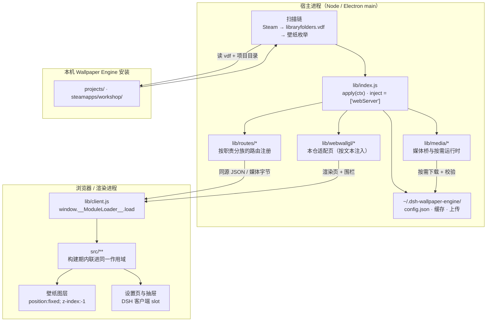
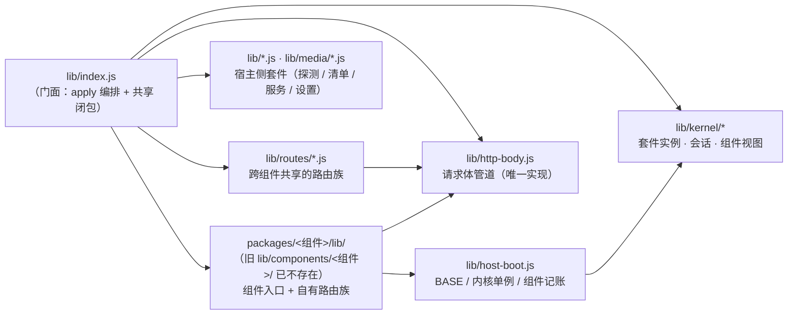
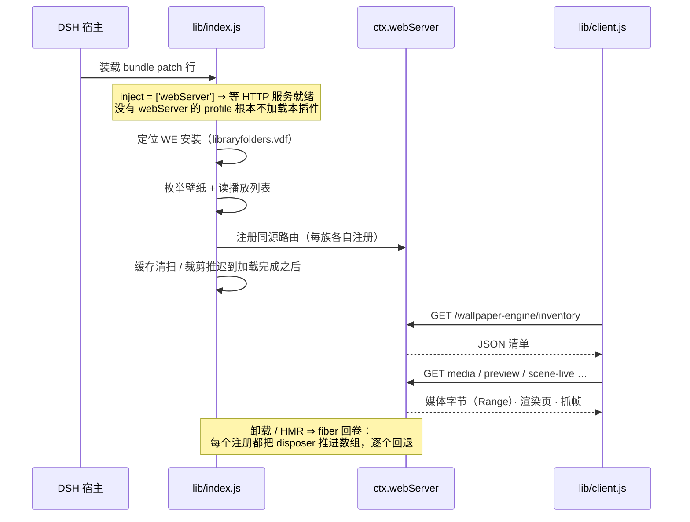
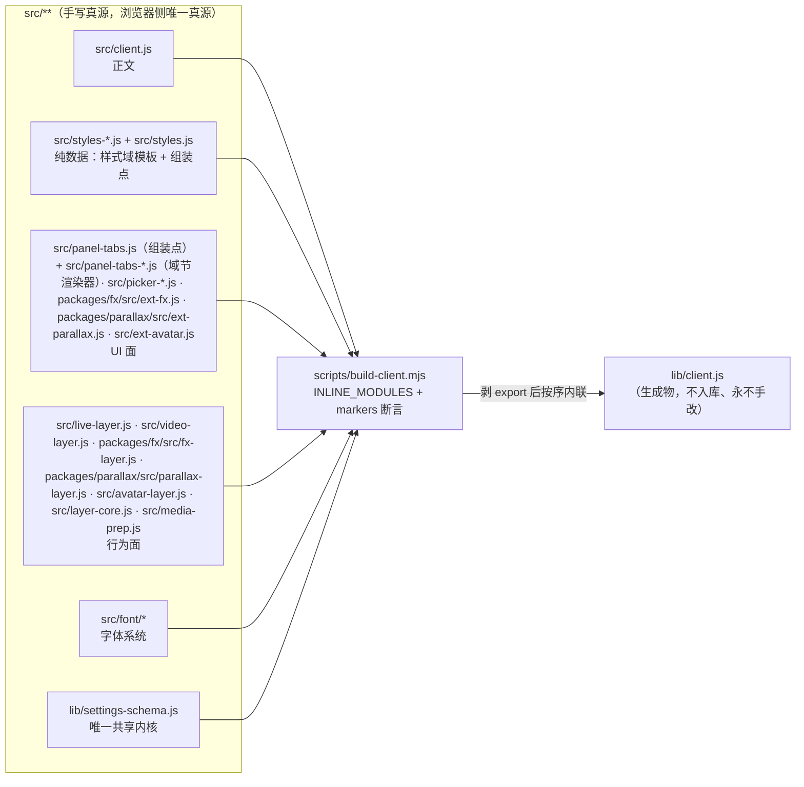
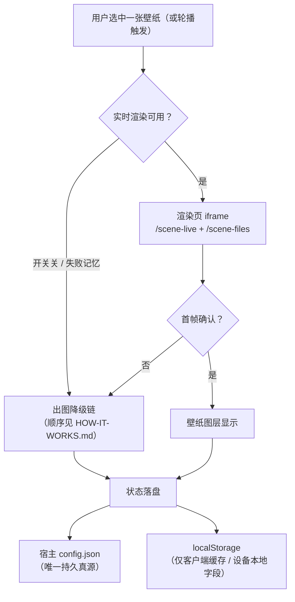

# 代码结构与边界（Code structure）

> **English**: `en/CODE-STRUCTURE.md`（**已随 2026-10 文档瘦身撤除**：维护者向文档只留中文，见 [`README.md`](./README.md) §语言结构）
>
> **本文回答三件事**：**代码放哪**（新文件落点）、**结构长什么样**（谁调用谁、数据往哪流）、**边界在哪**（什么算越界）。
> **为什么这么选**写在 [`adr/`](./adr/)；**机制与不变量**写在对应文件的头注释里（本仓纪律：能写在代码旁的规则不单写文档）；**怎么加一个东西**见 [`DEV-GUIDE.md`](./DEV-GUIDE.md)。
>
> 本文由两份文档合并而成（原 `MODULE-LAYOUT.md` ⊕ `ARCHITECTURE.md`）：它们本就是同一条轴上的内容 ——
> 前者是**规范**（判据、准入门槛），后者是**总览**（结构、生命周期、真源）。合并它们是为了让"代码结构"
> 只有一处可读，代价是本文比单看任一份长。
>
> **改动纪律**：改本文的**规则**时，若该规则在 §6 有配套守卫，必须**同一次提交**里一并改掉（反之亦然）；
> **没有配套守卫的规则靠约定成立**，不许为了凑"有守卫"而新加一条读散文的判据
> （[`adr/0006`](./adr/0006-comment-discipline-as-written-convention.md)）。
> **不写会漂的数值**（条数 / 行数 / 门槛 / 体积）：一律指向真源或给复算命令。

## 读者路径

| 你想知道 | 读哪里 |
|---|---|
| 用户可见行为、出图降级链、路由表 | [`HOW-IT-WORKS.md`](./HOW-IT-WORKS.md) |
| **代码放哪 / 结构 / 边界** | **本文** |
| 某个设计为什么是这样 | [`adr/`](./adr/) |
| 怎么加一个路由 / 设置项 / 浏览器端模块 / 守卫 | [`DEV-GUIDE.md`](./DEV-GUIDE.md) |
| 跑测试、写测试、两档判据 | [`DEV-GUIDE.md`](./DEV-GUIDE.md) §4 |
| 权限与升级 | [`UPGRADING.md`](./UPGRADING.md) · [`TROUBLESHOOTING.md`](./TROUBLESHOOTING.md) |

---

## 1. 一条轴，不是两条

分工不是"`lib` = 服务端 / `src` = 客户端"，而是两个**正交**属性：

| 属性 | 判据 | 它决定什么 |
|---|---|---|
| **跑在哪个进程** | 要在浏览器里跑吗？ | 放 `src/` 还是 `lib/` |
| **是否随包发布** | 在 `package.json` 的 `files` 里吗？ | 能不能留死码 / 能不能放只给开发用的东西 |

组合出的四格，就是本仓的全部落点：

| | **随包发布** | **不发布（开发面）** |
|---|---|---|
| **浏览器进程** | `lib/client.js` —— **生成物，全仓唯一一个** | `src/**` —— 浏览器侧的**唯一真源** |
| **宿主进程**（Node / Electron main） | `lib/index.js` ＋ 它 import 的 `lib/**` 模块 ＋ `lib/webwallgl/`（本仓渲染页适配层：`index.html` + `renderer.js` + `occlusion-bridge.js`；引擎本体走 npm 依赖 `webwallgl`，运行期由 `/scene-live/engine/` 从 `node_modules` 直出；`lib/vendor/` 是**约定**允许的另一个落点，当前为空——最后一份自带副本已随其唯一消费者退役） ＋ `lib/types/` | **`test/`（守门：`verify-*` + `*-smoke` + `e2e-*`）· `test/tools/`（诊断/分析/生成工具）** · `scripts/`（只有 `build-client` / `prepare`，构建与发布期用）· `docs/` ＋ 本机未跟踪的研究 / 取证目录（由忽略规则覆盖，**不入库、也不被入库文档引用**） |

### 1.1 一份代码，两个半边（两种运行形态）

本插件是**一个 npm 包**，但同时是两种东西 —— 两条加载路径**互不知道对方存在**：

| 身份 | 入口 | 谁加载它 | 跑在哪 |
|---|---|---|---|
| **Cordis 宿主插件** | `lib/index.js` 的 `inject` / `apply(ctx)` | DSH 宿主按 bundle patch 行装载 | Node（Electron 主进程侧） |
| **DSH 客户端插件** | `lib/client.js`（`exports["./client"]` + `package.json` 的 `dsh.client` 清单） | DSH **客户端加载器**按包元数据取（宿主不提供任何路由发它） | 浏览器 / 渲染进程 |

各自能写什么、改完怎么生效：

| | **宿主半** | **浏览器半** |
|---|---|---|
| 入口 | `lib/index.js`（`package.json` 的 `main`；`apply(ctx)`） | `lib/client.js`（由客户端加载器 `window.__ModuleLoader__.load({ id, factory })` 消费） |
| 源码在哪 | **就是 `lib/*.js` 本身**（手写、直接发布） | **`src/**`**：`src/client.js` 是正文，其余是构建期内联的模块 |
| 可用什么 | `node:*`、`worker_threads`、`child_process`、`fs` | `document`、`fetch`、DSH 客户端 ctx 服务；**无 `node:`、无 `import`** |
| 改完怎么生效 | **必须重启 DSH**（`lib/*.js` 启动时加载，不热更） | `npm run build` 重新生成 `lib/client.js` |



> 两条路径的**唯一接口**是 HTTP 路由表。因此路由表是**生成物**
> （`docs/ROUTE-INDEX.md`，由 `test/tools/host-route-index.mjs` 重算并逐字节核对）—— 手写必烂，本仓有过教训。

---

## 2. 宿主半边：门面、内核、路由族与组件行

`lib/index.js` 是**门面**：它做注册与协议聚合，**不装新逻辑**。宿主半边里住着五类东西
（"主包 + 组件行 + 内核化"这套形态、它与上游单包形态的差异与迁移路径见
[`ARCHITECTURE-SPLIT.md`](./ARCHITECTURE-SPLIT.md)）：

- **宿主内核** `lib/kernel/*` —— 门面在**模块加载期**一次建成的各套件实例（`host-kernel.js`）、
  一次 apply 的会话段（`host-session.js`）、组件行消费的组件视图与迷你会话（`component-session.js`）、
  配置与数据目录（`config.js` / `data-dir.js`）。
- **路由族**（`lib/routes/<族>.js`，或组件包内的 `packages/<组件>/lib/routes/<族>.js`，一文件一族）—— 拿一个显式
  context 对象，各自注册自己的路由。族的成员是**派生量**，本文不列：路由枚举的真源是
  `test/tools/host-route-index.mjs` 的 `buildIndex()`（它把搬进 `lib/routes/` 的族按调用点放回原位），
  路由级视图是生成物 `docs/ROUTE-INDEX.md`（`verify-route-index` 重算并逐字节比对）。
  `verify-route-families` 另按账本 §7-6 的触发线盯「某族长到 ≥3 条 ⇒ 拆族或改线」。
- **组件行**（**组件包** `packages/<组件>/lib/` —— P-F 组件行统一，旧落点 `lib/components/<组件>/` 已不存在，`packages/about-notice/`、`packages/mascot-avatar/`、`packages/media-bridge/`，2026-10-16）—— 一个 bundle 多行（[`adr/0013`](./adr/0013-bundle-multi-component-rows.md)）：
  组件入口 `index.js` + 它自己的路由族实现 + 该行消费的组件视图。行的开关是宿主的
  （`cordis.patch.yml`）；"哪个实现属于哪一行"由 `test/verify-route-ownership.mjs` 钉住，
  行的装载形态由 `test/verify-bundle-rows.mjs` 钉住。
- **宿主侧套件**（`lib/*.js` 与 `lib/media/*.js` 里的非路由模块）—— 纯逻辑，不碰 `ctx.webServer`：发现与探测
  （`steam-discovery` + `wallpaper-scan` / `media/mp4-probe` / `media/scene-probe`）、清单与文件服务
  （`inventory` / `serve` / `mp4-vfs` / `faststart` / `pkg-read` / `scene-manifest`）、
  设置与配置（`settings-schema` / `kernel/config`）、清扫与诊断（`startup-sweep` / `diag-trace`）。
  **哪些是活的以 §2.2 那张表和 `node test/verify-reachability.mjs` 为准**（上游同名副本已全部清掉，
  该守卫现在是 0 不可达 / 0 行）。
- **共享管道** `lib/http-body.js` —— 请求体读取的唯一实现，路由族共用，不各写一份。

组件的**浏览器可见面**另有单一真源：`lib/component-visibility.js`（"哪个组件渲染哪一块"的宿主侧声明，
门面再导出一次使它在 import 图上），两侧对账由 `test/verify-component-visibility.mjs` 承担；
组件能拿到什么由 `test/verify-component-face.mjs` 按内核的组件视图逐键对账。



**族的形态有明文规定**（§4 第 1 条）：路由模块从 `apply(ctx)` 拿一个**显式 context 对象**
（字段就是它用到但不属于它的东西），而不是继承 `lib/index.js` 的 import。这条边界由守卫
`verify-module-layout` 的『路由模块不得"继承" lib/index.js 的 import』一节钉住。

**为什么门面不拆干净**：一部分共享可变状态（媒体源地址、载荷账本、缓存索引）必须与 `/inventory`
同作用域。本分支把这组闭包搬进 `lib/kernel/host-session.js`（一次 apply 一段，工厂在 `apply()` 里
被调用），但仍只能以**访问器**跨模块出去 —— 传值就是陈旧快照。

### 2.1 启动与生命周期



- **`webServer` 是硬依赖**：声明在 `inject` 上，由 Loader 等待 —— 无 HTTP 服务的 profile
  **不加载**本插件，而不是加载后崩溃。
- **一切注册都经 fiber**：路由、媒体源、定时器、子进程都在卸载时回退。这条不是可选的 ——
  否则卸载 / HMR 后会留下挂着的处理器。
- **`ctx.webServer` 仍防御性读取**：路由表建不起来时要有明确失败，而不是 undefined 崩。

### 2.2 非路由套件：职责与「为什么单独成模块」

抽模块的接缝判据只有一条：**同一份推导被两个互不相干的消费者读到**（或者反过来，同一件事存在
两个可以出错的实现）。下表把宿主半边**在 import 图上**的套件逐个说明 —— 每条的落点都是内核
（`lib/kernel/host-kernel.js`）真正 import 的那个文件：

| 模块 | 职责 | 接缝判据（为什么不能再摊在门面里） |
|---|---|---|
| `lib/media/mp4-probe.js` | MP4/MOV 容器探测：一次 moov 盒走读，回答尺寸 / 编码 / 帧率 / 时长与 moov 落点 | 同一份走读被两个消费者读：`/media-info` 的面板提示与 `runFfmpegTranscode` 的"源帧率 ≤ 上限就跳过转码"决策；`moovStart` / `moovSize` 又是 `mp4-vfs` 的 faststart 判据。抄两份就会各自漂移 |
| `lib/media/scene-probe.js` | scene 的两本探测账本：独立音轨（BGM）与"主文件是否内嵌 MP4" | 两件事的消费者完全重合（`/scene-audio`、`/scene-video`、`/inventory`）。分开写会出现两份缓存键、两套陈旧判定：同一份 pkg 被探两次，两个回答还可能不一致 |
| `lib/steam-discovery.js` + `lib/wallpaper-scan.js` | 发现与扫描两族：「Steam/WE 安装与库归属」与「目录树 → 清单条目」（扫描根推导、扫描签名、`project.json` → 条目、WE 播放列表） | 取上游的两族拆分：安装发现要跟 Steam 布局打交道，扫描族只消费三个注入谓词（存在 / 目录 / 文件）——"扫描根少算一个"的病根（签名一直"没变"、那一根里新增的壁纸永远不进库）因此只有一处推导；两族各有聚焦守卫。`extOf` / `schemeToCss` 由内核注入（单一真源在 `lib/fs-paths.js` 与 `lib/kernel/host-kernel.js`） |
| `lib/startup-sweep.js` | 启动完成 3s 后的缓存清扫 + 容量上限（转码总量、缩略图份数、自定义画面孤儿 `.tmp`、旧版 faststart 副本） | 六件事共享同一条纪律「只清本进程不拥有的、且够旧的孤儿产物」；它们原先分居门面两处，改一处的边界口径要回头确认另一处。清扫器本体仍住各自套件（`lib/media/transcode.js` / `video-preview.js` / `media-dirs.js` / `lib/faststart.js`），本条只管**时点与顺序** |
| `lib/kernel/config.js` | `config.json` 的读、原子发布（临时名 + `fsync` + `rename`）与 `settings` 段的读-改-写串行化 | **持久状态的写纪律与读改写排队**。`config.json` 被目录设置、上传元数据、字体集状态等多个业务面读-改-写共用，**每一次读改写都必须过同一条队列**（并发时后写者会基于旧快照吞掉先写者的改动）；摊在门面里就等于每个调用点各自排队，两处实现就会两处丢改动 |
| `lib/diag-trace.js` | 诊断行的落盘账与请求追踪（`/diag-log` 读的就是它） | 多个族（媒体桥 / 场景 / 遮挡 / 设置）都要追加同一条环形账；每族各写一份就会各丢一段 |

> ⚠️ **别按上游的文件名找这些套件**。本分支库化后曾有 9 个上游同名副本长期**不在 import 图上**、
> 却仍留在发布面；它们**已逐个删掉或移回真源**（现在一个都不剩）⇒ `node test/verify-reachability.mjs`
> 是 **0 不可达 / 0 行**（棘轮基线未动，绿是清干净换来的）。**改套件前先跑它**，别照着旧路径改。

不变量写在各自的文件头（动它们之前先读那一段）。共同的一条：**套件不自己决定"缓存放哪"** ——
音轨产物落点（`ensureFrameCacheDir`）、原子落盘（`atomicWriteFileP`）、转码 / ffmpeg / 缩略图三个
目录（`transcodeCacheDir` / `ffmpegDataDir` / `videoPreviewCacheDir`）都由内核装配时注入，
路径访问器本身住 `lib/kernel/data-dir.js`（锚点在 `test/verify-cache-dir.mjs` 的读点里现取）。
`lib/kernel/config.js` 的调用点真源也现取：

```sh
grep -rn 'enqueueConfigWrite(' lib/
```

**门面与套件的边界**：套件只 `import` node 内建与同层纯函数；凡是要 `ctx.webServer`、要 fiber
disposer、要门面闭包状态的，留在路由族或 `apply()` 里。

### 2.3 `lib/index.js` 现在还剩什么

本分支的门面是**薄适配层**（P0 库化 / P1 内核化）：它只 import 各段、把内核返回的键按**真实引用面**
投影回模块作用域、在 `apply()` 里按族注册并按 disposer 回卷。剩下的都是"必须与一次 apply 同生命周期，
或必须留判据锚点"的东西，不是待拆的巨石：

- **注册与编排**：`apply(ctx)` 调 `createHostSession()`、按族注册路由、把 disposer 推进 fiber；
- **一次 apply 的共享可变状态与访问器**：媒体源地址、载荷账本、token 表、faststart 账、缓存索引
  —— 住 `lib/kernel/host-session.js`，必须与 `/inventory` 同作用域，跨模块只能以**访问器**形式出去
  （传值就是陈旧快照）；
- **不复制、只 import 的基座**：`hostKernel` 单例与 `BASE` / `PLUGIN_NAME` / `repoSlugFromPkg()` 的声明住
  叶子模块 `lib/host-boot.js`（组件入口取同一份 ⇒ 拆掉「门面 ⇄ 组件入口」的 import 环）；
  `pluginDataDir()` / `configPath()` / `cacheBaseDir()` 住 `lib/kernel/data-dir.js`。它们带着
  `verify-client` / `verify-cache-dir` / `verify-about` 的文本锚点，所以转码/预览两个套件
  只**收**这几个解析器（经注入）、不搬走它们；
- **组件分发与账本**：`componentImpls()`（组件名 → 实现的**声明面唯一真源**）与 `applyComponent()`
  （"按组件加载"入口）；实例与唯一记账入口 `runComponent()` 在 `lib/host-boot.js`。

⚠️ 组件 / 路由族的**注入面是显式契约**：每个族的 `DEPS` 声明与门面 / 组件入口调用点的实参键集
**双向对账**（`test/verify-inject-contracts.mjs`），组件只从内核取**它那一格的组件视图**
（`componentViewFrom()`，键集见 `lib/kernel/component-session.js`）⇒ 少一个键不是静默 `undefined`，
而是当场报红。

---

## 3. 浏览器半边：构建期内联，不是模块系统

浏览器半边的真源是 `src/**`，但**运行时没有本地模块解析器**（加载器的 `require` 只服务外部包）。
因此拆出去的模块由 `scripts/build-client.mjs` 在**构建期**按 `INLINE_MODULES` 清单
剥掉 `export` 后注入 `lib/client.js` 的**同一个工厂作用域**。



详细取舍见 [`adr/0003`](./adr/0003-build-time-module-inlining.md)。

**"同一作用域"最容易被低估的后果是名字**：模块被剥掉 `export` 后**平铺进一个作用域**，于是

| 名字这件事 | 由什么兜住 |
|---|---|
| 模块名 ∩ `client.js` 正文 | 构建期**机器提取**（每个模块的顶层声明名 + `export {…}` 列表名）后比对，冲突即 `exit 1` |
| **模块之间**重名 | 构建期的**产物语法检查**（`vm.Script`）—— 平铺后就是 `Identifier '…' has already been declared`，构建失败并点名 |
| `markers` 锚点缺失 | 逐条断言，缺任一即硬失败（所以"这段还在"不是靠人看） |
| 每个 `src/` 模块都被内联 | `verify-module-layout` ①（除 `client.js` 外零孤儿） |
| 搬动后相对说明符仍可解析 | 同守卫 ④（Node 式解析 —— 动态 `import()` 的失败是运行期，必须静态判定） |
| 浏览器安全（无 `import` / `require` / Node API） | 构建期逐条断言，且**先剥注释再判** |

> ⚠️ 唯独**漏登记 `INLINE_MODULES` 不报错** —— 那个文件永远不进产物，调用点一到运行期就是
> `ReferenceError`（本仓踩过一次）。这是本路线最危险的失效模式。

### 3.1 "同一作用域"到底意味着什么（模块分工与依赖方向）

**这是浏览器半边最容易误判的一层**：模块之间**不 import**，却共享**一个扁平符号命名空间**
⇒ "这个模块从哪拿外界"不是靠 import 表达的，而是靠**谁在文件头声明了它**。
（逐模块的契约与依赖清单住在**各文件头**，本文不复制。）

| 角色 | 模块 | 谁给它外界 |
|---|---|---|
| **状态真源 + 装配（门面）** | `src/client.js`（正文） | 自己持有：设置 store（`selection`）、持久化、`apiFetch`、`weT` 接线、React 根、`ctx` 的组装点 |
| **接收 `ctx` 的渲染 / 行为层** | `live-layer` · 页签族：`panel-tabs.js`（**组装点**：只留 `render*Tab` 与 `extensionModules`；导出清单 = 该文件尾的 `export {…}`）+ `panel-tabs-{wallpaper,appearance,mascot,effects,advanced}.js`（按域搬出的节渲染器 `render*Section`；**构建期内联在组装点之前**，同作用域靠扁平符号协作） · **`glass-panel`** · `ext-fx` · `ext-parallax` · `ext-avatar` · `sidebar-right` · `picker-modal` · `picker-props-panel` · `theme-follow` · `fontset-editor` · `font/apply` · `font/color-roles` | **门面在调用点组装 `ctx` 传进来** —— 这一层里**不**直接读 `selection` |
| **基座（无 `ctx`，读扁平符号）** | **`we-base`**（最小地基：`weClampTo` / `weNow` / `weBody` 的唯一实现，零依赖） · `media-prep` · `picker-model` · `video-layer` · `fx-layer` · `parallax-layer` · `avatar-layer` · **`glass`** · `effects` · `quick-panel` · `i18n` · `api-client` · `adapter` · `we-cond` · `persistence` · `fontset-store` | 直接读**同作用域**的符号；自己的符号反过来被正文读 |
| **纯数据 / 常量表** | 样式族 `styles-*.js`（域模板）+ `styles.js`（组装点）· i18n 词表 `i18n-copy-*.js`（域词表）+ `i18n-copy.js`（组装点，另含宿主文案表）· `about-assets.js` · `font/typography.js` · `font/components.js` | 无外界 |
| **通道 / 工具** | `layer-core`（两条通道共用的切换核心） · `nav-icon` · `persistence` · `fontset-store` · **`preset-store`**（玻璃预设的客户端通道：清单与正文住宿主文件 `glass-presets/<id>.json`，应用走 settings 通道） | 见各自文件头 |

**依赖方向单向，但两侧含义不同**：

- 正文 → 模块（给 `ctx`，或读模块的顶层声明）＝ **常规**；
- 模块 → 正文的**顶层读**是**禁止**的：注入点在 bundle **顶部**、早于正文 ⇒ 撞 TDZ（§5 第 2 条）；
- 反过来"模块把符号导出给正文读"是**允许**的（`live-layer` 的 `LIVE_FIRST_FRAME_MS` 就因此导出）。

⇒ **改一个常量前必须先确认它住哪个文件**：改错了地方会"看起来改了却没生效"。

> 为什么这条值得单独写：§1.1 的两半图只画到"`src/**` 内联进同一作用域"，
> 而"同一作用域"**到底意味着什么**（谁能读谁、改哪里才算改对）此前没有任何一处写下来 ——
> 每个模块头只讲**自己**的契约，跨模块的这张分工表**只能靠读遍 20+ 个文件头重建**。

**函数族（"这几块是一伙的"）—— 登记在这里，不靠目录表达。** `src/` 的目录不承载机器含义
（§4 第 1 条），所以"谁和谁一伙"这件事只在本文登记；**只有 `src/font/` 走目录**（门槛见 §4 第 1 条）。
判据是**家族内部**互相读取，不是文件名前缀，也不是被多少模块读（fan-in 高多半只是**门面装配耦合**）：

| 族 | 成员 | 家族内耦合（实测） | 目录 |
|---|---|---|---|
| **字体子系统** | `font/apply` · `font/components` · `font/color-roles` · `font/typography` | `components → apply` ×13 · `→ color-roles` ×10 | ✅ `src/font/`（门槛① 4 个成员 + 门槛② [`FONT-SYSTEM.md`](./FONT-SYSTEM.md)） |
| **picker** | `picker-model`（纯函数、零外界） · `picker-modal` · `picker-props-panel` · `quick-panel` | `modal → model` ×30 | 平铺（见下） |
| **渲染器层** | `panel-tabs`（族：组装点 + 五个域模块，成员与内联顺序真源 = `scripts/build-client.mjs` 的 `INLINE_MODULES`，按 `src/panel-tabs` 前缀读） · `picker-modal` · `picker-props-panel` · `fontset-editor` · `ext-fx` · `ext-parallax` · `ext-avatar` | **互相零读取**（只读门面与纯函数工具） | 平铺 |
| **媒体管线** | `live-layer` · `video-layer` · `media-prep` · `layer-core` · `effects` | `live-layer` → 家族内 | 平铺 |
| **点击与拖尾（「扩展」二号模块的两半）** | `fx-layer`（画布层：零 `ctx`、只读 `selection`、自带输入监听与内容驱动的 rAF） · `ext-fx`（扩展岛：收 `ctx`，动作走具名 `on*`） | 两者**互相零读取**（岛不读画布层的任何符号；画布层只在帧里现读 `selection`） | 平铺 |
| **3D 纵深（「扩展」三号模块的两半）** | `parallax-layer`（行为层：零 `ctx`、只读 `selection`、**一个 DOM 节点都不建**，每帧把算完的**最终位移**直接写进**要动的那几层自己**的 CSS 独立属性 `translate` —— 每帧零自定义属性写入，body 上只剩一个"壁纸补边系数"；除壁纸与吉祥物外还能整块挪**界面四类**：`[data-composer-card]` / `[data-slot="conversation.view"]` / `[data-slot="sidebar"]` / `[data-chat-flow-kind="user"|"steering"]`（用户气泡，只取 DOM 顺序里最近 24 条），受子开关 `parallaxUi` 管、方向与壁纸**同向**，**每块各存自己的绝对百分比**（`parallaxUiChatDepth` / `parallaxUiComposerDepth` / `parallaxUiSidebarDepth` / `parallaxUiBubbleDepth`，KINDS `num 0..10`、步长 0.1、出厂 1.2 / 1.8 / 1.6 / 1.4（用户诉求 m04159；真源 = `lib/settings-schema.js`），设 0 = 这一块完全不缓动；老口径那枚总倍率 `parallaxUiDepth` 与"面板 ×100、存档 ÷100"整条退役 ⇒ 面板与存档**同一个单位**，百分比的口径 = "最大位移占屏幕最长对角线的 p%"、层里 `PARALLAX_STEP_DIV = 50`）；**别的插件注册的前端元素组**（用户口径 m02697-②）由**它自己的开关** `parallaxPlugin` 另管（用户诉求 m03549：**独立于 `parallaxUi`、默认关**，因为它挪的是别的插件画出来的真实界面；关着时层**连扫都不扫**、面板那一卡只有开关）：开着时才扫宿主槽出口 `[data-slot]`、位移落在它的**元素子节点**上（出口自己 `display: contents` 无盒），跳掉整帧容器（`root` / `main` / `rightbar`）、原生三组的出口本身与设置、插件管理那几块子树（前缀 `settings.` / `plugins.` / `shell.` 与子树 `settings.section` / `plugins.bundle.config`），再过一道 `parallaxPluginEffectiveGroups()`：落在**原生四组盒子**里、或落在**另一个认到的插件组**里的出口不算（重扫那一步"组里套组只留最外侧"的同一条；⚠️ 这道只在「界面元素跟随」**开着**时才算 —— 关着时那四组系数恒为 0、压根不是候选，拿它们去挡会让这个开关拖不动），距离住 `parallaxPluginDepths`（槽键 → %，`map` 档；缺键 = `PARALLAX_PLUGIN_DEFAULT` 1%、显式 0 = 这一组不动；那张表只在开关开着时才算数），名单由 `parallaxDiscoveredGroups()` 经 `ctx` 交给扩展岛（**与屏上同源**：它和 `parallaxTargetsRefresh()` 共用同一个 `parallaxPluginEffectiveGroups()` ⇒ 认到几个画几行、画出来的每一行都有落点；唯一例外 = 组里有 `position: fixed` 后代时整组不动，那一条写进每行 tooltip 与那一卡上方的说明文案里）；界面那几层在会话滚动容器**里面** ⇒ 样式族的视差段（`src/styles-ext.js`）顺手给该容器封了横轴（`overflow-x: hidden`），否则横向位移会让 `overflow-y: auto` 的它长出一条横向滚动条、占掉 scrollport 把 sticky 的输入卡片顶上去）；宿主槽出口自己写死 `display: contents`、**不生成盒子** ⇒ 位移落在**锚点自己（自己就有盒子就用自己）或最近的有盒子的祖先**上（`parallaxGroupBox()`，最多往上 3 层），位移量化到整设备像素（带迟滞：零附近的尾巴不来回翻）、归零摘属性、组里有 fixed 后代就整组不动、嵌套组只留最外侧（**气泡是例外**：位移叠在会话文本区之上）；**左栏是唯一例外形态** —— 它走相对定位（`position: relative` + `left`/`top`）而不写 `translate`，因为那一列里有宿主的 `position: fixed` 收起按钮，给它任何 `transform` 都会换掉按钮的包含块（与 #131 同类的事故）） · `ext-parallax`（扩展岛：收 `ctx`，动作走具名 `on*`，面板分「背景」/「原生前端」/「插件前端」三张卡） | 岛不读行为层的其它符号，**只读它导出的三枚常量** —— `PARALLAX_PLUGIN_DEFAULT`（缺省距离的单一真源）与 `PARALLAX_GROUP_DEPTH_MIN` / `PARALLAX_GROUP_DEPTH_MAX`（插件槽那一档回显的钳制范围）；行为层只在帧里现读 `selection`（百分比、插件表都从那里来） | 平铺 |
| **设置与宿主通道** | `persistence` · `fontset-store` · `adapter` · `api-client` · `i18n` | 互读少 | 平铺 |

**为什么不给上表除 `src/font/` 之外任何一族建目录**（一次性裁决，别再重新讨论）：

| 族 | 不建的理由 |
|---|---|
| **picker** | 门槛②需要**新建一份权威文档**（`FONT-SYSTEM.md` 的对应物）；四个成员里 `picker-model` 是纯数据层、`quick-panel` 是组件，**形态不同**，是否同收取决于"选择器"被定义为数据 + 视图还是再加一层外壳。收益上限只是"一眼看出是一伙的"，而成本见 §4 第 1 条的"搬动的成本" |
| **渲染器层** | 它是同一**架构层**，不是一伙人（成员**互相零读取**）。且与 picker **归属冲突**（`picker-modal` / `picker-props-panel` 同属两族），而规则没写优先级 ⇒ **同一优先级只开一个** |
| **媒体管线** | `src/video-layer.js` 头注释写明它独立的**全部理由**就是"**不**在实时那条路里"（真机踩过十几秒纯色帧）；`src/layer-core.js` 的围栏专门钉"与壁纸类型无关"。收进同一目录**正好从目录上抹掉这条边界** |
| **点击与拖尾** | 同上一条：`fx-layer` 零 `ctx`、`ext-fx` 收 `ctx`，两半跨两张角色清单。共同点同样由**文件名前缀（`fx-`）+ 设置键前缀（`fx*`）+ 扩展岛**表达；额外理由：画布层是**纯客户端**的（不读任何宿主路由），与宿主那半边毫无关系，收成目录反而会暗示"这两半要一起改" |
| **3D 纵深** | 同前两条：`parallax-layer` 零 `ctx`、`ext-parallax` 收 `ctx`，两半跨两张角色清单。共同点由**文件名前缀（`parallax-`）+ 设置键前缀（`parallax*`）+ 扩展岛**表达；额外理由：行为层连 DOM 都不建（每帧只把**最终位移**写进要动的那几层自己的 `translate`（左栏例外，见上一族：相对定位 + `left`/`top`），一个自定义属性都不写；壁纸补边的那条静态 `scale` 住在样式族的视差段（`src/styles-ext.js`）），与岛那半边**连"运行时对象"都没有一个**，收成目录只会暗示它们必须一起改 |
| **设置与宿主通道** | `src/fontset-store.js` 头注释写明"**另立一条**而不是并进 `persistence.js`"（真源/键集/失败语义都不同）；目录名会传递"这些是一回事"的**误读** |

**四条通用反例**（同样适用于今后新增的族）：按**文件名前缀**机械分组（`video-layer` 与 `live-layer`
前缀相同却是两条**刻意分开**的通道）· 按 **fan-in/cluster** 聚类 · 把"**不读 `selection`**"当分组依据
（那是一张**角色清单**，成员之间零耦合）· **同时开两个新目录**（归属冲突，见上）。

### 3.2 样式与令牌：三层入口，各改一处

界面样式**不在任何 `.css` 文件里**（除了 `lib/webwallgl/` 那套渲染页适配层 —— 引擎本体走 npm
`webwallgl`，见 §4 第 4 条；它与插件 UI 无关）。
它分三层，**每一层只有一个入口**：

| 层 | 真源 / 入口 | 怎么生效 | 改哪里 |
|---|---|---|---|
| **整份样式表** | 样式族 `src/styles-*.js` 的域模板 + 组装点 `src/styles.js`（纯数据；成员与内联顺序的真源 = `scripts/build-client.mjs` 的 `INLINE_MODULES`） | 构建期内联进 bundle；运行时 `ensurePluginCss()` 把同一个 `<style>` 挂进 `document.head`，带 `data-plugin-css` 标记与**代际**标记，重挂载时按当前 bundle 内容刷新 | 改 `src/styles-*.js`（或组装点）→ `npm run build` |
| **运行时令牌**（`--we-*`） | `src/effects.js`：`applyEffects()` 往 **`document.body.style`** 写整族 CSS 变量（**玻璃那一族自 `src/glass.js` 抽出**：`applyGlass()` 写各面釉层变量与门控属性；其余写点分散在 `src/live-layer.js` 与 `src/font/apply.js`，各管自己那几项——**要数当前有几处就复算**：`git grep -c 'setProperty(' -- src`） | 样式表里的规则读 `var(--we-*)`；设置一变就重写那几个属性 | 改 `src/effects.js` / `src/glass.js`（**不是**样式族） |
| **字体自定义** | `src/font/apply.js`（宿主默认值快照 + 组件作用域样式表） | 单独一条通道，见 [`FONT-SYSTEM.md`](./FONT-SYSTEM.md) | 改 `src/font/` |

> **判据落在哪也照这个分**：`verify-readability` 会**从产物里抽出** `src/effects.js` 的钳制函数
> 复算对比度网格（所以"改样式表就能过判据"不成立）；`verify-host-paint-scope` 从产物里取样式表
> 判"满屏浮层放行拖拽"。⇒ **改哪一层，就去哪一层对应的真源改** —— 这是本仓"一处定义"在样式上的形态。

---

## 4. 新文件放哪（决策程序）

按顺序问六句，第一句命中就停：

1. **要在浏览器里跑吗？**
   → `src/**`，**并且必须登记进 `scripts/build-client.mjs` 的 `INLINE_MODULES`**（含 `markers` 锚点）。
   ⚠️ 忘了登记**不会报错**，只是这个文件永远不进产物（本仓踩过一次）。
   **`src/` 默认平铺**：根目录就是默认落点。只有当一个子系统**同时**满足两条时，才为它建子目录：
   - ① **成员数达到准入门槛**（`.js` 计数，含嵌套）—— 门槛的**唯一真源**是守卫里的
     `SRC_DIR_MIN_MEMBERS`（`test/verify-module-layout.mjs`），本文不抄那个数字；
   - ② **有自己的一份权威文档**，且那份文档的**一级标题**点名这个目录 —— 唯一样本是
     `src/font/`（[`FONT-SYSTEM.md`](./FONT-SYSTEM.md) 的一级标题即 `# src/font/ —— 字体系统`）。
     ⚠️ **这一条是纯约定，无守卫**：原先 `verify-module-layout` ⑥ 有一条"H1 点名"判据，
     已按 [`adr/0007`](./adr/0007-machine-checks-target-code-not-prose.md) 撤除 ——
     它守的是标题措辞，而且**空壳文档（标题对、正文空）照样通过**，守的是形式不是实质。
   **为什么门槛这么高**：`src/` 模块之间**没有 `import`**（§5 第 4 条），构建期被拍平进同一个工厂作用域
   ⇒ 目录在这一侧**不承载任何机器含义**：没有解析器、也没有守卫能验证"层次"。它唯一的作用是
   "让人一眼看出这几块是一伙的"，而只有一两个文件的目录做不到这件事，只多一层路径与一次搬动。
   反过来 `lib/` 的目录是**承重**的（Node 真解析相对说明符、`files` 逐文件登记）⇒ 两侧准入条件
   不同，别互抄。**① 由 `verify-module-layout` ⑥ 判（带负对照），② 靠约定。**
   **搬动的成本（实测，用来判断"值不值得"）**：搬一个模块要同步改 —— `INLINE_MODULES` 条目
   （含它的 `markers`）· **`test/` 里对 `src/*.js` 的路径引用**（约 241 处，其中**真读磁盘**的仅
   约 25 处会当场红，其余是注释与字符串 —— **不报错，只会悄悄变成错的话**）· `src/` 注释里的
   互引（约 148 处）· `docs/` 与三份 README 里的路径（约 122 处）· `scripts/`（约 34 处）·
   重建 `lib/client.js` · 若动了路由则重算 `ROUTE-INDEX.md`。
   ⇒ **搬 4 个文件的成本约 1–2 人日**；收益上限是"一眼看出是一伙的"。逐族的裁决与"为什么不建"
   见 §3.1 末尾那张表（**别在那里重新讨论**）。
2. **两侧都要用吗？**（同一份数据/规则同时被宿主与客户端消费）
   → 放 `lib/`（宿主 ES `import`）**并**登记进 `INLINE_MODULES`（客户端构建期内联）。
   这就是 `lib/settings-schema.js` 的形态（设置键单一真源），因此它同时受 §5 全部约束（浏览器安全）。
   **这是唯一被允许的共享形态**，第二个共享内核要显式登记（§6 的共享内核白名单）。
3. **是宿主自己的实现吗？**
   → `lib/<语义名>.js` **并加进 `files`**。按职责分子目录（现状：`lib/kernel/`、`lib/media/`、
   `lib/routes/`、`packages/<组件>/lib/routes/`）。
   门面 `lib/index.js` 只做注册与协议聚合，**不装新逻辑**。
   ⚠️ 若这份实现属于**某个组件行**（它的路由与浏览器可见面随行开关启停），落 `packages/<组件>/lib/`
   （**已出户的组件**落 `packages/<组件>/lib/` —— P-F，2026-10-16 起：`packages/about-notice/`、`packages/mascot-avatar/`）
   并由该行入口装配 —— 别放进 `lib/routes/`（归属判据见 [`ARCHITECTURE-SPLIT.md`](./ARCHITECTURE-SPLIT.md)）。
   → **随包的数据文件**（不是代码，但要跟包走）也放 `lib/<语义名>/`，**同样加进 `files`**：
   现状 `lib/fontsets/`（随包预设，只读；用户的编辑按写时复制落 `pluginDataDir()`）。
   `verify-package-files` P1 要求 `files` 覆盖 `lib/` 下**每一个**文件 —— 漏一条这里就红。
4. **是第三方副本 / 类型声明吗？**
   → vendored 放 `lib/vendor/`（内联副本），**不许改**；
   → WebWallGL 引擎走 npm 依赖 `webwallgl`（运行期从 `node_modules` 供给），`lib/webwallgl/` 只放本仓的适配页；
   → 类型放 `lib/types/*.d.ts`，**必须与代码一致**。
5. **是开发面的东西吗？**（不进发布包）
   → **守门与冒烟 → `test/`**（`verify-*.mjs` 结构守卫、`*-smoke.mjs` 节点级冒烟、`e2e-*.mjs` 真浏览器端到端）；
   → **诊断 / 分析 / 生成工具 → `test/tools/`**（无 CI 消费者的手动工具）；
   → **构建与发布期脚本 → `scripts/`**（只放 `build-client.mjs` / `prepare.mjs` 这类只在本仓与发布流程里跑的）；
   ⚠️ `test/tools/` 比 `test/` **深一层** ⇒ 用 `import.meta.url` 推仓库根时要退**两层**
   （`verify-module-layout` 的『相对说明符必须解析到真实文件』有断言钉住）。
6. **是设计源资产吗？**（原始素材，不进发布包）
   → `assets/<用途>/`，与代码同仓、**不进 `files`**；运行时要用的那版是**派生物**，放
   `lib/<用途>/` **并进 `files`**（`verify-package-files` P1 盯着）。
   现状两处：`assets/mascot/` 与 `assets/about/`（二维码源图 → 裁码后的 `lib/about/*.png`，
   由 `packages/about-notice/lib/routes/about-qr.js` 直出（该组件 2026-10-16 经 P-F 出户，原 `lib/components/about-notice/about-qr.js`）。
   ⚠️ 这类目录里的 `README.md` 是**该目录的自述**（替代不了文件头注释时就写在那里：派生口径、
   替换素材的步骤、"源资产不进包"这条不变量），**与 `lib/**` 的 `README.md` 同类**；
   它们**有意不进 `docs/` 的生命周期规则**（不是常青文档，也不随版本演进），
   但**必须能从别处走到** —— 例如 `assets/about/README.md` 由根 `README.md` 的「联系方式」段引用。

**一句话版**：*浏览器手写 → `src/` 且登记内联；两侧共用 → `lib/` 且登记内联；只有宿主 → `lib/` 且登记 `files`；第三方 → vendored 子目录；守门 → `test/`；工具 → `test/tools/`；用户脚本 → `scripts/`；设计源资产 → `assets/`（派生物进 `lib/`）。*

**反例（不要这么做）**
- 把"顺手拆出来的工具函数"放 `lib/`，然后又内联进浏览器 —— 边界就从这里开始烂。
- 在 `src/` 建一个文件却不登记 —— 它静默不生效（本仓有过一例）。
- 为了少改一个 import，把宿主模块搬进 `src/` 或反向搬 —— 两侧的**依赖方向是单向**的（§6）。
- 手改 `lib/client.js` 让产物"看起来对"。
- 把一次性诊断脚本丢回 `scripts/` —— 那里只放用户与发布流程真的会跑的脚本（`test/tools/` 才是手动工具的家）。

### 4.1 扩展点速查（加东西时落在哪）

| 要加什么 | 落在哪 | 还必须在哪登记 |
|---|---|---|
| 一条宿主路由 | `lib/routes/<族>.js`（成族才单独成文件，否则就近）；属于某组件行 ⇒ `packages/<组件>/lib/routes/<族>.js`（旧形态 `lib/components/<组件>/<族>.js` 已不存在） | 路由索引由生成器自动重算；组件归属另由 `verify-route-ownership` 判 |
| 一个设置项 | `lib/settings-schema.js` 的 `DEFAULTS` + `KINDS` | 面板读取即可，**不要另写一张 UI 表**。⚠️ 若涉及**字体角色 / 字号上下限**，浏览器侧那份副本（`src/font/color-roles.js` / `typography.js`）**也要改**（见 §7 第 1 行） |
| 两端都要用的状态 | `lib/<语义名>.js` | `INLINE_MODULES`（构建期内联；这是**唯一**被允许的共享形态） |
| 浏览器端一块 UI / 行为 | `src/<语义名>.js` | `INLINE_MODULES`（**漏登记静默失效**） |
| 字体相关 | `src/font/`（子目录有准入门槛） | 见 [`FONT-SYSTEM.md`](./FONT-SYSTEM.md) |
| 随包的数据文件 | `lib/<语义名>/` | `package.json` 的 `files`（P1 会判） |
| 设计源资产（原始素材，不进包） | `assets/<用途>/` | 运行时要用的那份是**派生物** ⇒ `lib/<用途>/` 并进 `files`；源图口径写在 `assets/<用途>/README.md` |
| 一条守卫 | `test/`（守门）或 `test/tools/`（手动工具） | 视档位挂进 `verify` / `verify:docs` |

逐步配方（含"改错了会怎样"）见 [`DEV-GUIDE.md`](./DEV-GUIDE.md)。

### 4.2 拆分既有代码：先纯搬移（零行为改动）、再改

拆一个上帝函数 / 大文件时，**分两相做，不混在同一次改动里**：

1. **纯搬移**（默认这一相）：只改声明**住在哪**，不改它**做什么**。搬完行为必须**等价**
   —— 靠 `npm run verify:all`（含 `verify-client-sync` 真跑构建、逐字节比对）兜底。
2. **行为改动**（可选的独立一刀）：真要改语义 / 加参数，也在纯搬移**之后另起一次**做，
   别和搬移缠在一起 —— 否则一旦回归，分不清是"搬错了"还是"改错了"。

**纯搬移的判据**（一个声明能不能提到**外层作用域**）：

- **能搬** —— 它只读**模块级单例**（`selection` 一族）、只调**模块级函数**，不引用原作用域的局部名
  （`src/` 模块间"同一作用域"⇒ 这些是自由变量，可以解析）。提到模块级后身份反而**稳定**
  （原先跟着渲染每次重建一份 ⇒ 函数 / 对象身份每次都变）。
- **不能搬（反判据）** —— 读**可变** store 算出的**派生值**（例：`group` / `candidates`）。
  提到模块级会退化成"只在模块初始化时算一次"的**冻结快照**，必须留在消费点每次重算。
- 同一条界线要能**双向**判：守卫既断言"该在模块级的名字在组件 / 函数**之前**声明"，也带一条
  **负对照**证明"仍住原处的名字会被同一条判据判出"（否则判据可能恒真）。

**机制（本仓踩过的坑，照做即可）**：内容锚定（精确行 + 唯一性断言）→ **行索引 splice** →
逐行保留**行尾**（`src/` 多为纯 CRLF：`split('\r\n')` 留下的尾随空元素**不得**再补一个 `'\r\n'`，
否则每跑一次文件尾多一个空行）→ 搬完 **`npm run build` + `npm run verify:all`** →
一次性脚本**用完即删**（不留在仓库）。
⚠️ **按函数名取体**的守卫（如 `balancedBody(liveSrc, 'syncLayers')`）不受搬移影响；但**按名字切片**的
守卫（如 `verify-windows-caption` 取 `setWallpaperActive` → `syncLayers` 之间那段）会把落在两者之间的
新声明一并切进去 —— 纯函数声明（无顶层副作用）安全，仍要留神。

> 本小节是**约定**，不对文档措辞设守卫（[`adr/0006`](./adr/0006-comment-discipline-as-written-convention.md)）；
> 对**代码**的判据（"某声明在模块级 / 在前"）可以机器守，且鼓励带负对照。

---

## 5. 硬约束（都由构建期/打包期断言兜住，不是建议）

1. **内联模块必须浏览器安全**：不得出现 `import` / `require(` / `export default` / `process.*` / `__dirname` / `__filename`（`build-client.mjs` 逐条断言，且**先剥注释再判**）。
2. **内联模块不得有顶层可执行语句去读宿主状态**：它们被注入在 bundle 顶部（早于 `src/client.js` 正文），顶层读正文里的 `const` 会撞 TDZ。
3. **名字必须唯一**：内联后与 `src/client.js` 同作用域 ⇒ 重复声明的名字会被构建**机器提取**后断言，冲突即构建失败。
4. **`src/` 模块之间不得 `import`**：它们靠"同一作用域"协作，靠模块头写下的**契约**（需要的外界、对外提供什么）而不是显式依赖。
5. **导出形态**：`src/` 模块用 `export { … }` 列出对外名字；构建剥掉 `export` 关键字与 `export {}` 块。**导出清单同时是守卫的接口**（守卫直接 `import` 模块做行为断言）。
6. **产物出库**：`lib/client.js` 是生成物且**不入库**（v1.4，取舍见 [`adr/0012`](./adr/0012-artifact-untracking.md)）；本地 / CI / `prepack` 三条路径各自 `npm run build` 现场生成，CI 断言「`lib/client.js` 与 `docs/images` 不被 git 跟踪」，新鲜度由 `verify-client-sync` 真跑构建逐字节判。**永不手改 `lib/client.js`。**
7. **打包面**：`files` 覆盖 `lib/` 全部运行期文件（P1）；具名入口既存在又被发布（P3）；每个运行时模块的**相对导入目标都在磁盘上**（P7）；`dependencies` 每条都真的被 `lib/` import（P4）；build/verify/smoke 链**零裸依赖**（P5）；发布面文件**不得带 UTF-8 BOM**（P8）。
8. **发布面必须"装上就能跑、且不多带东西"**（npm 方向的四条，见 `verify-package-publish`）：
   ① 活的代码所需文件（从 `lib/index.js` 出发的**可达闭包**）必须全在 `files` 里，且闭包里的每个相对
      导入目标都**真实存在于磁盘** —— 指向不存在文件的 import 在仓库里是死路径，装到用户机器上才炸成
      `ERR_MODULE_NOT_FOUND`；
   ② 发布集里不得出现 `src/` `scripts/` `test/` `docs/` 等开发目录（白名单为**空**，棘轮只许收紧：
      安装期不跑任何仓库脚本，构建挂在 `prepack` 上 —— `prepack` 只在打包/发布时于发布者工作区跑）；
   ③ 发布文本里不得带**同步机器**的用户目录路径（占位符不算）—— 那是不可复现的元数据；
   ④ `dependencies` 每一条都必须被**可达闭包**加载（死码 import 不算 ⇒ 否则是白下载）。

### 5.1 层间边界（什么算越界）

| 边界 | 规则 | 由什么兜住 |
|---|---|---|
| 宿主 ↔ 浏览器 | 只经**同源 HTTP 路由**；浏览器半边不得 `import` 宿主代码 | 无本地模块解析器（结构上不可能） |
| `lib/` → `src/` | **禁止**：`lib/**` 不得 import `src/**`（依赖方向单向） | `verify-module-layout` ②（零容忍） |
| 发布面 | 留在 `lib/` 的一切都会被发布 ⇒ 死码不许留 | `verify-package-files` · `verify-reachability` |
| 门面 | `lib/index.js` 只做注册与协议聚合，不装新逻辑 | `verify-module-layout`『路由模块不得继承门面 import』 |
| 注释与文档 | 机制写文件头、决策写 ADR、数值指向真源 | **约定**（无守卫，见 [`adr/0006`](./adr/0006-comment-discipline-as-written-convention.md)） |

---

## 6. 守卫（与本文结构规则同名的那批；全量清单的真源是 `test/run-guards.mjs`）

> **本表只登记"与本文结构规则直接相关"的机器判定**，不是全量名册。**全量清单的真源是
> `test/run-guards.mjs` 的 `MANIFEST`**（`verify` / `docs` / `smoke` 三组步骤表；读它即得 ——
> `node test/run-guards.mjs verify --list`，抄一份进本文就是多一个无人复算的副本）——
> 两档判据、逐条约定与运行矩阵见
> [`DEV-GUIDE.md`](./DEV-GUIDE.md) §4（链条结构与改法见 §4.8）。
>
> 因此**不在表里 ≠ 没有机器判定**。链上还有一批同属"读**代码**"的结构性判据（路由索引生成物
> 对照、i18n 双向对账、跨半边契约、`/about-qr` 资源在包内、死声明、可达性棘轮、退役线、
> 模块布局的 ⑤/⑦/⑧、产物同步）—— 它们与本文 §1–§5 的边界**不重叠**，故不逐条搬进来。
> 边界纪律本身见 [`adr/0006`](./adr/0006-comment-discipline-as-written-convention.md) /
> [`adr/0007`](./adr/0007-machine-checks-target-code-not-prose.md)：
> **读代码的守卫照留，读文档散文的守卫不加**。

| 规则 | 现状（含档位：硬档挡 PR / **软档只出声**） | 缺口 |
|---|---|---|
| 内联模块浏览器安全 / `markers` 在位 / 名字不与正文冲突 | ✅ `scripts/build-client.mjs`（构建期硬失败） | — |
| `files` 覆盖 `lib/`；具名入口在位；相对导入目标都在磁盘上；依赖无死声明；工具链零裸依赖；**发布面无 BOM**；内联产物可被 `node --check` 解析 | ✅ `test/verify-package-files.mjs` P1–P8（**其中六条各带负对照**；P1/P3 复用 P2 的判据，不另设对照） | — |
| **发布面自洽（npm 方向）**：可达闭包 ⊆ `files` 且闭包目标在磁盘上在位；发布集无开发目录（白名单为空）；发布文本无**同步机器**的用户目录路径；`dependencies` 每条都被**活的代码**加载；入口/导出目标都在包里；发布出去的 `lib/client.js` 是加载器形态且可解析；**安装期不得跑任何仓库脚本**（无 `prepare`/`preinstall`/`install`/`postinstall` 构建钩子 —— git 直装不得要求 allowBuilds，issue #141；构建挂 `prepack`） | ✅ `test/verify-package-publish.mjs`（**七组，六组带负对照**；"入口与导出目标"那组是正断言） | — |
| `lib/client.js` 新鲜度 + 产物不入库 | ✅ `test/verify-client-sync.mjs` —— **`verify` 链首条**：真跑构建、折行尾后逐字节比对（不用 git）+ `git ls-files` 判产物未被跟踪（带正/负对照）；CI 另有同名「产物不入库」步，打包面由 `prepack` 现建 | — |
| **`src/` 无孤儿**：除 `src/client.js` 外每个文件都必须在 `INLINE_MODULES` 里 | ✅ `test/verify-module-layout.mjs` ①（全量扫描 + 负对照）・**软档** | — |
| **依赖方向单向**：`lib/**` 不得 import `src/**` | ✅ 同守卫 ②（零容忍，不需要棘轮）・**软档** | — |
| **共享内核白名单**：允许被内联进浏览器的 `lib/**` 文件只许来自一张显式清单（现状见守卫里的 `SHARED_KERNEL_WHITELIST`） | ✅ 同守卫 ③（再加一条必须改清单 ⇒ 共享是**决策**而不是顺手）・**软档** | — |
| **`src/` 子目录准入（① 成员数）**：`.js` 计数达 `SRC_DIR_MIN_MEMBERS`（§4 第 1 条门槛之一；② "有自己的一份权威文档"是**约定，无守卫**） | ✅ 同守卫 ⑥（带负对照）・**软档** | — |
| **相对说明符必须解析到真实文件**：搬动代码后相对路径按新位置重解析（动态 `import()` 的失败是运行期、且常被吞成业务错误 ⇒ 必须静态判定） | ✅ 同守卫 ④『相对说明符必须解析到真实文件』（Node 式解析 + 负对照）・**软档** | — |
| **类型面与代码同源**：`lib/types/*.d.ts` 必须与实现一致 | ✅ `test/verify-types.mjs`：`.d.ts` 的**声明集 == 手工钉住的必需字段集**，且每个字段在实现里确有生产者 | — |
| **收 body 的路由必须有上限，且收完只解码一次**：逐块累加而不比较长度 ⇒ 宿主堆无界增长；逐块 `toString()` ⇒ 跨 TCP 分片的多字节码点被切成 U+FFFD（用户可见字符串被静默写坏） | ✅ `test/verify-body-caps.mjs`（**从磁盘枚举**每个 `req.on('data')` 站点，8 条正/负对照 + 覆盖面地板；"裸标识符回调"是**结构性**豁免，不是名单）・**硬档** | —（P4-13 已收敛：共享读体器在 `lib/http-body.js`，两条棘轮钉住"内联收集器 ≤2 处流式豁免 / 共享读体器调用点 ≥9"） |
| **路由族触发线**：某个路径首段族达到 ≥3 条路由 ⇒ 回来裁决（按族拆出 `lib/routes/<族>.js`，或改账本 §7-6 那条线并同改判据） | ✅ `test/verify-route-families.mjs`（枚举口径 = `host-route-index` 的 `buildIndex()`；归族规则与 `analyze-host-apply.mjs` ② 组逐字相同；带正/负对照与覆盖面地板）・**硬档** | — |

**已从本表撤除**（各自的原因写在对应 ADR 里）：

| 曾被守的规则 | 撤除原因 |
|---|---|
| **本文散文里的数字必须现算**（内联模块计数 == 构建清单条数） | 守的是**措辞**：句子一改写，判据就从"复算数字"退化成"守住那两句话"，开始拦编辑而不是拦腐化。数值改由**符号引用**承担。见 [`adr/0006`](./adr/0006-comment-discipline-as-written-convention.md) |
| **`src/` 子目录被某份常青文档的一级标题点名**（§4 第 1 条门槛②） | 守的是**标题措辞**，且**空壳文档照样通过** ⇒ 守形式不守实质。门槛② 改由约定承担。见 [`adr/0007`](./adr/0007-machine-checks-target-code-not-prose.md) |
| **源码里的文案片段**（状态行三分支措辞、提示语、`ESC 返回`、四字状态片段、设置入口的 `/设置\|Settings/i` 锚点） | 第 1/4 问：判定对象是**人的措辞**。其中设置入口那条更糟——它的失败信号要求"保持原样"，而原样正是那个 locale 缺陷 ⇒ 判据站在修复的对立面。改判**机制**：三分支且每支是 `weT(...)`（`test/verify-adapter.mjs`）；锚点候选集存在 + 门控 / 排除自家入口 / 无名字兜底 / 重入锁在位（`test/verify-scene-live.mjs`）。见 [`adr/0007`](./adr/0007-machine-checks-target-code-not-prose.md) |
| **一次性清理的验收判据**（退役线里的"笔误「秡」不再出现"） | 修完即**恒真**；按 §写作纪律 5「删完清空即为零残留」，收口时就该撤。见 [`adr/0007`](./adr/0007-machine-checks-target-code-not-prose.md) |

**本文怎样才算"规范"**：§5 的硬约束与 §6 在册的守卫同时成立即可 —— 两者现在都成立。
升为规范的**过程记录**（当时的四条偏离如何逐条收敛）属于历史（见 `CHANGELOG.md` 与 git 历史），本文不重复。

---

## 7. 状态住哪（唯一真源清单）

| 状态 | 真源 | 谁读 | 结构 |
|---|---|---|---|
| **设置的全部键**（默认值 / 范围 / 枚举） | `lib/settings-schema.js` | 宿主 **和** 客户端 | 构建期内联给浏览器（唯一共享内核）。⚠️ **但文字颜色角色的 id、排版角色的 id 与字号上下限各有一份逐字副本**在 `src/font/color-roles.js` / `src/font/typography.js` —— 因为宿主也 `import` schema，而 `src/font/**` 只进浏览器包（该文件自己的注释原话："两份必须一致"）⇒ **改角色必须同时改两份**，由 `verify-theme-layer` / `verify-component-fonts` 机械对账。**副本的条数与取值一律看这两处源码**，本文不抄 |
| **持久化的值** | 宿主 `config.json` | 宿主写；客户端读 inventory、写经保存接口 **+ 三个根字段端点**（`/we-assets-dir` · `/upload-dir` · `/fontsets` 的 `activate`） | 客户端 `localStorage` = 设置的**缓存** + **设备本地字段**（`rope-pos` / `picker-tab` / `qp-view` / `weLive*` —— 这些**不落 `config.json`**，也不在 schema 白名单里） |
| **界面语言 + 译词表** | **宿主 locale 服务**的 `getSnapshot().active`（不是插件设置，缺省 `zh`，`?we-lang` 可覆盖） | `src/i18n.js` 订阅广播 ⇒ 客户端 `weT(...)`；非 React 的 DOM 补丁走 `weOnLocaleChange` | 词表住 `src/i18n-copy.js` 两张（客户端 / 宿主）；键集由 `verify-i18n` **双向对账**（漏译、孤儿键、`weT` 未包的中文各一条判据）。**不落 `config.json`** |
| **活动字体集** | `config.json` 的根字段 `fontSetId` ⇒ `lib/fontsets/*.json`（随包只读预设）+ `pluginDataDir()/fontsets`（用户层，写时复制） | 宿主路由 `/fontsets`；客户端 `src/fontset-store.js` | **与设置平行的另一条真源**（`build-client.mjs` 的 `why` 原话）—— 字体键**不在** settings 白名单里；`localStorage` 的 `we-fontset-active` 只是缓存 |
| **路由表** | `docs/ROUTE-INDEX.md`（生成物） | 人 + 守卫 | 由 `test/tools/host-route-index.mjs` 复算 |
| **构建期内联清单** | `scripts/build-client.mjs` 的 `INLINE_MODULES` | 构建 + 守卫 | 带 `markers` 锚点 |
| **发布面** | `package.json` 的 `files` | 守卫 P1–P8 | 留在 `lib/` 的一切都会被打进包 |
| **star 数缓存**（全插件唯一出站请求的状态） | `packages/about-notice/lib/routes/github-stars.js`（2026-10-16 前在 `lib/components/about-notice/`）：进程内 TTL + `pluginDataDir()/star-count.json` | 客户端 `src/client.js` 的 `starCount` 镜像（**自己一份同量级 TTL**） | 仓库地址的真源是 `package.json` 的 `repository`，宿主**现读**（不另抄字面量）；拉到失败**不写**时间戳 |
| **「关于」页静态数据** | `src/about-assets.js`（仓库地址 + 两条路由路径） | 客户端渲染 + `packages/about-notice/lib/routes/about-qr.js` 直出 PNG（2026-10-16 前在 `lib/components/about-notice/`） | 二维码**源图**在 `assets/about/`（不进包），随包的是裁码后的 `lib/about/*.png`；文件名白名单在服务侧**另有一份逐字副本**（换码只换 PNG，不重建产物） |
| **退役线 / 死码基线** | `test/verify-retired-lines.mjs` · `test/verify-reachability.mjs` | 守卫（**软档**：失败只出声） | 前者 = "退役线里的东西**不许复活**"；后者 = 不可达计数**只许缩小**（棘轮） |
| **对上游的宿主要求** | `package.json` 的 **`engines.dsh`** | **插件市场与 DSH 自己的插件管理 UI** 直接从已发布的 manifest 读它（社区目录不参与），显示在插件卡片上并与运行中的宿主比对；人类读三份 README 与 [`UPGRADING.md`](./UPGRADING.md) 里的同一段散文 | 机读的那份**只有这一处**；散文是它的回声，**改一处就要改全部**。`dsh-better-sidebar` 这类**非** `@deepseek-ai/*` 的依赖**表达不了**，只存在于散文里 |

> **文档一律不抄这些值**。想知道当前值：设置看 `lib/settings-schema.js`，路由看生成物，
> 守卫条数看 `test/run-guards.mjs` 的 `MANIFEST` —— 抄一份就是多一个无人复算的副本。
>
> **本表与 §8 用同一口径**：`localStorage` 里既有"设置的缓存"，也有**只属于这台设备**的字段
> （见上表第 2 行）—— 后者不是任何宿主状态的回声，因此**不能**被"清缓存即可重建"这句话覆盖。
>
> **派生缓存不在此表**：GPU 帧 / 静态帧、转码产物（`tc_*.mp4`，按大小 LRU）、**虚拟 faststart 布局
> （不落盘：`lib/mp4-vfs.js` 只读源算出「moov 前置 + chunk 偏移整体平移」的段表，`lib/serve.js`
> 在服务期按段表合成字节；成因与口径见 CHANGELOG 的未发布段）**、视频预览、
> live 帧、诊断目录、inventory 的扫描索引（`inventory-index.json`：扫描签名 + 扫描原料 +
> 逐条目探测记忆，见 `lib/inventory.js` 的文件头）、Steam / 内嵌 MP4 探测（后者未命中一律
> **未知 → null，绝不猜**）。它们的真源都是**壁纸源文件本身**，全部可删、可重建。

---

## 8. 一次壁纸的生命周期（数据流）



> **降级链的成员与顺序只在 [`HOW-IT-WORKS.md`](./HOW-IT-WORKS.md) 定义一处** —— 本文只把它当
> 一个结构节点画出来，**不复制它的步骤**（复制一份就会在下一次调整降级顺序时漏改一处）。

**关键结构性质**：

- **降级是链式的，不是二元的**：任何一级失败都有下一级接手，最后一级允许"诚实留空"。
- **失败记忆分两层**：**共享设置**（所有窗口共用，会被落盘）与**会话内软失败**（不落盘）。
  传输类失败只进后者 —— 一次被饿死的传输不该变成每个窗口的永久降级。
- **隐藏 / 未播放的实例根本不拉载荷**：建层时延迟赋 `src`、切后台摘成 `about:blank`，
  否则它会和看得见的那个抢带宽与解码器。
