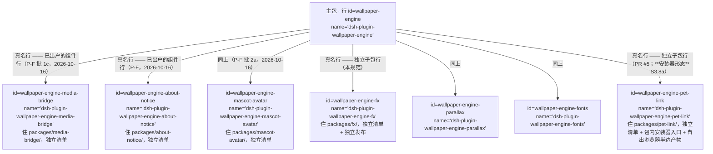
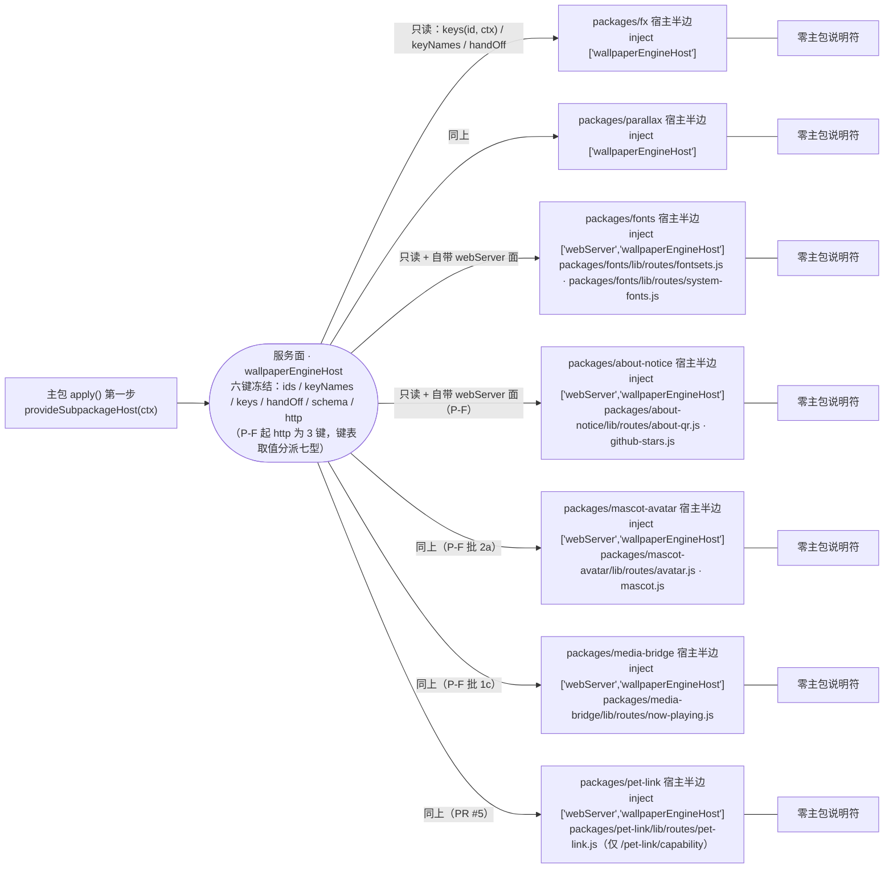
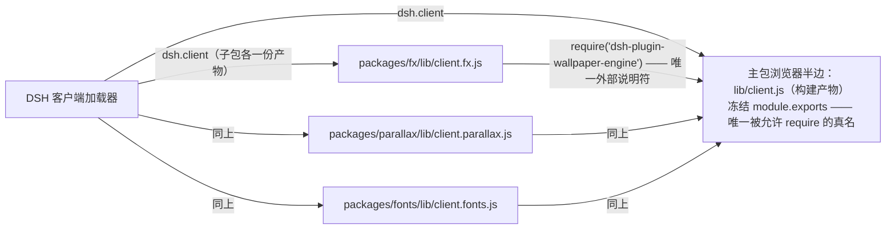

# 子包依赖图（人工维护快照）

> **规范在 [ADR-0014](./adr/0014-subpackage-contract.md)**（条款号 `S*`）—— 本文只画"长什么样、谁连谁"，
> 不复述条款，也不定义契约。
> **本文没有机器判据**（ADR-0014 的 D3/D4）：它是一张**人工维护的快照**，包一增一改就靠人跟着改。
> 语言：维护者向，只出中文（见 [`README.md` §语言结构](./README.md)）。

## 改本文之前 / 读本文之后：复算命令

下面几条都是**只读扫描**（最后两条会重算生成物）。它们是本文的"防腐化手段" ——
仓库**不**拿它们判本文对错（用户口径：针对 markdown 的机械判据一律不设）。

```bash
ls packages/*/package.json                                # 在册独立子包
git grep -n "id: wallpaper-engine" -- cordis.patch.yml    # 主包 patch 里的行（两种行都在这里）
git grep -n "file:packages/" -- package.json              # 开发期依赖形态（S8.1）
git grep -n "from '" -- packages                          # 宿主半边的 import 面（S5.1 / S5.3）
git grep -n 'require("dsh-plugin-wallpaper-engine")' -- packages   # 浏览器平面唯一说明符（S5.2）
node test/tools/host-route-index.mjs --write              # 重算 docs/ROUTE-INDEX.md
node test/tools/guard-targets.mjs --write                 # 重算 docs/GUARD-MAP.md
```

## 一、行树：主包挂的两种行

`cordis.patch.yml` 里两种行**名字形态不同、寿命不同**（术语见 S1.1），混读是这张图最常被误读的地方。



- **组件行**（P-F 组件行统一之后本仓已**没有**这种形态：三格全部出户 ⇒ 主包 `files` 里不再有组件代码，
  下面这条留给"将来又有人按旧形态登记组件"的情形）：代码在主包的 `files` 里，随主包一起发布 ——
  它的清单就是主包清单，没有"子包清单契约"这回事。
- **独立子包行**：真名行，代码在自己仓库目录里，**有独立清单、独立发布、独立开关**（S3–S10 管的是它）。
- **已出户的组件行**（P-F 组件行统一：`packages/about-notice/` 批 1、`packages/mascot-avatar/` 批 2a、
  `packages/media-bridge/` 批 1c，均 2026-10-16）：`id` 不变、`name` 改真名、
  代码与清单都在自己的 `packages/<pkg>/` 里 ⇒ 它**同时**是"组件行"（`lib/kernel/component-session.js` 的
  `COMPONENT_VIEW_KEYS` 声明面）与"独立子包行"（S3–S10）。**三格已全部出户** ⇒ 上面两种行在本仓已合并成一种
  （组件是否"是组件"从此由 `COMPONENT_VIEW_KEYS` 声明面回答，不再由落点目录回答）。

## 二、宿主平面（进程内、cordis 行）

主包在 `apply()` 的**第一步**把跨包通道 `provide` 成一个服务；子包 `inject` 之后**只读**取用，
宿主半边里**零主包说明符**。



- 每个子包能拿到**哪些键**由主包 `lib/subpackage-boot.js` 的 `SUBPACKAGE_KEY_TABLE` 按 **id**（= 行 id 去掉
  `wallpaper-engine-` 前缀）供给，**双向对账**：表里多一项、少一项都红（S10.1）。
- 行的**位置与顺序**是主包 `cordis.patch.yml` 的事；子包自己那份 `cordis.patch.yml` 只在"把它当独立 bundle"
  时生效，两处的 `(id, name)` 必须逐字相等（S4.2）。
- 主包行被关掉 ⇒ 服务面消失 ⇒ 子包 fiber **级联 park**（不是"半挂"，S7.2）。

## 三、浏览器平面（构建产物、客户端加载器）

浏览器半边**不能**在运行时互相 import：子包产物**唯一**允许的外部说明符是主包真名，
由构建期发出（S5.2）；主 bundle 的 `module.exports` 就是那条冻结面。



- 子包产物由**包内配方** `packages/<pkg>/client.build.json`（`artifact` / `entry` / `inline[]`）驱动
  `scripts/build-client.mjs` 逐项构建（产物被 `.gitignore` 排除、**不进 git**）；声明面
  （`exports['./client']` + `dsh.client`）与配方、盘上产物三方对账（S3.4 / S10.2）。
- **三个子包现在都在这个平面上**（2026-10-16 P-C 第一刀之后）：`packages/fonts` 已带浏览器半边
  （`src/client.js` + 外观页签字体节 + 字体集编辑器 ⇒ 产物 `lib/client.fonts.js`），与 fx / parallax 同形。
  host-only **形态本身仍然合法**（宿主侧功能为主的包可以只有宿主半边）：本仓今天**两种形态并存** ——
  在册的四个独立子包（`packages/fx` / `parallax` / `fonts` / `pet-link`）都带浏览器半边；三格已出户的组件行
  （`packages/about-notice` / `mascot-avatar` / `media-bridge`）仍是 host-only，浏览器半边仍内联在主包 `src/**` 内；
  **不要**为了"看起来统一"给 host-only 包补一个空的 `./client`（S3.4）。
- ~~**第三种形态（PR #5 引入，2026-10-16）：源码在包内、构建归主包**~~ ⇒ **已于 2026-10-17 收口成一般形态**
  （`refactor/pet-link-client-half`）：`packages/pet-link` 的浏览器半边源码仍住 `packages/pet-link/src/**`，但已补齐
  **包内配方** `client.build.json`（`entry: src/client.js` → `artifact: lib/client.pet-link.js`）、
  **包内产物** `packages/pet-link/lib/client.pet-link.js`（≈178 KB，2026-10-17 实测）、
  `exports['./client']` 与 `dsh.client`（与根逐键相同），并把源码从主包 `INLINE_MODULES` 摘出
  （主包 `lib/client.js` 4,607,984 → 4,433,884 B）。
  收口前它是"停在主 bundle"的第三种形态，与 `test/verify-module-layout.mjs` 规则③ 的既有口径
  （`INLINE_MODULES` 里非 `src/` 的项只许 `lib/settings-schema.js`，见 `SHARED_KERNEL_WHITELIST`）相冲突、
  在**软档**出声 —— 那两条软档红（"登记的每个 file 都真实存在"/"登记表里非 src/ 的项都在白名单里"）
  **随收口一起消失**，这就是本次收口要达成的可观测目标。
  · 词条表 `packages/pet-link/src/i18n-copy-pet-link.js` 按 fonts 的既有惯例（`src/i18n-copy-font.js`）
    归位到主包 `src/i18n-copy-pet-link.js`（它属"停在主 bundle"的域表，与浏览器半边产物无关）。
  · 主包只留**门面**（`src/client.js` 尾部的 `petLink` / `petLinkWiring`）：9 处调用点文本零改动；
    跨包求值顺序不保证（`src/extension-registry.js` 的注释）⇒ 门面把一次性接线缓冲到
    `registerPetLink` 到达时补做。缺席语义 = `mascot.tap()` **抛错**（不是空操作），
    以保住主包 `try { … } catch { wallSidebarToggle(); }` 的回落语义。
  · ⚠️ 仍余一条**与本形态无关**的软档红：浏览器回归脚本引用运行时才创建的 `../.artifacts/**`
    （`test/verify-module-layout.mjs` 的"每条相对路径都指向存在的文件"）；它是 PR #5 带来的既有偏差，
    不由收口负责。

## 四、边表（允许 / 禁止）

| # | 从 → 到 | 允许？ | 依据 |
|---|---|---|---|
| 1 | 主包 `apply()` → 服务面（`provide`） | ✅ | S5.4 |
| 2 | 子包宿主半边 → 服务面（只读 `keys` / `keyNames` / `handOff` / `schema` / `http`） | ✅ 只读取用 | S5.4 |
| 3 | 子包宿主半边 → 主包（任何 value import，含旧叶子写法） | ❌ | S5.1 / S5.3 |
| 4 | 子包宿主半边 → 另一个子包 | ❌ | S5.3 |
| 5 | 主包实现 → 子包实现文件（绕过行名直接 import） | ❌（主包只按**行名**挂载） | S5.3 / S4.4（例外见 S5.3） |
| 6 | 子包产物 → 主包真名 `require` | ✅ **唯一** | S5.2 |
| 7 | 子包源码（`src/**`）→ `require` / `import` | ❌（说明符只许构建期发出） | S5.2 |
| 8 | 子包 ⇄ 主包 / 子包 ⇄ 子包的 **npm 依赖**（任一侧把对方名写进 `dependencies` / `peerDependencies`） | ❌ | S3.5 |
| 9 | 子包 `peerDependencies` → 主包 `peerDependencies` | ✅ 且 `@deepseek-ai/*` 范围**逐字**取根 | S3.5 |
| 10 | 行 ⇄ 清单（主包 patch 行 ↔ `packages/*/package.json` 的 `name`） | ✅ **双向**（无死行、无未登记的包） | S4.1 |

判据名（谁钉住这些边）：`verify-subpackage-purity`（3/4/5）、`verify-subpackage-client-half`（6/7）、
`verify-subpackage-manifests`（8/9 与清单面）、`verify-bundle-rows` + `test/tools/host-route-index.mjs`（10）。

## 五、登记点矩阵（新增一个独立子包的逐格清单）

每加一个 `packages/<pkg>/`，下表每一格都要有人负责 —— 有判据的格子会自己变红，没判据的格子靠这张表提醒。

| 登记点 | fx | parallax | fonts | about-notice | mascot-avatar | media-bridge | pet-link | 依据 / 谁负责 |
|---|---|---|---|---|---|---|---|---|
| `packages/<pkg>/package.json` | ✓ | ✓ | ✓ | ✓ | ✓ | ✓ | ✓（含 **S3.8a 安装器形态**：`files` 八项 = 基础五项 + `tools/`·`assets/`·`src/`） | S2.1 / S3.*（含 S3.8 模板与同形态逐字对账，有判据） |
| 包内安装器入口 `exports['./install']`（**安装器形态**，S3.8a） | — | — | — | — | — | — | ✓ | S3.8a（有判据） |
| 自带 `cordis.patch.yml`（`(id,name)` 与主包行逐字） | ✓ | ✓ | ✓ | ✓ | ✓ | ✓ | ✓ | S4.2（有判据） |
| `icon.png` + `locale/{en,zh}.json` | ✓ | ✓ | ✓ | ✓ | ✓ | ✓ | ✓ | S2.1（有判据） |
| `lib/index.js`（= `main`，宿主半边入口） | ✓ | ✓ | ✓ | ✓ | ✓ | ✓ | ✓ | S2.2 / S6.1（有判据） |
| 宿主半边路由族 `packages/<pkg>/lib/routes/<族>.js` | —（空壳：行为全在浏览器半边） | —（同上） | ✓ `fontsets` / `system-fonts` | ✓ `about-qr` / `github-stars` | ✓ `avatar` / `mascot` | ✓ `now-playing` | ✓ `pet-link`（仅 `/pet-link/capability` 一条能力路由） | S2.3（人工） |
| 浏览器半边源码 `packages/<pkg>/src/**` | ✓ | ✓ | ✓（P-C 第一刀：入口 `src/client.js` + 外观页签字体节 + 字体集编辑器） | 无（浏览器半边仍在主包 `src/**` 内联） | 无（同上） | 无（同上） | ✓（入口 `src/client.js` + 两份内联 `pet-link-tuner.js` · `pet-link.js`；2026-10-17 起自出产物） | S1.2 / S3.4 |
| 构建产物 `lib/client.<pkg>.js`（构建产出；被 `.gitignore` 排除，**不进 git**） | ✓ | ✓ | ✓ `lib/client.fonts.js` | 无（浏览器半边仍在主包 `src/**` 内联） | 无（同上） | 无（同上） | ✓ `lib/client.pet-link.js`（2026-10-17 收口成一般形态；收口前由主包内联） | S10.2（有判据） |
| `exports['./client']` + `dsh.client` | ✓ | ✓ | ✓ | 无（浏览器半边仍在主包 `src/**` 内联） | 无（同上） | 无（同上） | ✓（2026-10-17 收口成一般形态） | S3.4（有判据） |
| 主包 patch 行（`id` / `name`） | ✓ | ✓ | ✓ | ✓ | ✓ | ✓ | ✓ | S4.1 / S4.3（有判据） |
| 根清单 `devDependencies: file:packages/<pkg>` | ✓ | ✓ | ✓ | ✓ | ✓ | ✓ | ✓ | S8.1（有判据） |
| 发布形态：根 `dependencies` 同号精确版 + 删 `file:` | **未执行**（七包一致） | **未执行** | **未执行** | **未执行** | **未执行** | **未执行** | **未执行** | S8.2（人工执行 + `verify-package-publish.mjs` ⑨ 钉「全有或全无」） |
| `package-lock.json` 同一次提交重算 | ✓ | ✓ | ✓ | ✓ | ✓ | ✓ | ✓ | S8.3（有判据） |
| `lib/subpackage-boot.js` 的 `SUBPACKAGE_KEY_TABLE` 一项（键 = id 去前缀） | ✓ `fx` | ✓ `parallax` | ✓ `fonts` | ✓ `about-notice` | ✓ `mascot-avatar` | ✓ `media-bridge` | ✓ `pet-link` | S10.1（有判据） |
| 包内配方 `packages/<pkg>/client.build.json`（`artifact` = `exports['./client']` 落点） | ✓ | ✓ | ✓（P-C 第一刀新增） | 无（浏览器半边仍在主包 `src/**` 内联） | 无（同上） | 无（同上） | ✓（2026-10-17 收口成一般形态新增） | S10.2（有判据） |
| 生成物重算 `docs/ROUTE-INDEX.md` / `docs/GUARD-MAP.md` | 复算 | 复算 | 复算 | 复算 | 复算 | 复算 | 复算 | S10.3（生成物判据） |
| 守卫的自动发现面（`test/tools/packages.mjs` 包发现层：磁盘枚举 + 根 patch 行；`host-route-index` / `guard-targets` / `verify-client-sync` 都读它） | 免手改 | 免手改 | 免手改 | 免手改 | 免手改 | 免手改 | 免手改 | S10.3 |
| 注释与引用只指向稳定位置（`S*` / 实现文件头 / 判据名；不引 `docs/wip/`、`docs/archive/`） | ✓ 已收口 | ✓ 已收口 | ✓ 已收口 | ✓ 已收口 | ✓ 已收口 | ✓ 已收口 | ✓ 已收口 | S9.1 / S3.9（**人工**，无判据） |
| **本文**（行树 / 图 / 边表 / 本矩阵） | 人工 | 人工 | 人工 | 人工 | 人工 | 人工 | 人工 | D4（**无判据**） |

## 六、这张图会怎么漂（人工复核触发线）

1. **新增 / 删除一个独立子包** —— 三张图 + 矩阵全都要动；判据只兜住清单面与登记点。
   ✅ **已发生一次（2026-10-16，PR #5 合并）**：第七个独立子包 `packages/pet-link`（可选桌宠联动）已入册 ——
   §一/§二 的图、§三 的"第三种形态"、§五 矩阵的 `pet-link` 列与新增的"包内安装器入口"行都已同步；
   `docs/ROUTE-INDEX.md` / `docs/GUARD-MAP.md` 已重算，ADR-0014 的 §S3.8a（安装器形态）是本 PR 一起写进去的。
2. **行的 id / name 改名** —— 图里的标签与矩阵的行名会失真；`id` 本身是用户覆盖面锚点（S4.3），改名代价很大。
3. **半边搬迁**（例如 fonts 的浏览器半边真拆出来）—— §三 与矩阵的"host-only"格要一起改，并同步 S3.4 的说明。
   ✅ **已发生一次（2026-10-16，P-C 第一刀）**：fonts 的浏览器半边已拆出，本文 §三、矩阵三格与 ADR-0014 的 S3.4 现状行已同步。
   ⚠️ **另有一次"第三种形态"入库（2026-10-16，PR #5）**：`packages/pet-link` 的浏览器半边源码在包内、构建在主包
   （`INLINE_MODULES` 内联），**无**包内产物/声明面 ⇒ §三 已写明它与 `verify-module-layout` 规则③ 的软档冲突。
   ✅ **已于 2026-10-17 裁决并收口（选"收口成包内产物"）**：本文 §三/§五 的四格与 ADR-0014 的 S3.4 / S10.2
   现状行已同步为"已收口"；两条软档红随之消失，`FLOORS.clientArtifacts` 4→5。
4. **真发布一次**（S8.2 的形态从开发期切到发布期）—— 矩阵里"未执行"七格转为"已发布"，同时要回来改 ADR-0014 的 §现状偏差（S8.2 行）与 S8.2 的口径。

改本文时**不必**改 ADR-0014（那是决策记录）；除非触发 ADR-0014 §复核触发线四条之一。
