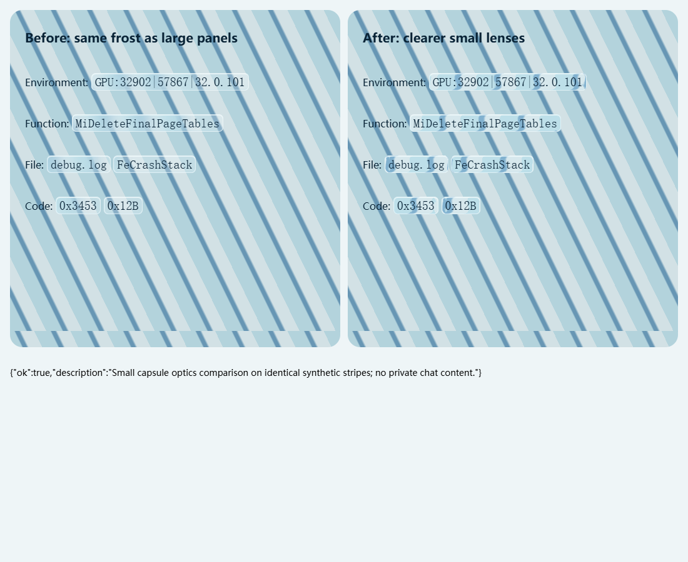

# Optional lens refraction

Appearance → Glass UI → **Lens refraction and pointer light (experimental)** enables rounded refraction, narrow rim highlights and a light that follows the pointer beyond the surface edge. The default is off. Disable it if compositing or scrolling becomes slow. Reduced-motion preferences disable pointer light.

The setting is `glassOptics`, owned by the shared settings schema and included in glass reset and appearance presets. The glass child owns its runtime and releases observers, timers, CSSOM rules, decoration leaves and SVG filters when disabled, unloaded, yielding to a skin, or using software-render fallback. No network diagnostics are added.

The toggle is disabled in software rendering mode. The GTX 1650 is the approximate recommendation. The GTX 1060, older Intel integrated graphics, Radeon RX 400/500 and other recognized lower-tier models require manual opt-in on the current device. The settings panel shows a GPU load warning when enabling the effect. The device opt-in stays in local storage, so an imported preset cannot enable it on a device that has not opted in. Unknown renderer names follow the ordinary default-off setting.

Existing material tint and blur remain in place on panels. Short, single-line code uses a clearer lens profile on an independent background leaf: glyphs are not filtered or duplicated. Wrapped inline code keeps the native line boxes and does not receive a rectangular backdrop over neighboring prose (see #197). Nested surfaces and explicit native-preserve regions are excluded.

Maps are shared by geometry, capped at 560 pixels per dimension and retained in a bounded unused cache. Surfaces near the vertical edge of a scrollport get their maps before entering view, with preparation spread across frames. On nested scroll, only the affected surfaces refresh their positions. Pointer-only frames use cached rectangles and update coordinates through CSSOM. Refraction stays enabled while scrolling. Dense inline code and animated wallpaper still incur backdrop compositing cost.

Run:

```sh
npm ci --omit=peer --ignore-scripts --no-audit --no-fund
npm run verify:all
node test/verify-glass-optics.mjs
node test/verify-glass-optics-browser.mjs
```

The browser test requires Chromium, Chrome or Edge; set `WE_TEST_BROWSER` if it is not in a standard location. It creates an isolated browser profile and synthetic content, with results in `.artifacts/glass-optics/`. It checks material carriers, wrapping fallback, native-preserve behavior, dynamic content, visibility, lifecycle cleanup, injected allocation failure, steady pointer movement, and refraction layer alignment during nested scroll. Visual inspection remains necessary: a computed filter URL alone does not prove visible refraction.

The accompanying synthetic comparison is between the earlier local lens profile and the new compact profile, not a comparison against an official release. It contains no user wallpaper or chat content.


